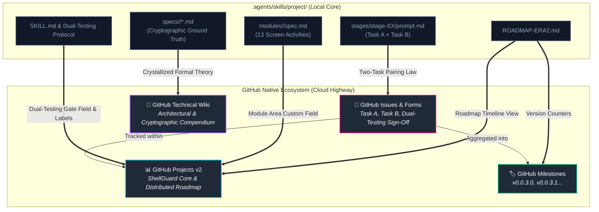
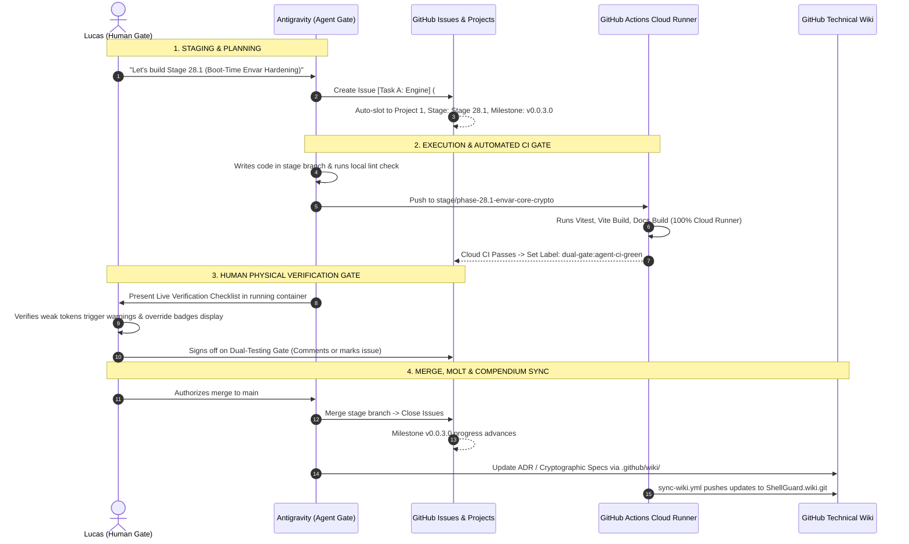

# 🗺️ Meta `/project` Skill ⟷ GitHub Native Mapping & Operational Guide

> **Architectural Rosette Stone for ShellGuard**  
> *How the local Three-Pillar Specification Harness translates directly into GitHub's native ecosystem, how everything connects, and how to operate it seamlessly.*

---

## 🧭 The Core Mental Model: From Local Brain to Cloud Highway

In our local agent environment, the `/project` skill organizes our codebase into three clear boundaries:
1. **Modules**: What the user touches (UI surfaces and component interaction invariants).
2. **Specs**: What the system guarantees (cryptography, schemas, routes, and admin boundaries).
3. **Stages**: What we are building right now (the active 2-task execution slice).

When offloaded to GitHub, these files don't disappear—they gain **interactive cloud counterparts** that give you visual boards, automated CI gating, transparent release milestones, and formal wiki documentation.

---

## 📊 Comprehensive Component-by-Component Mapping Table

The table below breaks down every directory, file, and axiom in the `/project` skill and maps it directly to its GitHub equivalent, explaining **what it is**, **where it lives**, and **how to use it**.

| Local `/project` Primitive | GitHub Native Equivalent | Purpose & Operational Role | How You Interact With It |
|---|---|---|---|
| **`SKILL.md` (Dual-Testing Teamwork Protocol)** | **`Dual-Testing Gate` Field** & **`dual-gate:*` Labels** | Enforces the two-gate sign-off: (1) Agent automated cloud CI pass, followed by (2) Lucas physical testing in the running app. | When CI passes, label becomes `dual-gate:agent-ci-green`. Lucas tests live, checks the verification box or comments, and marks `4. Ratified & Merged`. |
| **`ROADMAP-ERA2.md`** | **GitHub Milestones** & **Projects v2 Timeline View** | The master schedule tracking Era 2 versions (`v0.0.3.0`, `v0.0.3.1`, `v0.0.3.2`, etc.) and release progress. | View the progress bar on GitHub Milestones; open the Timeline View in Projects to see active vs queued phases. |
| **`meta-prompt-antigravity.md`** | **Projects v2 Board View (Kanban)** | The sliding router that identifies the lowest-numbered active stage directory. | The board visualizes in-flight work moving from `Backlog` ➔ `Task A [Engine]` ➔ `Task B [UI/Docs]` ➔ `Dual Gate` ➔ `Done`. |
| **`stages/stage-XX/prompt.md` (Task A)** | **GitHub Issue Form: `task-a-engine.yml`** | The functional, cryptographic, or backend engine half of a stage slice. | Created as an issue titled `[Task A]: ...` with labels `pillar:stage`, `task:engine`, and the target milestone. Holds falsifiable test assertions. |
| **`stages/stage-XX/prompt.md` (Task B)** | **GitHub Issue Form: `task-b-ui-walk.yml`** | The UI component, visual state, and 4-zone documentation walk half of a stage slice. | Created as an issue titled `[Task B]: ...` with labels `pillar:stage`, `task:ui-docs`, linked to Task A's issue number. |
| **`modules/<activity>/spec.md` (13 Modules)** | **`Module Area` Project Field** & **Issue Epics** | Invariants for the 13 feature activities (`01-auth-gateway`, `02-vault-workspace`, `07-admin-panel`, etc.). | When creating an issue, select the `Module Area` dropdown. Filter the project board by module to see all changes affecting that screen. |
| **`specs/crypto/`** | **Wiki: `/wiki/Cryptographic-Foundations`** | Mathematical proofs, RFC 5869 HKDF derivation diagrams, Canonical AAD formulas, and memory zeroization. | Deep academic reference hosted on the Git-backed wiki (`.github/wiki/`), versioned and reviewed via pull requests. |
| **`specs/admin/admin-suite-spec.md`** | **Wiki: `/wiki/Administrative-Plane-T1-T2-Threat-Matrix`** | Formal decomposition of T1 (network) vs T2 (compromised host) threat models and blast radius calculations. | Referenced by security researchers and auditors to verify why vault data is cryptographically opaque to root host operators. |
| **`specs/storage/database-schema.md`** | **Wiki: `/wiki/ADR-Directory` (e.g. ADR-001)** | Architectural Decision Records explaining why SQLite BLOB chunked streaming was chosen over external filesystems. | Read immutable historical records of system trade-offs and decisions. |
| **`stages/` Molt & Prune Axiom** | **Issue Closing & Branch Merging** | The rule that completed stage execution prompts are deleted upon merge to `main`. | Closing the paired issues (#13, #14) on GitHub advances the milestone counter; merging the stage branch triggers the release roll. |

---

## 🔄 The Life of a Stage: How Everything Works Together

Here is the exact lifecycle of how a feature moves from local files into GitHub and lands in production:

---

## 🛠️ Step-by-Step Operator Guide: How You Use This Daily

### 1. How to View the Project & Roadmap
- Navigate to your project board: **[ShellGuard Core & Distributed Roadmap](https://github.com/users/ClawStackStudios/projects/1)** (or click the *Projects* tab in `ClawStackStudios/ShellGuard`).
- **Board View**: Shows the 2-task pairs moving through stages.
- **Group by Stage**: Group items by the `Stage` field to immediately see what belongs to `Stage 28.1`, `Stage 28.2`, or `Stage 29`.
- **Filter by Dual-Testing Gate**: Filter to `Dual-Testing Gate: 3. Physical Verification Pending` to see only the items ready for you to physically test in your running Docker container.

### 2. How to Open a New Stage Task
When opening an issue on GitHub:
1. Click **New Issue** on `ClawStackStudios/ShellGuard`.
2. Choose either **🛡️ Task A — Functionality / Security Engine** or **🎨 Task B — UI Component & Walk-the-Docs**.
3. Select the **Stage & Milestone** (`Stage 28.1`, `v0.0.3.0`).
4. Select the **Security Layer** (e.g. `Layer 1: Resting ShellCryption (hu-)`).
5. GitHub will automatically tag it with the correct labels (`pillar:stage`, `task:engine`, `dual-gate:staged`) and slot it onto the Project board.

### 3. How to Execute the Dual-Testing Sign-Off
1. When Antigravity finishes writing the code for a sub-phase, Antigravity pushes to the stage branch and watches the GitHub Actions CI run (`gh run watch`).
2. When the cloud run exits green, the `dual-gate:agent-ci-green` label confirms the automated gate passed.
3. Antigravity presents the numbered **Live Verification Checklist**.
4. You test the running app on `https://localhost:6565` (or your Docker host).
5. Once satisfied, you sign off. The stage branch merges to `main`, the issues close, and the milestone counter increments automatically.

### 4. How the Technical Wiki Stays Up to Date
- Rather than manually editing the wiki in a browser with no review process, all formal compendium pages live inside the repository at `.github/wiki/`.
- Whenever a deep architectural decision or cryptographic proof is written or modified, it gets committed to `.github/wiki/`.
- When merged to `main`, the `.github/workflows/sync-wiki.yml` action automatically pushes the files directly to `https://github.com/ClawStackStudios/ShellGuard.wiki.git`.
- This ensures your deep documentation is version-controlled, can be reviewed via pull requests, and stays 100% synchronized with runtime code.

---

## 🏷️ Permitted Vocabulary Cheat Sheet

Whenever authoring issues, wiki pages, or PR descriptions, refer to this neutral vocabulary anchor:

| Instead of (Lore/Nautical) | Use (Neutral Professional Standard) |
|---|---|
| *The Reef* | The cluster, distributed fleet, or application instance |
| *The Grotto* | The local vault workspace or data directory (`DATA_DIR`) |
| *Hatching / Molting* | Account registration / Lifecycle stage pruning |
| *Carapace / CaraBase* | Security perimeter / Base squircle card component |
| **ClawKeys** *(Permitted)* | User cryptographic identity credential (`hu-` prefix) |
| **LobsterKeys** *(Permitted)* | Scoped, hash-only agent API keys (`lb-` prefix) |
| **HumanKeys** *(Permitted)* | Master passphrase / Recovery credential |
| **Resting ShellCryption** *(Permitted)* | Field-level AES-256-GCM authenticated encryption protocol |

---
*Created for Lucas by Antigravity under the Three-Pillar Specification & Dual-Testing Verification Harness.*
