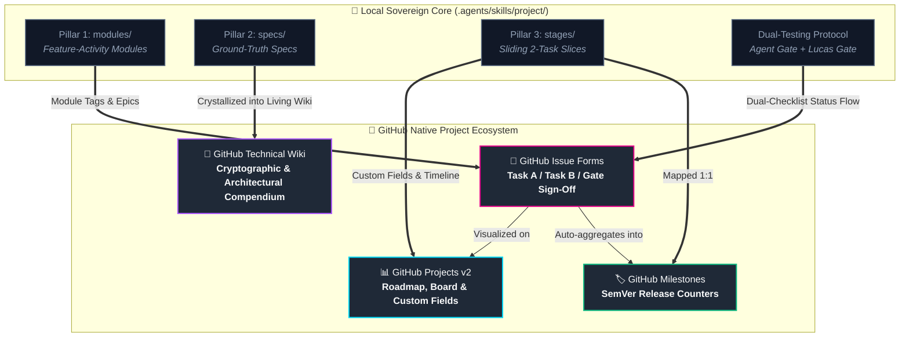
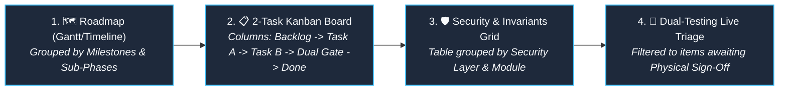
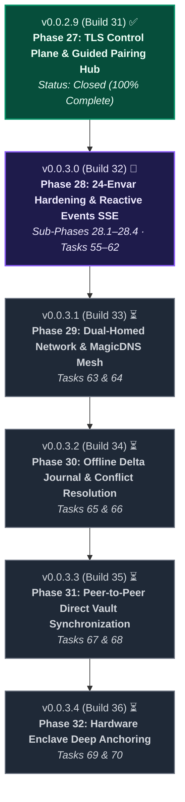
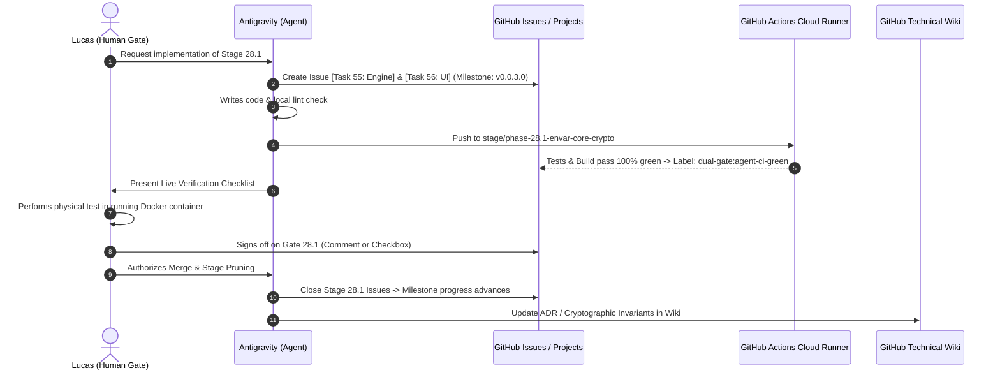

# 🐙 GitHub Native Architecture: Offloading `/project` Structure & Technical Wiki

> **Architectural Blueprint for ShellGuard (`ClawStackStudios/ShellGuard`)**  
> *Translating the Three Pillars of `.agents/skills/project/` into GitHub Projects v2, Milestones, Issue Forms, and the Technical Wiki.*

---

## 🧭 Executive Summary & Core Philosophy

The `/project` skill established a deterministic, 3-pillar harness for ShellGuard:
1. **Pillar 1 (`modules/`)**: 13 feature-activity screen modules with surface and interaction invariants.
2. **Pillar 2 (`specs/`)**: Ground-truth cryptographic, relational, network, and administrative specifications.
3. **Pillar 3 (`stages/`)**: Sliding 2-task execution slices governed by **Dual-Testing Teamwork**.

By projecting this structure into **GitHub Native Primitives** (Projects v2, Milestones, Issue Forms, Discussions, and the Git-backed GitHub Wiki), we elevate ShellGuard from a local agentic workflow into a multi-dimensional, transparent, and asynchronous engineering system.



---

## 🏛️ 1. Neutral Language Policy & The Three-Tier Documentation Doctrine

### Neutral Language & Permitted Terms Policy
To ensure documentation is immediately accessible to external engineers, auditors, and operators without requiring knowledge of internal brand lore, all user-facing documentation and architectural references transition to standard, neutral engineering terminology.

#### Permitted Terms (Strictly Logical Definitions):
- **ClawKeys**: User cryptographic identity credentials (`hu-` prefixed) utilized to derive client encryption keys and unlock the vault. *Example: "ClawKeys are used to unlock the vault and must not be lost."*
- **LobsterKeys**: Scoped, hash-only agent API keys (`lb-` prefixed) issued for automated or CLI integration with restricted permissions.
- **HumanKeys**: Human user account credentials and recovery passphrases representing physical operator sovereignty.
- **Resting ShellCryption**: The application-layer encryption protocol (AES-256-GCM authenticated envelopes with HKDF key derivation) protecting data fields prior to database persistence.

> [!IMPORTANT]
> **Neutral Tone Standard**: All community-facing, operator, and security documentation must be free of ecosystem lore, nautical metaphors, and internal brand fiction (e.g. avoid terms like "Reef", "Grotto", "Carapace", "Molting" in public documentation). Standard software engineering vocabulary (e.g. *workspace, sync cluster, node, lifecycle transition, administrative plane*) is used uniformly.

---

### Three-Tier Documentation Separation

| Documentation Surface | Audience & Purpose | Tone & Style | Contents |
|---|---|---|---|
| **Tier 1: VitePress Portal (`docs/`)** | **System Operators, End Users, Fleet Administrators** | Neutral, professional, task-oriented, clean visual hierarchy | Deployment guides (Docker, Unraid), HTTPS and TLS configuration, device pairing instructions, companion app usage, REST API endpoints, environment variable matrix. |
| **Tier 2: In-Repo Sovereign Core (`.agents/skills/project/`)** | **Core Engineers & AI Assistants** | Dense, machine-parseable, falsifiable, immediate | Active sliding stage prompts (`stages/`), active 2-task execution constraints, test oracle redlines, direct component file links. |
| **Tier 3: GitHub Technical Wiki (`repo.wiki.git`)** | **Security Researchers, Core Contributors, Cryptographers** | Academic, uncompromisingly deep, formal, architectural | Cryptographic proofs, HKDF derivations, AAD serialization taxonomy, threat model matrices (T1/T2), side-channel audits, memory zeroization invariants, offline conflict vector-clock math, ADR archives. |

> [!NOTE]
> **The GitHub Technical Wiki Role**: While VitePress answers *"How do I configure, deploy, and operate ShellGuard?"*, the Wiki answers *"Why does the cryptographic boundary hold under hostile conditions, and how is the distributed architecture proven?"*

---

## 📊 2. GitHub Projects v2: Field & View Blueprint

GitHub Projects (v2) provides a database-backed project management canvas. We configure a workspace project: **"ShellGuard Core & Distributed Roadmap"**.

### Custom Fields Configuration

| Field Name | Type | Options / Validation | Purpose |
|---|---|---|---|
| **Phase / Stage** | Single select | `Phase 27 (Shipped)`, `Stage 28.1`, `Stage 28.2`, `Stage 28.3`, `Stage 28.4`, `Stage 29`, `Stage 30`, `Stage 31`, `Stage 32` | Ties issues to the active release stages. |
| **Pillar** | Single select | `Pillar 1: Module`, `Pillar 2: Spec`, `Pillar 3: Stage Execution`, `Infrastructure / CI` | Anchors to the specification cartography. |
| **Task Type** | Single select | `Task A [Security / Engine]`, `Task B [UI & Docs Walk]`, `Lifecycle Prune`, `Spike / RFC` | Enforces the strict 2-task pairing rule. |
| **Security Layer** | Single select | `Layer 1: Resting ShellCryption (hu-)`, `Layer 2: MetadataGuard (sqlcipher)`, `Layer 3: Host/Transport (TLS/instance.key)`, `Non-Cryptographic` | Categorizes security-sensitive tasks. |
| **Dual-Testing Gate** | Single select | `1. Staged / In Flight`, `2. Automated Cloud CI Passed`, `3. Physical Verification Pending`, `4. Ratified & Merged` | Tracks the human-agent verification pipeline. |
| **Module Area** | Single select | `01-auth-gateway`, `02-vault-workspace`, `03-generator`, `04-lobster-keys`, `05-import-export`, `06-settings`, `07-admin-panel`, `Companion Android` | Maps directly to the functional modules. |
| **Target Base** | Text | `stage/phase-XX-*`, `main` | Guarantees changes target stage branches first. |

### The 4 Recommended Project Views



1. **Roadmap View (Timeline)**:
   - Grouped by **Milestones** (`v0.0.3.0`, `v0.0.3.1`, etc.).
   - Visualizes schedule and target completion dates for Stages 28.1 through 32.
2. **2-Task Pairing Kanban Board**:
   - Columns: `Backlog` ➔ `Task A [Engine]` ➔ `Task B [UI/Docs]` ➔ `Dual-Testing Sign-off` ➔ `Complete`.
   - Card displays: Issue title, Task Type badge, Security Layer badge, and Assignee.
3. **Module & Spec Inventory (Table View)**:
   - Grouped by `Module Area`.
   - Columns: Issue, Pillar, Security Layer, Verification Gate, PR link.
4. **Dual-Testing Handshake View (Filter View)**:
   - Filter: `Dual-Testing Gate is "2. Automated Cloud CI Passed"` or `"3. Physical Verification Pending"`.
   - Dedicated operational dashboard during live testing and sign-off sessions.

---

## 🏷️ 3. GitHub Milestones: SemVer Version Anchors

Milestones correspond 1:1 with ShellGuard's `MAJOR.MINOR.PATCH.REVISION` release cadences.



### Milestone Configuration Spec

| Milestone Title | Target Build | Scope Description | Exit Criteria |
|---|---|---|---|
| `v0.0.2.9` *(Closed)* | Build 31 | Phase 27: Automated TLS, Transport Control Hub, QR pairing, atomic burn invites. | All 5 verification gates passed; release drafted and deployed. |
| `v0.0.3.0` *(Active)* | Build 32 | Phase 28: 24-envar boot-time diagnostics, entropy guards, fail-safe TLS fallback, quota bounds, and authenticated SSE sync stream. | Tasks 55–62 closed; Dual-Testing gates 28.1–28.4 signed off; CI 100% green. |
| `v0.0.3.1` | Build 33 | Phase 29: Dual-homed network resolution engine, Tailscale MagicDNS race, connection health drawer. | Tasks 63 & 64 closed; live WiFi/Tailscale handover verified. |
| `v0.0.3.2` | Build 34 | Phase 30: Offline Room+SQLCipher sync queue, delta journal playback, conflict resolution UI. | Tasks 65 & 66 closed; offline mutation playback verified. |
| `v0.0.3.3` | Build 35 | Phase 31: Multi-node peer-to-peer vault synchronization across independent instances. | Tasks 67 & 68 closed; convergence test passed. |
| `v0.0.3.4` | Build 36 | Phase 32: Android StrongBox / Apple Secure Enclave hardware binding with WebAuthn PRF. | Tasks 69 & 70 closed; physical key enclave operations verified. |

---

## 📝 4. GitHub Issue Forms (`.github/ISSUE_TEMPLATE/`)

Instead of freeform issues, GitHub Issue Forms (`.yml`) ensure that every task posted to GitHub conforms strictly to the **Generative**, **Falsifiable**, and **Dual-Testing** axioms of `/project`.

### Template 1: `task-a-engine.yml` (Security & Core Engine Task)

```yaml
name: 🛡️ Task A — Functionality / Security Engine
description: Core cryptographic, schema, relational, or backend engine task
title: "[Task A]: "
labels: ["pillar:stage", "task:engine", "dual-gate:staged"]
body:
  - type: markdown
    attributes:
      value: |
        ### 🛡️ Task A: Generative & Falsifiable Core Engine Specification
        Every clause must unfold across schema, Express routes, and cryptographic layers, and be backed by automated Vitest assertions.
  - type: dropdown
    id: stage
    attributes:
      label: Target Stage & Milestone
      options:
        - "Stage 28.1: Envar Core Crypto (v0.0.3.0)"
        - "Stage 28.2: Envar Network TLS (v0.0.3.0)"
        - "Stage 28.3: Envar Storage & Containers (v0.0.3.0)"
        - "Stage 28.4: Reactive Events SSE (v0.0.3.0)"
        - "Stage 29: Dual-Homed MagicDNS (v0.0.3.1)"
        - "Stage 30: Offline Delta Journal (v0.0.3.2)"
    validations:
      required: true
  - type: dropdown
    id: security_layer
    attributes:
      label: Security Layer Touched
      options:
        - "Layer 1: Resting ShellCryption (hu- / AES-256-GCM / AAD)"
        - "Layer 2: MetadataGuard (sqlcipher / per-row disk)"
        - "Layer 3: Transport & Instance Identity (TLS / instance.key)"
        - "Relational & Schema (SQLite Engine)"
        - "Network / Route Envelopes"
    validations:
      required: true
  - type: textarea
    id: specification
    attributes:
      label: Generative Specification Clauses
      description: Numbered architectural clauses detailing exact behavior, entropy bounds, and error handling.
      placeholder: "1. Trim and validate DB_ENCRYPTION_KEY...\n2. Verify 16-byte SQLite header magic bytes..."
    validations:
      required: true
  - type: textarea
    id: test_oracle
    attributes:
      label: Falsifiable Test Oracle
      description: Exact Vitest test file and assertions that prove this engine holds.
      placeholder: "tests/unit/env-validator.test.ts: proves invalid Base64 throws, proves short key rejected..."
    validations:
      required: true
  - type: checkboxes
    id: invariants
    attributes:
      label: Core Architectural Invariants
      options:
        - label: Zero plaintext secrets stored on disk or emitted in logs
        - label: Backward-compatible with existing database migrations
        - label: Cloud CI verification targeted (`stage/*` branch, never direct `main`)
```

### Template 2: `task-b-ui-walk.yml` (UI Component & Documentation Walk Task)

```yaml
name: 🎨 Task B — UI Component & Documentation Walk
description: Frontend interface component and 4-zone documentation sweep
title: "[Task B]: "
labels: ["pillar:stage", "task:ui-docs", "dual-gate:staged"]
body:
  - type: markdown
    attributes:
      value: |
        ### 🎨 Task B: UI Presentation & Documentation Parity
        Pairs with Task A to deliver the user interface and guarantees documentation 100% reflects runtime code.
  - type: input
    id: paired_task
    attributes:
      label: Paired Task A Issue
      placeholder: "#55"
    validations:
      required: true
  - type: textarea
    id: ui_components
    attributes:
      label: Component & Visual Invariants
      description: Specific components modified, design tokens applied, and interactive states handled.
      placeholder: "SuperLobsterPanel.tsx: Add Enforced by Environment badge, disable DB toggle..."
    validations:
      required: true
  - type: checkboxes
    id: walk_the_docs
    attributes:
      label: 4-Zone Documentation Verification
      options:
        - label: "Zone 1: Operator Documentation (docs/deployment/*.md)"
        - label: "Zone 2: Surface & Admin Docs (docs/superlobster/*.md or docs/companion/*.md)"
        - label: "Zone 3: Root Manifests (ARCHITECTURE.md, ADMIN.md, SECURITY.md, README.md)"
        - label: "Zone 4: Navigation & Unit Tests (docs/.vitepress/config.ts & docsLinks.test.ts)"
```

### Template 3: `dual-testing-gate.yml` (Live Verification Handshake)

```yaml
name: 🤝 Dual-Testing Teamwork Sign-Off Gate
description: Human-agent physical verification and merge approval gate
title: "[Gate Sign-Off]: "
labels: ["dual-gate:testing-handshake"]
body:
  - type: markdown
    attributes:
      value: |
        ### 🤝 Dual-Testing Teamwork Protocol
        Ensures both automated cloud validation and physical human inspection pass before advancing.
  - type: input
    id: stage_subphase
    attributes:
      label: Stage / Sub-Phase Identifier
      placeholder: "Gate 28.1"
    validations:
      required: true
  - type: input
    id: ci_run_url
    attributes:
      label: GitHub Actions CI Run URL
      placeholder: "https://github.com/ClawStackStudios/ShellGuard/actions/runs/..."
    validations:
      required: true
  - type: checkboxes
    id: agent_verification
    attributes:
      label: Agent Automated Gate (Cloud Runner)
      options:
        - label: Static typecheck and linting passed 100% clean (`npm run lint`)
        - label: All Vitest unit and integration suites passed green (`npm test`)
        - label: Production bundle compiled cleanly (`npm run build`)
        - label: Documentation portal compiled with zero broken links (`npm run docs:build`)
  - type: textarea
    id: live_checklist
    attributes:
      label: Live Physical Verification Checklist (Lucas)
      description: Numbered steps performed in the physical running container/app.
      placeholder: "1. Boot container with weak ADMIN_TOKEN -> verify warning in docker logs\n2. Open https://localhost:6565/superlobster -> verify override badge..."
    validations:
      required: true
  - type: checkboxes
    id: lucas_signoff
    attributes:
      label: Lucas Human Gate Sign-Off
      options:
        - label: Physical verification successful in running application
        - label: Ready to merge stage branch and advance to next phase
```

---

## 📖 5. The GitHub Technical Wiki: Architectural & Cryptographic Compendium

The GitHub Wiki is stored as an independent Git repository (`https://github.com/ClawStackStudios/ShellGuard.wiki.git`). This makes it version-controlled, cloneable, and capable of holding nuanced, deep technical knowledge that would clutter the user-facing VitePress documentation.

```mermaid
flowchart TD
    classDef wikiRoot fill:#1e293b,stroke:#38bdf8,stroke-width:2px,color:#f8fafc
    classDef cryptoBranch fill:#1e1b4b,stroke:#06b6d4,stroke-width:1.5px,color:#e0f2fe
    classDef threatBranch fill:#450a0a,stroke:#ef4444,stroke-width:1.5px,color:#fee2e2
    classDef archBranch fill:#064e3b,stroke:#10b981,stroke-width:1.5px,color:#ecfdf5
    classDef adrBranch fill:#1f2937,stroke:#eab308,stroke-width:1.5px,color:#fef9c3

    Home["🏠 Wiki Home: Technical Compendium"]:::wikiRoot

    Home --> C["🔐 Cryptographic Foundations"]:::cryptoBranch
    Home --> T["🛡️ Threat Modeling & Boundaries"]:::threatBranch
    Home --> A["📐 Distributed Topology & Math"]:::archBranch
    Home --> D["📜 Architectural Decision Records (ADR)"]:::adrBranch

    C --> C1["Layer-1-Resting-ShellCryption-HKDF-&-AAD-Taxonomy"]:::cryptoBranch
    C --> C2["Layer-2-MetadataGuard-&-SQLCipher-Bedrock"]:::cryptoBranch
    C --> C3["Zeroization-Memory-Hygiene-&-Entropy"]:::cryptoBranch

    T --> T1["Administrative-Plane-T1-T2-Threat-Matrix"]:::threatBranch
    T --> T2["Physical-LAN-vs-Tailscale-Side-Channel-Audit"]:::threatBranch
    T --> T3["Compromised-Host-Blast-Radius-Analysis"]:::threatBranch

    A --> A1["Device-Pairing-QR-Protocol-Specification"]:::archBranch
    A --> A2["Reactive-Events-SSE-Cursor-Reconciliation"]:::archBranch
    A --> A3["Vector-Clock-Conflict-Resolution-in-Offline-Replication"]:::archBranch

    D --> D1["ADR-001-SQLite-BLOB-Streaming-vs-Filesystem"]:::adrBranch
    D --> D2["ADR-002-EC-P256-Instance-Key-vs-RSA"]:::adrBranch
    D --> D3["ADR-003-Pure-TS-WebCrypto-Fallback-Engine"]:::adrBranch
```



### Technical Wiki Page Inventory & Specification

#### 1. Cryptographic Foundations (`/wiki/Cryptographic-Foundations`)
- **`Layer-1-Resting-ShellCryption-HKDF-&-AAD-Taxonomy`**:
  - The formal mathematical derivation of `SENSITIVE_KEY` from ClawKeys (`hu-` credentials).
  - Bitwise diagrams of HKDF-Extract and HKDF-Expand rounds.
  - The exact Canonical AAD String serialization formula (`owner_uuid:item_id:rev:field_name`) preventing ciphertext transplantation across records.
- **`Zeroization-Memory-Hygiene-&-Entropy`**:
  - How JavaScript garbage collection handles secret keys in V8 vs Node.js buffers.
  - Zeroization routines for decrypted TOTP seeds and ClawKey instances upon vault lock.
  - Cryptographic entropy source hierarchy (`crypto.getRandomValues` vs `/dev/urandom` vs WebCrypto fallbacks).

#### 2. Threat Modeling & Boundary Analysis (`/wiki/Threat-Modeling`)
- **`Administrative-Plane-T1-T2-Threat-Matrix`**:
  - Formal decomposition of the two primary adversary profiles:
    - **T1 (Network Adversary / Malicious Tenant)**: Cannot forge administrator tokens, intercept TLS LAN payloads, or inspect encrypted SQLite rows.
    - **T2 (Compromised Host / Rogue Server Operator)**: Threat boundaries when the root operator has raw filesystem access. Why user vault items remain cryptographically opaque (zero-knowledge) even when the database file is physically exfiltrated.
- **`Compromised-Host-Blast-Radius-Analysis`**:
  - Detailed blast radius calculation: what an attacker gains with `DATA_DIR` access vs what remains sealed behind client-side ClawKeys.

#### 3. Distributed Topology & Mathematical Reconciliations (`/wiki/Distributed-Topology`)
- **`Device-Pairing-QR-Protocol-Specification`**:
  - Full RFC-style URI specification for `shellguard://pair?v=1&lan=...&fp=...&ik=...`.
  - ECDSA P-256 self-healing rotation manifests and mathematical proof verification on mobile companion clients.
- **`Vector-Clock-Conflict-Resolution-in-Offline-Replication`**:
  - Deterministic tie-breaking rules for concurrent edits occurring across disconnected mobile clients.
  - LWW (Last-Write-Wins) vs multi-value conflict branch resolution models.

#### 4. Architectural Decision Records (`/wiki/ADR-Directory`)
- Living historical records of why fundamental decisions were made:
  - **ADR-001**: SQLite BLOB Storage with Chunked `substr` GET downloads vs External S3/Filesystem.
  - **ADR-002**: Pure-Kotlin Application-Scoped Lazy DI vs Hilt/Koin in Android companion.
  - **ADR-003**: 24-Envar Boot Validation over Dynamic Runtime Discovery.

---

## ⚡ 6. Automation & Integration: The Glue

We bind GitHub's native features directly into our CI/CD and development workflows with GitHub Actions.

### A. Dual-Testing Gate Automation (`.github/workflows/gate-sync.yml`)
When a stage pull request passes cloud checks:
1. When a PR to `stage/*` passes all CI checks, the GitHub Action automatically adds the label `dual-gate:agent-ci-green` and moves the Project board card to **"Physical Verification Pending"**.
2. When Lucas comments `/sign-off` on the issue or PR, the action updates the project field to **"Ratified & Merged"** and queues the merge.

### B. Automated Wiki Sync (`.github/workflows/wiki-sync.yml`)
We can maintain wiki markdown files versioned inside the repository (in `.github/wiki/`) and have a GitHub Action automatically push them to `ShellGuard.wiki.git` upon merge to `main`. This allows all technical reference documentation to undergo code review and PR verification.



---

## 🛠️ 7. Initial Rollout Plan: Concrete Next Steps

To stand up this system seamlessly without disrupting active development on Stage 28.1:

1. **Step 1: Create GitHub Milestones**:
   - Create `v0.0.3.0 (Build 32)` (Phase 28), `v0.0.3.1 (Build 33)` (Phase 29), and close historical `v0.0.2.9 (Build 31)`.
2. **Step 2: Initialize GitHub Projects v2**:
   - Create the "ShellGuard Core & Distributed Roadmap" project.
   - Configure the 6 Custom Fields (`Stage`, `Pillar`, `Task Type`, `Security Layer`, `Dual-Testing Gate`, `Module Area`).
   - Create the 4 Views (Roadmap Timeline, 2-Task Board, Security Grid, Dual-Testing Handshake).
3. **Step 3: Commit Issue Templates in Repository**:
   - Add `.github/ISSUE_TEMPLATE/task-a-engine.yml`, `task-b-ui-walk.yml`, and `dual-testing-gate.yml` to the repository.
4. **Step 4: Initialize the GitHub Technical Wiki**:
   - Initialize the wiki repository or establish `.github/wiki/` with automated sync.
   - Seed the initial pages: `Home.md`, `Layer-1-Resting-ShellCryption-HKDF-&-AAD-Taxonomy.md`, `Administrative-Plane-T1-T2-Threat-Matrix.md`, and `ADR-Directory.md`.

---
*Created for Lucas by Antigravity under the Three-Pillar Specification & Dual-Testing Verification Harness.*
