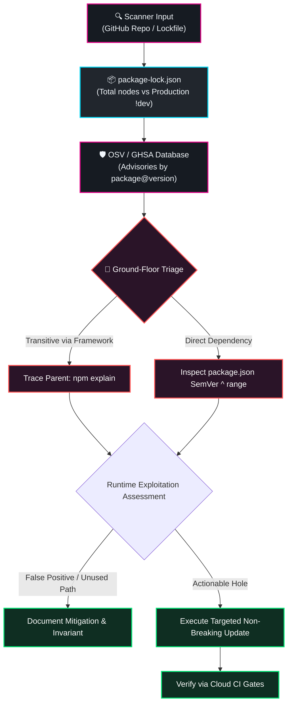

# Dependency Vulnerability Audit & Lockfile Forensics

Protocols, decision trees, and verification workflows for investigating, deconstructing, and cleanly resolving external security scanner findings (OpenSSF Scorecard, Google OSV database, GitHub Advisory Database / GHSA, and `npm audit`).

## When to Use This Skill
- An external security scanner (OpenSSF Scorecard, Socket.dev, Snyk, OSV.dev, or GitHub Dependabot) reports known vulnerabilities or flags "So-so security habits" against repository lockfiles.
- Running routine security health checks on `package-lock.json` or preparing a production release draft.
- Differentiating between actual runtime vulnerabilities versus development-only (`devDependencies`) noise.
- Tracing transitive/nested dependencies up the graph to identify the parent package responsible for pulling in a flagged version.
- Upgrading pinned lockfile versions cleanly without introducing breaking changes or violating SemVer ranges.

---

## Core Concepts

### 1. The Ground-Floor Deconstruction Axiom
Security scanners evaluate metadata snapshots from lockfiles, not running code.
$$\textbf{A flagged vulnerability is a claim about a pinned dependency version, not necessarily an exploitable flaw in your system.}$$

When a scanner reports something like *"6 of the 248 parts it uses have a known security hole"*:
1. **Decode the Denominator ("248 parts")**: Scanners typically count unique production `name@version` packages (`!pkg.dev` in `package-lock.json`), ignoring `devDependencies`.
2. **Identify the Numerator ("6 holes")**: The scanner matched 6 specific pinned package versions against public OSV/GHSA entries.
3. **Trace the Parent Seam**: Packages rarely exist in isolation. Most flagged packages are transitive dependencies introduced by higher-level frameworks (e.g. `body-parser` and `proxy-addr` brought in by `express`).



---

## 2. Investigation Protocol (The 4 Steps)

### Step 1: Enumerate and Partition the Dependency Graph
Determine the exact denominator and identify which packages belong to the production tree (`!dev`) versus development tools (`dev`).

Run a fast Node.js inspection:
```bash
node -e '
const fs = require("fs");
const lock = JSON.parse(fs.readFileSync("package-lock.json", "utf8"));
const pkgs = lock.packages || {};
let prodSet = new Set(), devSet = new Set();
for (const [k, v] of Object.entries(pkgs)) {
  if (!k) continue;
  const parts = k.split("node_modules/");
  const id = `${parts[parts.length - 1]}@${v.version}`;
  if (!v.dev) prodSet.add(id);
  else devSet.add(id);
}
console.log(`Production parts: ${prodSet.size}`);
console.log(`Development parts: ${devSet.size}`);
'
```

### Step 2: Extract Advisory Metadata via `npm audit --json`
Inspect raw audit output to isolate package names, vulnerability ranges, GHSA URLs, and severity levels:
```bash
npm audit --json > /tmp/audit.json
node -e '
const fs = require("fs");
const audit = JSON.parse(fs.readFileSync("/tmp/audit.json", "utf8"));
for (const [name, info] of Object.entries(audit.vulnerabilities || {})) {
  console.log(`Package: ${name} [${info.severity}] - Range: ${info.range}`);
  console.log(`  Via:`, info.via.map(x => typeof x === "string" ? x : x.title));
}
'
```

### Step 3: Trace the Dependency Seams (`npm explain`)
Never guess why a package is in your lockfile. Use `npm explain <package-name>` to trace the tree to the root caller:
```bash
npm explain <package-name>
```
*Example:*
- `body-parser@2.3.0` $\rightarrow$ pulled in by `express@5.2.1` $\rightarrow$ root `package.json`
- `esbuild@0.27.4` $\rightarrow$ pulled in by `tsx@4.21.0` $\rightarrow$ root `package.json`

### Step 4: Assess Actual System Impact
Before panicking over a "High" or "Critical" label, audit the codebase against the vulnerability's preconditions:
1. **Is the vulnerable code path actually reached?**
   *(e.g., An `esbuild` dev server SSRF vulnerability has zero impact if `esbuild` is only used as an offline transpiler/bundler via `tsx`).*
2. **Are there defensive invariants already mitigating the issue?**
   *(e.g., A collection memory exhaustion bug in a schema validator like `zod` is neutralized if reverse proxies or gateway middleware strictly limit the HTTP request body size to 1MB).*
3. **Does the fix require a major breaking change or a minor SemVer bump?**
   *(Check if the upstream parent framework has already published a patch that satisfies the existing `^` range).*

---

## 3. Remediation Strategy Matrix

| Scenario | Action | Tooling | Breaking Risk |
|---|---|---|---|
| **Transitive package has patched version within parent's range** | Targeted `npm update <parent-pkg>` | `npm update <parent>` or `npm audit fix` | Zero |
| **Direct dependency has patched version within range** | Update lockfile via `npm update <pkg>` | `npm update <pkg>` | Zero |
| **Direct dependency requires new SemVer minor/patch bump** | Bump version in `package.json` and reinstall | Edit `package.json` $\rightarrow$ `npm install` | Very Low |
| **Parent framework hasn't released a patch yet** | Use npm `overrides` in `package.json` (with caution) | `"overrides": { "vulnerable-pkg": "^x.y.z" }` | Medium (test thoroughly) |
| **Dev-only tool vulnerability (`devDependencies`)** | Update dev dependency; verify test/build pipelines | `npm update <dev-pkg> --save-dev` | Low |

---

## 4. Verification and Governance Rules

1. **Never Blindly Run `npm audit fix --force`**:
   `--force` can inject major breaking SemVer changes, rewrite peer dependencies, or downgrade packages without architectural review.
2. **Respect the Cloud-Offloaded Verification Policy**:
   Never run heavy tests or production compilation locally on constrained hosts. Run `npm run lint` (`tsc --noEmit`) locally, commit with Two-Layer Attribution, push to GitHub, and monitor the full test and build suites on GitHub Actions (`gh run watch`).
3. **Document Invariants for Upstream Delays**:
   If an advisory cannot be updated immediately due to upstream framework constraints, document the mitigating architecture (e.g. body parsers, firewalls, network boundaries) in the security policy or relevant brain spec.
