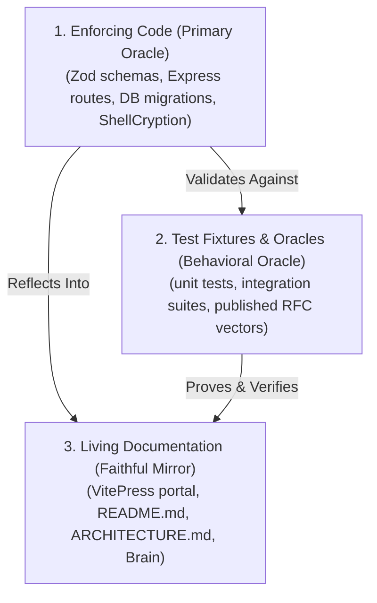
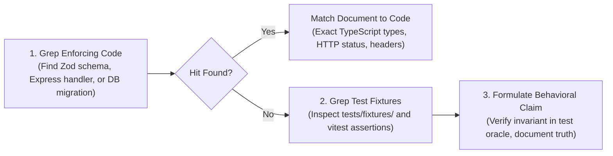
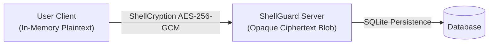

# Documentation Automation & The "Docs Bow to Code" Protocol

Patterns, test oracles, and automated workflows for deterministic documentation synchronization, VitePress portal maintenance, and drift elimination in ShellGuard.

## When to Use This Skill
- Adding, refactoring, or updating server routes, Zod schemas, or database tables.
- Modifying client state models, encryption flows (`ShellCryption`), or UI components.
- Authoring or updating VitePress portal pages in `docs/` and navigation in `docs/.vitepress/config.ts`.
- Creating or editing Mermaid diagrams across `README.md` and `docs/**`.
- Executing the pre-flight verification gate for documentation (`npm run docs:build`, `npm test`).
- Auditing documentation claims against runtime code using the **Claim Battery Method**.
- Ensuring brand asset twin parity between `public/` and `docs/public/assets/`.

---

## Core Concepts

### 1. The Fundamental Axiom: Docs Bow to Code
When a document contradicts shipped, verified, secure runtime behavior:
$$\textbf{The document is the defect. Never the code.}$$
- Never alter working, secure code to match an obsolete, aspirational, or misremembered documentation claim.
- The runtime implementation (and its passing test oracle) is the physical reality.
- The documentation is a reflection of that reality; when the reflection is warped, correct the mirror.

### 2. The Tri-Layer Source of Truth


1. **Enforcing Code**: The primary source of truth. If a rule or constraint exists, it lives in a Zod schema, a route handler, a crypto primitive, or a database migration.
2. **Test Fixtures & Oracles**: The behavioral truth. When code does not contain a literal string (e.g. AAD namespace patterns or multi-format sniffer sequences), test fixtures in `tests/fixtures/` and assertions in `tests/unit/` define the invariant.
3. **Living Documentation**: The faithful mirror. Kept in lockstep with layers 1 and 2 in the same commit.

### 3. The "Same-Commit" Mandate
- **Never defer documentation updates.** "I will update the docs later" is treated as an incomplete task and an open defect.
- Documentation updates must ride the exact same branch and commit as the feature or fix.
- Under ShellGuard's Two-Layer Attribution Format:
  - `User:` defines the architecture, intent, or specification.
  - `AI:` records both the code implementation AND the documentation files updated.

### 4. The Three Link Classes & Base-Prefix Invariant
In VitePress portals deployed with a subpath base (e.g. `base: '/ShellGuard/'` on GitHub Pages), internal links fall into three distinct classes:
1. **Config Links** (`docs/.vitepress/config.ts` — `link: '/...'`): VitePress handles base prefixing automatically.
2. **Markdown Links** (`[Label](/path)`): VitePress markdown-it compiler rewrites root-relative paths to the base.
3. **Raw HTML Hrefs in Custom Theme Components** (`href="/..."` in `.vue` components, e.g. `<Card>` or `<CardGrid>`):
   - **The Blind Spot**: VitePress does **NOT** automatically rewrite raw `href` attributes in custom Vue templates.
   - **The Rule**: Custom Vue components MUST import `withBase` from `vitepress` and bind `:href="normalizedHref"`.

### 5. Repository Security Policy Standard (`SECURITY.md`)
A secrets vault repository requires an explicit, binding security policy (`SECURITY.md`) at the repository root that adheres to OpenSSF (Open Source Security Foundation) and GitHub Security Advisory standards:
1. **Supported Versions Matrix**: Clear SemVer table of releases actively receiving security patches vs. end-of-life builds.
2. **Coordinated Vulnerability Disclosure Protocol**: A private reporting channel (e.g. `clawstackstudios@protonmail.com`), strict prohibition of public issues for zero-days, 72-hour acknowledgement SLA, and release notes attribution.
3. **Safe Harbor Guarantee**: Legal and technical safe harbor protecting security researchers acting in good faith under responsible disclosure.
4. **Threat Model & Cryptographic Invariants**: Uncompromising honesty regarding what the system guarantees (Triple-Layer Encryption, client-side zero-knowledge, hash-only agent key ledgers, forensic audit isolation) and what it cannot protect against (bare-LAN HTTP code tampering, lost identity keys).
5. **The Security Claim Battery**: Every cryptographic algorithm (e.g. `AES-GCM-256`, `HKDF-SHA-256`), table namespace, rate limit number, and storage ceiling stated in `SECURITY.md` must be verified against literal runtime code.

---

## The Automated Verification Test Harness

ShellGuard enforces documentation truth through automated, machine-evaluated test suites. These tests run in CI and in pre-flight test gates:

### Method 1: Navigation-Link Integrity Oracle (`tests/unit/docsLinks.test.ts`)
Validates that every internal link in the documentation portal resolves to a real file on disk and avoids 404s:

```typescript
import { describe, it, expect } from 'vitest';
import { readFileSync, readdirSync, statSync, existsSync } from 'node:fs';
import { join, resolve } from 'node:path';

const DOCS = resolve(__dirname, '../../docs');

function targetExists(sitePath: string): boolean {
  const clean = sitePath.split('#')[0];
  if (!clean) return true; // pure anchor fragment
  const base = clean.endsWith('/') ? clean.slice(0, -1) : clean;
  return (
    existsSync(join(DOCS, base + '.md')) ||
    existsSync(join(DOCS, base, 'index.md')) ||
    existsSync(join(DOCS, base))
  );
}

describe('docs navigation-link integrity', () => {
  it('every config.ts nav/sidebar link resolves to a real page', () => {
    const cfg = readFileSync(join(DOCS, '.vitepress', 'config.ts'), 'utf-8');
    const links = [...cfg.matchAll(/link:\s*['"`](\/[^'"`?#]*)/g)].map((m) => m[1]);
    expect(links.length).toBeGreaterThan(20);
    const dead = links.filter((l) => !targetExists(l));
    expect(dead).toEqual([]);
  });

  it('every markdown local link resolves to a real page', () => {
    // Walks docs/**/*.md and verifies ](/path) targets
  });

  it('theme components base-prefix internal links (withBase regression guard)', () => {
    const card = readFileSync(join(DOCS, '.vitepress', 'theme', 'components', 'Card.vue'), 'utf-8');
    expect(card).toContain("from 'vitepress'");
    expect(card).toContain('withBase');
    expect(card).toContain(':href="normalizedHref"');
  });
});
```

### Method 2: Mermaid Diagram Syntax & Parser Oracle (`tests/unit/mermaidDiagrams.test.ts`)
Prevents unparsed, broken, or raw-code diagram leaks on GitHub and VitePress:

```typescript
// Fatal syntax: unquoted brackets or braces inside node labels: Label[...] / Label("...")
const FATAL_NODE_LABEL = /^\s*[\w-]+\[[^\]"'\r\n]*[{}()][^\]"'\r\n]*\]/m;
// Fatal syntax: unquoted edge labels containing braces: -->|{...}|
const FATAL_EDGE_LABEL = /-->\|[^|"]*[{}][^|"]*\|/;

describe('mermaid diagram integrity (README + docs/**)', () => {
  it('every mermaid fence is closed', () => {
    // Asserts all ```mermaid blocks terminate with ```
  });

  it('no fatal unquoted braces/parens in node labels', () => {
    // Catches unquoted Node[label {with} braces] that crashes Mermaid
  });

  it('quoted labels may contain braces (valid mermaid)', () => {
    // Valid: Node["label {with} braces"]
  });
});
```

### Method 3: Dynamic Version Resolver Oracle (`tests/unit/version.test.ts`)
Eliminates hardcoded version drift in documentation, API status endpoints, and backup manifests:
- Never hardcode version strings like `'0.0.1.8'` into code or tests.
- Always resolve dynamically from `package.json` ground truth via `getAppVersion()`.
- Validate semver / build pattern (`/^\d+\.\d+\.\d+(\.\d+)?$/`).

---

## The Claim Battery Audit Protocol

When auditing or writing documentation for complex cryptographic, architectural, or API features, follow the **Claim Battery Protocol**:



### The 4 Audit Rules:
1. **Enumerate, Never Recall**:
   - Permission models come directly from the Zod schemas in `src/server/validation/`.
   - Rate limiter ceilings come from `rateLimiter.ts` cited with exact environment variables (`AUTH_LIMIT_MAX`, `ADMIN_LIMIT_MAX`).
   - Schema truth comes from `migrations/` files, not mental memory.
2. **Wire-Exact Payload Alignment**:
   - Distinguish exact types: an array of strings (`inserted: string[]`) vs. a count (`inserted: number`).
   - Distinguish HTTP statuses: `201 Created` vs. `207 Multi-Status` vs. `200 OK`.
3. **Asset Twin Parity**:
   - Every image, logo, and diagram asset in `public/` MUST exist identically in `docs/public/assets/`.
4. **Prune Phantom Artifacts**:
   - If a file or helper is deleted or consolidated in code, grep the entire `docs/` tree and brain to purge phantom references immediately.

---

## Standard Documentation Templates

### Template 1: VitePress Feature Guide (`docs/vault-features/<feature>.md`)
```markdown
# Feature Title

> Short one-sentence executive summary of the capability and its security/usability value.

## Overview & Zero-Knowledge Architecture
Explain the feature through the lens of zero-knowledge and client-side processing.



## How It Works
Step-by-step breakdown of user gestures, state transformations, and persistence.

### Key Guarantees
- **Client Encryption**: Plaintext never touches network transit.
- **Audit Logging**: Forensic entry recorded in `audit.sqlite`.

## User Interface & Ergonomics
Explain the UI interaction (e.g. Eye-beside-Copy controls, keyboard shortcuts).

## Related Documentation
<CardGrid :cols="2">
  <Card title="Architecture Blueprint" href="/architecture/" description="Deep dive into ShellGuard cryptographic layers." />
  <Card title="API Reference" href="/agent-integration/api-reference" description="REST endpoint contracts for automated agents." />
</CardGrid>
```

### Template 2: REST Endpoint Matrix Entry (`docs/agent-integration/api-reference.md`)
```markdown
### `POST /api/vault/bulk-import`

Imports up to 1,000 vault items in an atomic SQLite transaction with per-record validation.

- **Authentication**: Bearer `api-` token or Session Cookie
- **Rate Limit**: 10 requests / 15 minutes (`VAULT_IMPORT_LIMIT_MAX`)
- **Body Limit**: 10MB scoped parser

#### Request Body (`application/json`)
| Field | Type | Required | Description |
| :--- | :--- | :--- | :--- |
| `items` | `VaultImportItem[]` | Yes | Array of 1 to 1,000 items to import. |

#### Response Contracts
- **`201 Created`** (All records succeeded):
  ```json
  {
    "success": true,
    "inserted": ["uuid-1", "uuid-2"]
  }
  ```
- **`207 Multi-Status`** (Partial success):
  ```json
  {
    "success": true,
    "inserted": ["uuid-1"],
    "errors": [
      { "index": 1, "reason": "Title is required" }
    ]
  }
  ```
- **`400 Bad Request`**: Malformed JSON or container bounds violation (`<1` or `>1000`).
```

### Template 3: Zero-Knowledge Security Policy (`SECURITY.md`)
```markdown
# 🛡️ Security Policy — ShellGuard

[](#)
[](#)

> A secrets vault is a juicier target than a bookmark manager. This document describes the security model as it actually is — including what the server *can't* protect you from.

---

## 📦 Supported Versions

Security updates and critical patches are actively provided for the following releases:

| Version | Supported | Security Notes |
|:---|:---|:---|
| `v0.0.2.x (Build 26+)` | ✅ Supported | Active development & current release branch |
| `v0.0.2.0 – v0.0.2.3` | ⚠️ Upstream Fix Only | Upgrade to latest `v0.0.2.x` recommended |
| `< v0.0.2.0` | ❌ End of Life | Legacy pre-migration builds; no patches |

---

## 🔑 Security Model & Triple-Layer Architecture
Document Layer 1 (Client ShellCryption AES-256-GCM), Layer 2 (Server Metadata Encryption SG-META), and Layer 3 (SQLCipher at rest).

## 🔒 Security Practices & Key Ledgers
Document client memory lifecycle, hash-only key storage (`hu-`, `lb-`), session TTLs, and audit isolation.

## 🚨 Reporting a Vulnerability & Safe Harbor
- **Private Reporting**: Email `clawstackstudios@protonmail.com` (Never open public issues).
- **Acknowledgement SLA**: Within 72 hours.
- **Safe Harbor**: Researchers acting in good faith under responsible disclosure will not face legal action.
- **Release Credit**: Public acknowledgment in release notes and changelog.
```

---

## Best Practices

### Do's
- **Run the Pre-Flight Docs Oracle**: Always run `npm test` (which triggers `docsLinks.test.ts` and `mermaidDiagrams.test.ts`) and `npm run docs:build` before pushing or committing docs changes.
- **Audit `SECURITY.md` alongside Crypto/Auth PRs**: Whenever cryptography, key derivation, auth tokens, or version tags change, verify and update `SECURITY.md` in the same commit.
- **Maintain Safe Harbor & Private Channels**: Ensure private disclosure email and PGP fingerprint remain operational.
- **Use `withBase()`**: Always wrap raw paths in custom theme Vue components with `withBase()`.
- **Quote Mermaid Labels**: Enclose Mermaid node labels in double quotes (`["Label with {brackets}"]`) to prevent parser errors.
- **Update ROADMAP Documentation Impact**: Keep ROADMAP phase checklists updated with exact documentation touches.
- **Maintain Asset Twin Parity**: When adding or updating images, update both `public/` and `docs/public/assets/`.

### Don'ts
- **Don't Commit Broken Links**: Never commit dead internal links or unresolvable anchors.
- **Don't Let Security Claims Drift**: Never claim zero-knowledge properties or algorithms that code doesn't strictly execute.
- **Don't Guess Schemas**: Never draft API documentation from intuition; read the Zod schema directly.
- **Don't Let Docs Outrun Code**: Never document unreleased features as "currently available" without explicit "Planned / Roadmap" disclaimers.
- **Don't Mutate Code to Fit Stale Prose**: Code and test fixtures are the bedrock; prose bows to code.

