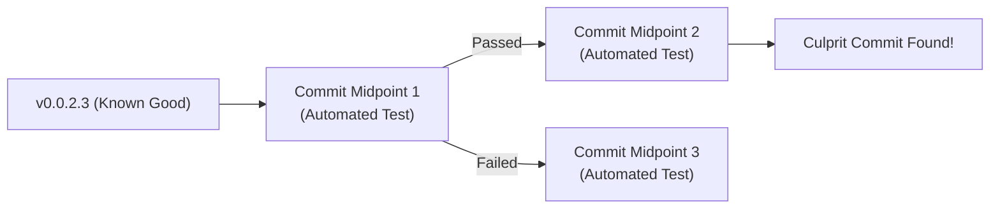

# Git Advanced Workflows

Master advanced Git techniques to maintain clean linear history, isolate parallel tasks, and recover from any repository situation with confidence in ShellGuard.

## When to Use This Skill
- Cleaning up and restructuring commit history before merging or opening a pull request.
- Applying specific commits or security hotfixes across multiple release branches.
- Pinpointing regressions and bug-introducing commits via automated binary search (`git bisect run`).
- Working on urgent fixes or multiple features simultaneously without stash switching or checkout friction (`git worktree`).
- Recovering from accidental hard resets, dropped commits, or deleted branches (`git reflog`).
- Splitting large monolithic commits into atomic, logical units.
- Safely synchronizing diverged branches using `--force-with-lease`.

---

## Core Concepts

### 1. Interactive Rebase (`git rebase -i`)
Interactive rebase allows you to rewrite, reorder, combine, or discard commits on a local feature branch before publishing:

| Command | Action | Usage |
| :--- | :--- | :--- |
| `pick` | Keep commit as-is | Default action |
| `reword` | Keep commit contents, but edit commit message | Fix typo or align with Conventional Commits |
| `edit` | Stop at commit to amend content or split | Split monolithic changes or fix files |
| `squash` | Combine commit into previous commit, keeping messages | Consolidate multi-step work |
| `fixup` | Combine commit into previous commit, discarding message | Merge typo fixes or minor adjustments silently |
| `drop` | Delete commit completely from history | Remove temporary debugging or dead-end attempts |

**Invocation Patterns:**
```bash
# Rebase the last N commits
git rebase -i HEAD~5

# Rebase all unmerged commits on the current branch against main
git rebase -i $(git merge-base HEAD main)

# Rebase starting from a specific parent commit hash
git rebase -i <commit-hash>
```

### 2. Autosquash & Commit Splitting
- **Autosquash**: Mark fixups immediately at commit time, then rebase hands-free:
  ```bash
  # Stage fix and mark commit for automatic folding into target hash
  git commit --fixup <target-hash>

  # Rebase with autosquash (Git automatically places fixup lines under target commits)
  git rebase -i --autosquash main
  ```
- **Commit Splitting**: Break one commit into distinct logical pieces:
  1. Start `git rebase -i HEAD~N` and mark the target commit with `edit`.
  2. When Git pauses, unstage the commit while keeping modified files in your working tree:
     ```bash
     git reset HEAD^
     ```
  3. Stage and commit individual files in logical, atomic strokes.
  4. Continue rebase: `git rebase --continue`.

### 3. Precision Cherry-Picking
Transplant individual commits or ranges onto other branches without merging entire history trees:
```bash
# Cherry-pick a single commit
git cherry-pick <commit-hash>

# Cherry-pick a contiguous range of commits (exclusive start, inclusive end)
git cherry-pick <start-hash>..<end-hash>

# Cherry-pick changes into the index without creating a commit (stage-only)
git cherry-pick -n <commit-hash>

# Partial file cherry-pick (extract only specific files from an existing commit)
git checkout <commit-hash> -- path/to/file1.ts path/to/file2.ts
git commit -m "fix(scope): port specific changes from <commit-hash>"
```

### 4. Automated Binary Regression Hunting (`git bisect`)
Find the exact commit that introduced a bug or broken test in $O(\log N)$ steps using binary search:


**Automated Bisect Execution:**
```bash
# Start bisect session
git bisect start HEAD v0.0.2.3

# Run automated test oracle until the culprit is identified
git bisect run npx vitest run tests/unit/cardUtils.test.ts

# Exit bisect and return to original HEAD state
git bisect reset
```
*Note*: The test script must return exit code `0` for good, and `1-127` (except `125` for skip) for bad.

### 5. Isolated Parallel Development with Git Worktrees
Worktrees allow multiple branches of the same repository to be checked out simultaneously into separate working directories, sharing the same underlying `.git` object store:
```bash
# List all active worktrees
git worktree list

# Create a new worktree on a new branch for an urgent fix
git worktree add -b fix/urgent-auth ../ShellGuard-hotfix main

# Switch directories and work without stashing or switching current branch
cd ../ShellGuard-hotfix
npm test
git commit -m "fix(auth): resolve session expiry edge-case"

# Clean up worktree directory when finished
cd ../ShellGuard
git worktree remove ../ShellGuard-hotfix
git worktree prune
```

### 6. The Reflog Safety Net & Disaster Recovery
Git records every HEAD movement (checkouts, commits, rebases, resets) in `git reflog` for at least 90 days by default:
- Even commits "lost" via `git reset --hard` or deleted branches still exist in the object database and appear in `git reflog`.
- To recover a lost state:
  ```bash
  # View reflog entries
  git reflog

  # Restore state to a specific reflog entry
  git branch recovery-branch HEAD@{2}
  ```

---

## Practical Step-by-Step Workflows

### Workflow 1: Feature Branch Consolidation & Cleanup Before PR
Prepare a local branch with clean, atomic Conventional Commits:

```bash
# 1. Ensure working directory is clean
git status

# 2. Snapshot a safety branch before rewriting history
git branch backup/feature-pre-rebase

# 3. Interactive rebase against upstream main
GIT_SEQUENCE_EDITOR=: git rebase -i $(git merge-base HEAD main)

# 4. If squash/reword is needed, open editor or pass script:
#    - squash/fixup WIP commits
#    - ensure every commit subject <= 72 chars with Conventional Commit scope

# 5. Run full pre-flight verification gates
npm test
npm run build

# 6. Push cleaned branch safely with lease protection
git push --force-with-lease origin feature/my-feature

# 7. Delete safety backup branch once verified
git branch -D backup/feature-pre-rebase
```

### Workflow 2: Cross-Release Hotfix Porting (Cherry-Picking Security Fixes)
Apply a security patch from active development to maintenance release branches:

```bash
# 1. Commit fix on active branch with two-layer attribution
git commit -m "fix(crypto): patch timing leak in key verification

User: resolve timing difference on invalid hash lookup
AI: utilize crypto.timingSafeEqual across all branches"

# 2. Note commit hash (e.g. abc1234)
# 3. Switch to maintenance release branch
git checkout release/v0.0.2.x

# 4. Cherry-pick the commit
git cherry-pick abc1234

# 5. If conflict arises, resolve files and continue
#    git status
#    git add <resolved-files>
#    git cherry-pick --continue

# 6. Verify tests pass on maintenance branch
npm test
```

### Workflow 3: Automated Regression Bisect via Vitest
Find when a test unexpectedly broke:

```bash
# 1. Ensure working tree is pristine
git status

# 2. Start bisect
git bisect start HEAD v0.0.2.3

# 3. Hand over execution to Vitest
git bisect run npx vitest run tests/unit/customFields.test.ts

# 4. Git outputs the first bad commit
# 5. Reset back to original branch
git bisect reset
```

### Workflow 4: Context-Switching via Ephemeral Worktrees
Handle an urgent review or hotfix without touching in-flight work:

```bash
# Current work is in-flight on chore/phase-26-import-lifecycle
# User requests immediate fix on main:

# 1. Create sibling worktree directory
git worktree add ../ShellGuard-hotfix -b hotfix/stream-ceiling main

# 2. Enter worktree and apply fix
cd ../ShellGuard-hotfix
# Edit files...
npm test
git commit -m "fix(storage): enforce 500MB ceiling check on upload"

# 3. Return to primary workspace
cd ../ShellGuard

# 4. Remove worktree
git worktree remove ../ShellGuard-hotfix
```

### Workflow 5: Disaster Recovery Runbook (Reflog Rescues)

#### Scenario A: Accidental `git reset --hard HEAD~3`
```bash
# 1. Inspect reflog
git reflog
# abc1234 HEAD@{0}: reset: moving to HEAD~3
# def5678 HEAD@{1}: commit: important work

# 2. Recover immediately to def5678
git reset --hard def5678
```

#### Scenario B: Accidental Branch Deletion (`git branch -D my-feature`)
```bash
# 1. Find the last commit hash of the deleted branch
git reflog | grep "my-feature"
# Or look at recent commits:
git reflog -n 20

# 2. Re-create the branch at that commit
git branch my-feature <hash-from-reflog>
```

#### Scenario C: Aborting a Disrupted Rebase or Merge
```bash
# Abort cleanly and return to pristine pre-operation state:
git rebase --abort
git merge --abort
git cherry-pick --abort
```

---

## Rebase vs. Merge Decision Matrix

| Dimension | Rebase (`git rebase`) | Merge (`git merge`) |
| :--- | :--- | :--- |
| **Primary Purpose** | Linear history, local cleanup before PR | Preserving true historical topology |
| **Applicable Scope** | Local feature branches only | Merging completed features into `main` |
| **Public Branches** | ❌ STRICTLY FORBIDDEN on public branches | ✅ Standard for integrating branches |
| **Conflict Resolution** | Replayed commit-by-commit | Resolved once in the merge commit |
| **Traceability** | Clean, linear timeline without clutter | Explicit fork and join points |

---

## Best Practices

### Do's
- **Always Snapshot Before History Rewrites**: Run `git branch backup/<name>-$(date +%s)` before interactive rebase or branch resets.
- **Always Use `--force-with-lease`**: If force pushing a local branch is required, never use bare `--force`. `--force-with-lease` aborts if someone else pushed to remote.
- **Rebase Only Unpushed Local Commits**: Never rebase commits that have been merged into `main` or pulled by collaborators.
- **Use Worktrees for Concurrent Branching**: Eliminate branch checkout thrashing by spinning up dedicated worktrees.
- **Keep Atomic Commit Scopes**: Every commit should represent one logical change, pass tests independently, and have a clear Conventional Commit message.
- **Know the Universal Escape Hatches**: Keep `--abort` in muscle memory (`git rebase --abort`, `git cherry-pick --abort`, `git merge --abort`).

### Don'ts
- **Never Force Push to Default Branches**: Never force push to `main`, `master`, or release tags.
- **Never Rebase on a Dirty Working Tree**: Always ensure `git status` is clean (or create a temporary commit) before starting rebase or bisect.
- **Never Panic on Reset**: Reflog stores all state changes for 90 days. Almost nothing is permanently lost if you know how to query `git reflog`.
- **Never Skip Pre-Flight Gates After History Rewrites**: Always re-run `npm test` and `npm run build` after squashing or rebasing.
