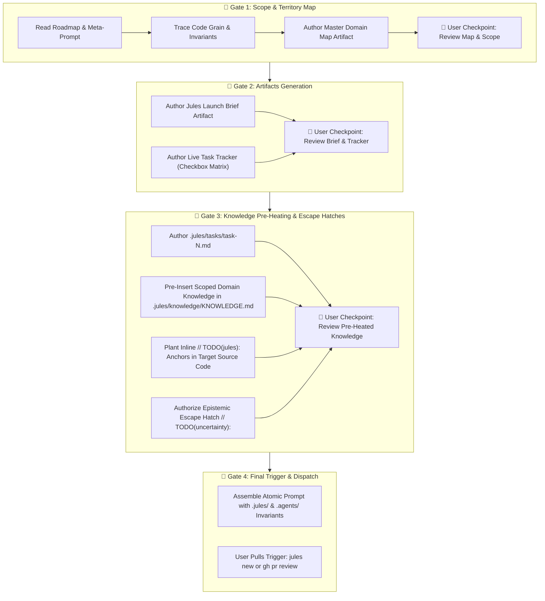

# 🛡️ Prep-Jules-Work Skill (Google Antigravity Edition)

This skill governs the pre-flight preparation and staging lifecycle before delegating coding tasks, refactors, or feature implementations to **Google Jules**.

It enforces the **4-Gate Preparation Pipeline**: scoping first, generating operational artifacts second, pre-heating Jules's inference with targeted knowledge and uncertainty escape hatches third, and stopping for user authorization before dispatching.

---

## 🏛️ Architecture: The 4-Gate Preparation Pipeline



---

## 🚪 Gate 1: Scope & Territory Map

Before drafting prompts or touching code, the orchestrator must map both sides of the bridge:

1. **Inspect Ground Truth**: Read the active phase prompt in `project/meta-prompt-ai-studio.md` and `ROADMAP.md`.
2. **Trace the Code Grain**: Inspect target files, existing tests, schemas, and routes to determine exact line ranges and boundary conditions.
3. **Author Master Domain Map Artifact**:
   - Location: `<appDataDir>/brain/<conversation-id>/phase-<N>-domain-map.md`.
   - Content: In-scope vs. out-of-scope boundaries, objective justifications, adjacent systems, implicated findings, OWASP & YAGNI audit, the core invariable, file impact list, and finishing criteria.
4. **Gate 1 User Checkpoint**:
   - Present the domain map artifact link to the user.
   - Ask: *"Does this scope map capture everything, or would you like to add or exclude any items before we draft the launch brief and task tracker?"*
   - Stop calling tools and await user feedback.

---

## 🚪 Gate 2: Artifacts Generation (Launch Brief & Task Tracker)

Once the user approves the scope map, author two complementary operational artifacts:

### 1. The Jules Launch Brief Artifact
- Location: `<appDataDir>/brain/<conversation-id>/phase-<N>-jules-launch-brief.md`.
- Format: Uses the **Universal Guidance & PR Review Template** from `jules-cli/SKILL.md`.
- Content:
  - Executive phase architecture outline.
  - Inviolable security redlines (no `.agents/`, no `.github/workflows/`, no force-push, two-layer commit attribution).
  - Paired sub-phase breakdown (Task A Functionality + Task B UI/Verification).
  - Exact verification and testing commands (`npm run lint`, `npm test`, `npm run docs:build`, `npm run build`).
  - Standardized Jules PR Reporting Contract (including the Epistemic Flags section).
  - Battle-tested CLI dispatch command formula.

### 2. The Live Task Tracker Artifact
- Location: `<appDataDir>/brain/<conversation-id>/phase-<N>-task-tracker.md`.
- Format: Living checkbox matrix (`- [ ]`).
- Content:
  - Pre-flight environment checkboxes.
  - Granular sub-task checkboxes covering every invariant, test vector, and route.
  - Quality verification gate checkboxes.
  - Sovereign boundary & PR hygiene checkboxes.
  - Release roll & version synchronization checkboxes.
  - Live commit audit log table.
- **Gate 2 User Checkpoint**: Present both artifacts to the user for review.

---

## 🚪 Gate 3: Knowledge Pre-Heating & The Epistemic Escape Hatch

To guarantee Jules's LLM inference is tuned to the specific task domain and remove the RLHF over-confidence bias:

### 1. Dedicated Task Files
- Author `.jules/tasks/task-<N>.md` for each task in the phase.
- Include milestone, domain, target branch, files in scope, detailed requirements, and acceptance criteria.

### 2. Targeted Knowledge Pre-Insertion (`.jules/knowledge/KNOWLEDGE.md`)
- Update or pre-populate `.jules/knowledge/KNOWLEDGE.md` with:
  - Specific API signatures, interfaces, or cryptographic constants needed for the stage.
  - Pitfalls and edge cases discovered in prior phases (e.g. `timingSafeEqual` throw behavior, SQLite pragma gotchas).
  - Anti-patterns to avoid.

### 3. Inline Code Anchoring
- Insert structured `// TODO(jules):` comments directly above target code blocks in application source files:
  ```typescript
  // TODO(jules): Phase 24 / Task 47 — Mechanize constant-time sweep: replace raw equality with constantTimeCompare().
  ```

### 4. 🪂 The Epistemic Escape Hatch Protocol
Standard LLM training penalizes models for sounding unconfident, forcing them to disguise compromises or write brittle fixes with confident commit messages.

The **Epistemic Escape Hatch** provides Jules with an explicit, rewarded safety valve:
1. **The Invariant**: Jules is authorized to make working fixes even under uncertainty, but **MUST NOT disguise doubt**.
2. **The Syntax**: When Jules implements a solution where it senses an edge case, race condition, typing compromise, or performance hazard, it plants an inline comment directly above the site:
   ```typescript
   // TODO(uncertainty): [Explain the exact doubt: e.g. "Working fix for X, but I am uncertain if Y edge case causes a race condition under high concurrency. Recommend orchestrator review."]
   ```
3. **The PR Self-Report**: Jules lists any planted uncertainty comments under a mandatory `### ⚠️ Epistemic Flags & Surfaced Uncertainties` section in its PR description.
4. **The Review Advantage**: During PR review, the orchestrator runs:
   ```bash
   git diff origin/main..HEAD | grep -n "TODO.*uncertainty"
   ```
   All soft spots are immediately surfaced without searching blindly.
- **Gate 3 User Checkpoint**: Ask the user: *"Task files, pre-heated knowledge, and uncertainty escape hatches are staged. Do you have any specific domain knowledge to add before we prep the dispatch?"*

---

## 🚪 Gate 4: The Invariant-Enclosed Prompt Formula & Final Trigger

### The Two Mandatory Prompt Invariants

Because Jules runs in an isolated container:
1. **Jules will NOT look in `.jules/` by default**:
   - The initial prompt **MUST explicitly instruct Jules to inspect `.jules/`**:
     `"Inspect root AGENTS.md, .jules/JULES.md, .jules/knowledge/KNOWLEDGE.md, and .jules/tasks/task-<N>.md."`
2. **`.agents/` is strictly sovereign and forbidden**:
   - The initial prompt **MUST explicitly forbid `.agents/` modifications**:
     `"DO NOT modify any file inside .agents/ or .github/workflows/."`

### The Atomic Prompt Formula
```bash
jules new --repo "<OWNER>/<REPO>" "First, verify repository files using git ls-tree -r --name-only HEAD on branch <TARGET_BRANCH>. DO NOT force-reset or force-push main. DO NOT modify any file inside .agents/ or .github/workflows/. Next, inspect root AGENTS.md, .jules/JULES.md, .jules/knowledge/KNOWLEDGE.md, and .jules/tasks/task-<N>.md. Execute your assigned task adhering to repository invariants. If you encounter low-confidence patterns or compromises, apply the fix and plant an inline // TODO(uncertainty): comment explaining your doubt. Verify with npm run lint, npm test, and npm run docs:build before opening a Pull Request targeting <TARGET_BRANCH>." < /dev/null
```

### The Final User Call
- **Never trigger dispatch autonomously.**
- Present the assembled dispatch command and session plan to the user.
- Allow the user to make the final trigger pull.

---

## 🛡️ The Socratic Invariable (Shape-Based Steering)

- **Pre-Flight Specs (`.jules/tasks/` & `// TODO(jules):`)**: Specify falsifiable boundaries, test oracles, and invariant shapes—never line-by-line procedural code. Prime the co-pilot to solve for the constraints.
- **Mid-Flight Checkpoints & PR Remediation**: When the co-pilot pauses for guidance or returns an incomplete PR, never issue imperative code patches. Frame all replies as Socratic, diff-anchored questions quoting physical tree reality against author testimony so the co-pilot discovers the gap and authors the fix.

---

## 🔄 Post-Execution Audit & PR Reconciliation

When Jules opens a PR or pushes commits:
1. **Audit Epistemic Scars First**:
   ```bash
   git diff origin/main..HEAD | grep -n "TODO.*uncertainty"
   ```
   Inspect each flagged site and evaluate whether the fix holds or requires mentoring.
2. **Sovereign Boundary Check**:
   ```bash
   git diff --stat origin/main..HEAD -- .agents/
   ```
   Ensure 0 modifications to `.agents/`. Discard any rogue bot changes with `git checkout origin/main -- .agents/`.
3. **Live Tracker Synchronization**:
   Check off completed sub-tasks in `<appDataDir>/brain/<conversation-id>/phase-<N>-task-tracker.md` and log commit SHAs.
4. **Pre-Merge Judgment Artifact**:
   Prior to merging to `main`, author `pre-merge-judgment-phase-<N>.md` comparing PR reality against the tracking matrix.
5. **Cadence Completion**: Execute the release bump, CHANGELOG updates, and roadmap advancement.
