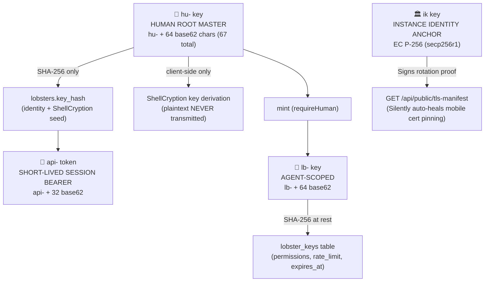

# 🔑 ShellGuard — Key Hierarchy Specification

> **The four key types, their lifecycles, permissions & boundaries**
> *Pulled into existence by Phase 3 (Lobster Keys) & Phase 27 (Instance Key). Grows with the walk.*

---

## §1. The Key Hierarchy

### §1.4 The Instance Identity Key (`ik` / `instance.key` — Phase 27)
A server-level persistent cryptographic anchor decoupling leaf certificate rotation from client trust:

| Property | Specification |
|:---|:---|
| **Algorithm** | EC P-256 (`secp256r1`) Keypair |
| **Storage** | `DATA_DIR/instance.key` (POSIX mode `0o600`) |
| **Transmission** | Private key NEVER transmitted. Public key (`ik`) exported as uncompressed hex via QR code & `/api/public/tls-manifest`. |
| **Purpose** | Signs TLS certificate rotation manifests, allowing paired mobile clients to auto-heal without re-pairing. |
| **Lifecycle** | Generated once on server installation; immutable across certificate regenerations. |

## §2. Lifecycle Rules (inviolable)

| Type | Generation | Transmission | Storage | Death |
|:---|:---|:---|:---|:---|
| `hu-` | Client-generated | **SHA-256(hu-) only** — plaintext NEVER crosses the wire | `lobsters.key_hash` (unique) | User destroys key → vault unrecoverable by design |
| `api-` | Issued by `/api/auth/token` from a verified key hash | Bearer header | `api_tokens` with `expires_at` | TTL expiry or logout |
| `lb-` | Minted by a human via `POST /api/agent-keys` | Returned **once** in plaintext at mint | Hashed server-side, plus `permissions`, `rate_limit`, `expires_at` | Revocable (`PATCH …/revoke`) or deletable — **without affecting human sessions** |
| `ik` | Server-generated on first install (`instanceKey.ts`) | **Public key only** (hex via QR & manifest) | `DATA_DIR/instance.key` (`0o600`) | Server host reset or manual admin purge |

## §3. Permission Model (claw strength)

Scoped booleans per `lb-` key; enforced per-route via `requirePermission`:

- `canRead` — `GET`
- `canWrite` — `POST`
- `canEdit` — `PUT`
- `canDelete` — `DELETE`

A missing permission is a `403`. Rate limits are per-key (LRU limiter) and
enforced **after** authentication (auth-before-limit ordering is a Phase 2
invariant).

## §4. Human-Only Gates (`requireHuman`)

Operations that only a `hu-`-derived session may perform — agents are
 categorically excluded:

- Minting, revoking, deleting Lobster Keys (`/api/agent-keys`)
- Reading/writing instance settings (`/api/settings/:key`)
- (Later phases: admin plane access, backup operations)

---
