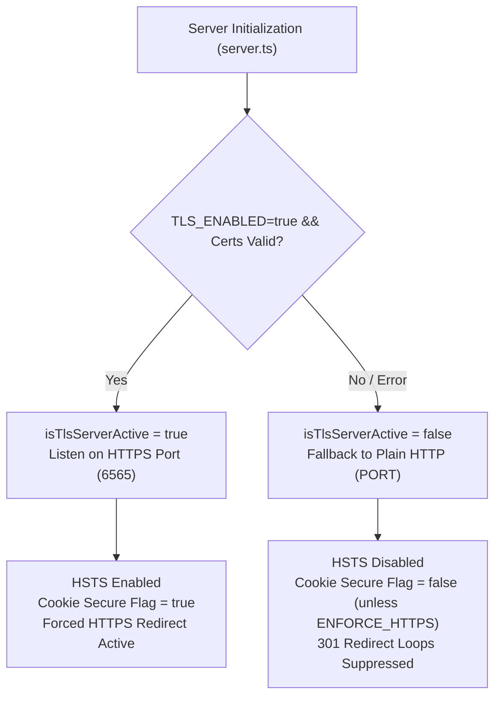
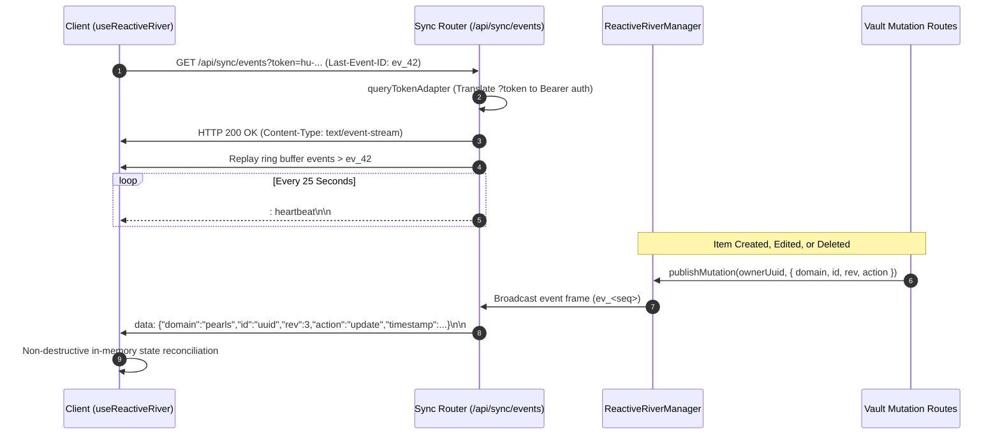

# 🌐 ShellGuard — Network Topology & Transport Control Specification

> **Fail-Safe TLS State, Dynamic Reverse Proxy Resolution & Reactive River SSE Wire Protocol**
> *Ratified for Milestone v0.0.3.0 (Build 32) under Sub-Phases 28.2 & 28.4.*

---

## §1. Architectural Scope

This specification codifies ShellGuard's network and transport invariants:
1. **Dynamic Socket State (`isTlsServerActive`)**: Tracking runtime TLS readiness to eliminate 301 redirection self-bricks and admin cookie lockouts.
2. **Reverse Proxy & Multi-Hop Resolution (`TRUST_PROXY`)**: Parsing comma-separated proxy headers and configurable hop counts.
3. **Healthcheck Probe Exemption**: Preserving unencrypted container health monitoring at `/api/health`.
4. **Sync-Native Reactive River SSE Protocol**: In-process real-time event streaming (`GET /api/sync/events`) for sub-50ms client reconciliation.

---

## §2. Fail-Safe TLS Runtime State (`isTlsServerActive`)

In container and homelab deployments, TLS certificate generation or key file mounting may encounter filesystem or configuration friction. Rather than crashing the process or forcing redirect loops:



### Invariants:
1. **Self-Brick Prevention**: If certificate initialization fails, the server falls back to plain HTTP. Because `isTlsServerActive` is false, `httpsRedirect.ts` suppresses 301 redirects, preventing infinite redirect loops to an unbound TLS port.
2. **Cookie Accessibility**: Administrative session cookies (`sg_admin_session`) drop the `Secure` flag during HTTP fallback unless `ENFORCE_HTTPS=true` is explicitly configured, ensuring instance operators are never locked out of `/superlobster`.
3. **Probe Exemption**: The route `GET /api/health` is unconditionally exempted from HTTPS redirection, ensuring Docker, Kubernetes, and reverse-proxy probes always receive an unencrypted `200 OK`.

---

## §3. Multi-Proxy & Reverse Proxy Hop Resolution

When ShellGuard operates behind reverse proxies or multi-tier ingress networks:

### A. Comma-Separated Protocol Chains
`X-Forwarded-Proto` may arrive as a comma-separated list when passing through multiple reverse proxies (e.g., `client -> Cloudflare -> Caddy -> ShellGuard` sends `https, http`).
`httpsRedirect.ts` parses the leftmost (client-facing) header value:
```typescript
const protoHeader = req.headers['x-forwarded-proto'];
const clientProto = (typeof protoHeader === 'string' ? protoHeader.split(',')[0].trim() : '').toLowerCase();
```

### B. Proxy Trust Hop Counts (`TRUST_PROXY`)
Express `trust proxy` accepts:
- Boolean: `TRUST_PROXY=true` (trust all hops) or `TRUST_PROXY=false` (trust loopback only).
- Integer Hop Counts: `TRUST_PROXY=2` instructs Express to trust exactly 2 proxy hops backwards from the socket connection.

---

## §4. Reactive River SSE Wire Protocol (`/api/sync/events`)

The Reactive River establishes an authenticated, one-way Server-Sent Events (SSE) stream delivering real-time mutation markers with $<50$ms commit-to-broadcast latency.



### A. Endpoint & Wire Headers
- **Route**: `GET /api/sync/events`
- **Authentication**: User session token, `hu-` Bearer token, or `?token=...` query parameter (adapted via `queryTokenAdapter` for native browser `EventSource`).
- **Response Headers**:
  - `Content-Type: text/event-stream; charset=utf-8`
  - `Cache-Control: no-cache, no-transform`
  - `Connection: keep-alive`
  - `X-Accel-Buffering: no` (disables Nginx reverse-proxy stream buffering)

### B. Event Framing & Monotonic Cursor
- **Event ID**: `id: ev_<seq>` where `<seq>` is an integer incrementing monotonically per owner.
- **Heartbeat Comments**: `: heartbeat\n\n` emitted every 25 seconds to prevent NAT, firewall, and reverse-proxy socket timeouts.
- **Replay Buffer**: Per-owner in-memory ring buffer storing the latest 100 mutation frames. When a client reconnects with `Last-Event-ID: ev_<seq>`, missed events are replayed before switching to live streaming.
- **Client Non-Destructive Reconciliation**: When mutation events arrive, `useReactiveRiver` updates client store caches in memory without triggering full page reloads or deselecting active items in `ItemDetailPane`.
