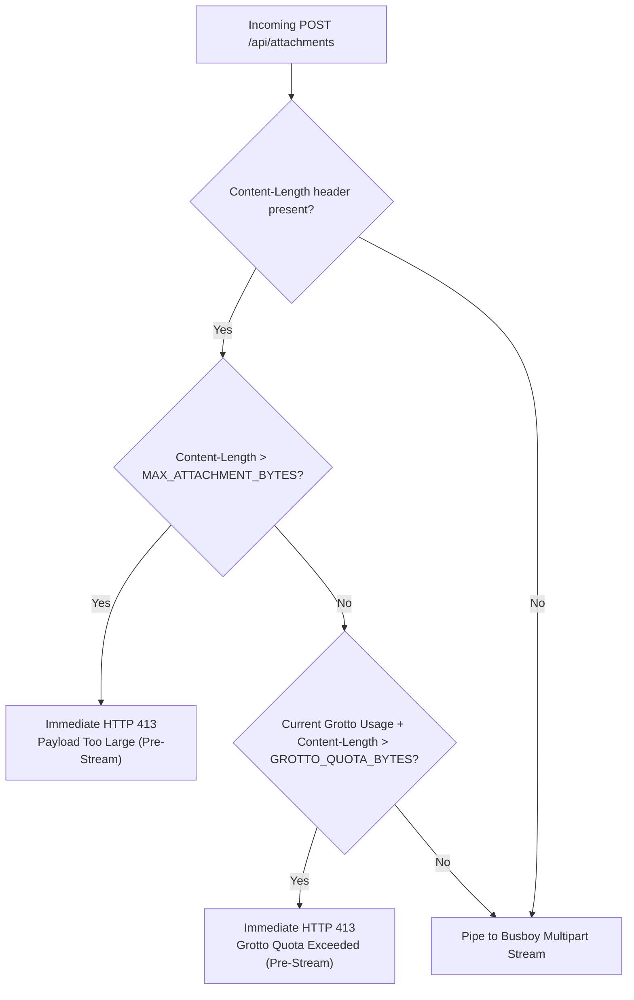

# 💾 ShellGuard — Storage Ceilings & Container Quota Specification

> **Storage Quota Clamps, Pre-Stream 413 Fast-Rejection & Container Permission Isolation**
> *Ratified for Milestone v0.0.3.0 (Build 32) under Sub-Phase 28.3.*

---

## §1. Architectural Purpose & Defense-in-Depth

ShellGuard stores encrypted file attachments as raw ciphertext BLOBs directly within SQLite (`vault_secure_attachments` table). Because SQLite buffers and writes pages synchronously, unbounded attachment uploads risk exhausting Node.js heap memory, triggering unhandled `busboy` stream panics, or filling host storage volumes.

This specification codifies four structural defense layers:
1. **Sanitized Storage Directory (`DATA_DIR`)**: Resolves empty or whitespace values safely to `./data` (standalone) or `/app/data` (container).
2. **Pure Quota Clamping (`storageConfig.ts`)**: Decouples storage limit math from SQLite initialization and clamps inputs to verified safe integer bounds.
3. **Pre-Stream HTTP 413 Fast-Rejection**: Inspects incoming `Content-Length` headers before piping request sockets to multipart parsing or allocating memory buffers.
4. **Independent Container Remapping (`PUID`/`PGID`)**: Validates integer IDs and remaps user and group identities independently in `docker-entrypoint.sh`.

---

## §2. Storage Bounds & Clamping Constants

Storage limits are governed by environment variables and clamped through `src/server/config/storageConfig.ts`:

| Parameter | Environment Variable | Default | Minimum Clamp | Maximum Clamp | Behavior on Breach |
|---|---|---|---|---|---|
| **Max Attachment Size** | `ATTACHMENT_MAX_MB` | `500 MB` | `1 MB` | `2,000 MB` (2 GB) | HTTP `413 Payload Too Large` |
| **Grotto Quota** | `GROTTO_QUOTA_MB` | `1,000 MB` (1 GB) | `1 MB` | `100,000 MB` (100 GB) | HTTP `413 Payload Too Large` |

### A. Pure Clamp Functions
```typescript
export function getSafeAttachmentMaxMb(rawVal?: string): number {
  const parsed = parseInt(rawVal ?? '500', 10);
  if (isNaN(parsed) || parsed < 1) return 500;
  if (parsed > 2000) return 2000;
  return parsed;
}

export function getSafeGrottoQuotaMb(rawVal?: string): number {
  const parsed = parseInt(rawVal ?? '1000', 10);
  if (isNaN(parsed) || parsed < 1) return 1000;
  if (parsed > 100000) return 100000;
  return parsed;
}
```

### B. Startup Diagnostic Consistency
At boot, `envValidator.ts` logs active storage ceilings and emits a warning if the per-file ceiling exceeds the total cumulative quota (`ATTACHMENT_MAX_MB > GROTTO_QUOTA_MB`).

---

## §3. Pre-Stream HTTP 413 Fast-Rejection

Traditional multipart uploads stream chunks into memory or disk before evaluating file length. In `src/server/routes/attachments.ts`, incoming requests are inspected prior to Busboy initialization:



- If `Content-Length` exceeds `MAX_ATTACHMENT_BYTES`, the route terminates immediately with HTTP 413 without piping to Busboy.
- If `currentUsage + Content-Length` exceeds `GROTTO_QUOTA_BYTES`, the route terminates immediately with HTTP 413.
- Mid-stream byte counters inside Busboy remain active as defense-in-depth against missing or forged headers.

---

## §4. Container Permission Isolation & Entrypoint Invariants

### A. Independent User and Group Remapping
In `docker-entrypoint.sh`, host user and group permissions are validated using POSIX integer regex (`''|*[!0-9]*)`):
- `PUID`: Validated and mapped to the container `node` user (default: `1000`; Unraid: `99`).
- `PGID`: Validated and mapped to the container `node` group (default: `1000`; Unraid: `100`).
- **Independence Invariant**: If `PUID=1000` but `PGID=100`, the script does not skip group remapping. Each identifier rebinds independently.

### B. Dynamic Healthcheck Port
In `Dockerfile`:
```dockerfile
HEALTHCHECK --interval=15s --timeout=10s --retries=5 --start-period=15s \
  CMD wget --no-check-certificate -qO- http://localhost:${PORT:-6464}/api/health || exit 1
```
The probe evaluates `${PORT:-6464}` dynamically, ensuring containers bound to custom ports remain healthy.
