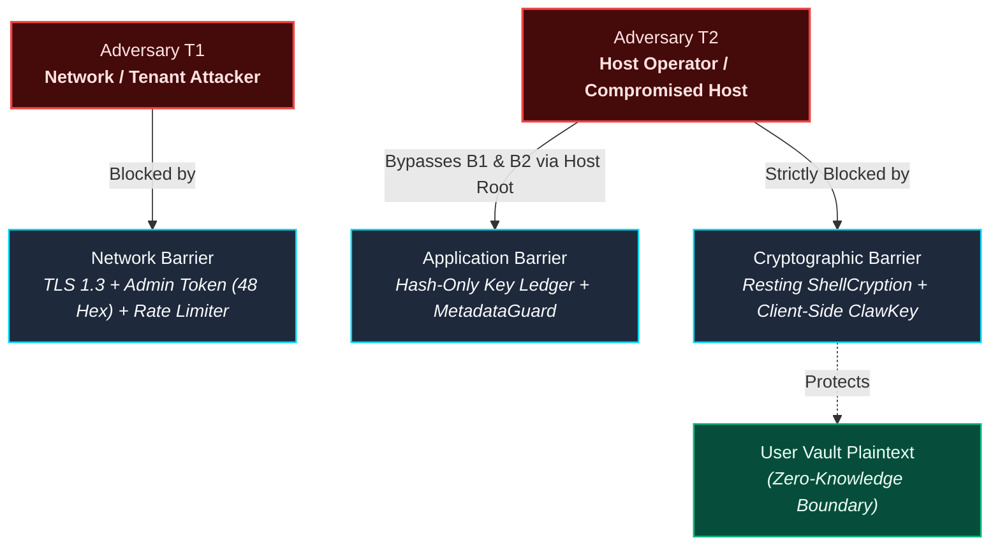

# Administrative Plane: T1 vs T2 Threat Matrix

## 1. Security Scope & Context

The ShellGuard Administrative Plane (accessible at `/superlobster`) provides host configuration, TLS certificate orchestration, storage quota monitoring, and audit log inspection.

Because ShellGuard is a zero-knowledge password and secrets manager, administrative access must **never** equate to secret decryption capability. This specification codifies the formal threat boundaries separating Network Adversaries (T1) from Compromised Host Operators (T2).

---

## 2. Adversary Profile Decomposition

### Threat Level T1: Network Adversary & Malicious Tenant
- **Attacker Capabilities**: Positioned on the local LAN or WAN; can observe cleartext traffic if TLS is disabled; can attempt brute-force attacks against HTTP endpoints; can register accounts if public signups are open.
- **Security Guarantees**:
  - Cannot access `/superlobster` without a high-entropy 48-character hex `ADMIN_TOKEN`.
  - Cannot brute-force credentials due to sliding-window rate limiters (`AUTH_RATE_LIMIT`, `API_RATE_LIMIT`).
  - Cannot forge user sessions or tamper with encrypted payloads in transit when TLS 1.3 is active.

### Threat Level T2: Compromised Host & Rogue Server Operator
- **Attacker Capabilities**: Has root access to the physical host, container filesystem, and `DATA_DIR`; can read the SQLite database (`vault.sqlite`), configuration files, and `ADMIN_TOKEN`.
- **Security Guarantees**:
  - **Zero-Knowledge Opacity**: The attacker **cannot** decrypt user passwords, secure notes, TOTP seeds, or attachments. Plaintexts are protected by **Resting ShellCryption** derived from client-held **ClawKeys** (`hu-`), which are never stored on the server.
  - **Immutable Audit Trail**: The audit log (`audit.sqlite`) is stored separately from vault data, preventing an attacker from modifying operational logs via standard administrative restore operations.
  - **No HTTP Backup Exfiltration**: The administrative interface intentionally omits HTTP database download endpoints. Backups must be accessed via local filesystem utilities (`docker cp` or file volume mounts), leaving an operating system audit trail.

---

## 3. Threat Matrix & Defense-in-Depth Breakdown

| Threat Vector | Target Component | T1 Mitigation | T2 Invariant |
|---|---|---|---|
| **Brute-Force Admin Access** | `/api/admin/*` | Constant-time token verification; IP rate-limiting. | N/A (Operator already possesses token). |
| **Database Exfiltration** | `DATA_DIR/vault.sqlite` | File system isolated inside container; not exposed via HTTP. | **Resting ShellCryption** prevents field decryption; `DB_ENCRYPTION_KEY` provides whole-DB encryption at rest. |
| **Ciphertext Swapping** | `vault_pearls` rows | Input validation on all write routes. | **Canonical AAD Binding** causes GCM authentication failure if ciphertexts are swapped across items. |
| **Public Signup Flooding** | User Registration | `DISABLE_SIGNUPS=true` lockdown; Genesis User #1 immunity prevents operator lockout. | Operator mints atomic single-use invite tokens (`inv_*`) via admin panel. |
| **Audit Log Tampering** | `audit.sqlite` | Strict append-only schema; zero-update API policy. | Separate SQLite database file; restore operations cannot overwrite audit logs. |
