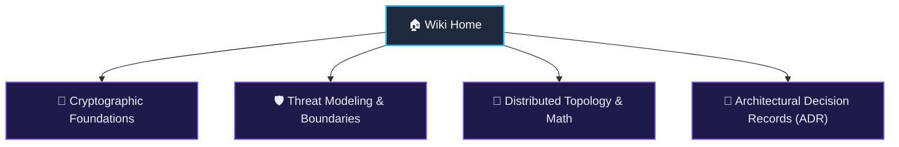

# ShellGuard Technical Wiki & Cryptographic Compendium

Welcome to the **ShellGuard Technical Wiki**. This repository hosts the formal architectural proofs, threat models, cryptographic derivations, and Architectural Decision Records (ADRs) for ShellGuard.

For user-facing deployment guides, Docker compose setups, and web vault usage, please refer to the primary documentation portal at **[clawstackstudios.github.io/ShellGuard](https://clawstackstudios.github.io/ShellGuard/)**.

---

## 📚 Compendium Structure

### 1. 🔐 Cryptographic Foundations
- **[Layer 1: Resting ShellCryption, HKDF & AAD Taxonomy](Layer-1-Resting-ShellCryption-HKDF-&-AAD-Taxonomy)**: Formal derivation of symmetric keys, AES-256-GCM authenticated envelopes, and ciphertext transplantation mitigation.
- **[Layer 2: MetadataGuard & Database Schema](Layer-2-MetadataGuard-&-SQLCipher-Bedrock)**: Multi-tenant metadata segregation, per-row disk encryption, and encrypted column storage.
- **[Memory Hygiene, Zeroization & Entropy](Zeroization-Memory-Hygiene-&-Entropy)**: Garbage collection mitigations, memory zeroization on vault lock, and entropy sources.

### 2. 🛡️ Threat Modeling & Security Boundaries
- **[Administrative Plane T1 vs T2 Threat Matrix](Administrative-Plane-T1-T2-Threat-Matrix)**: Formal security boundaries between network adversaries (T1) and compromised host operators (T2).
- **[Compromised Host Blast Radius Analysis](Compromised-Host-Blast-Radius-Analysis)**: Proof of zero-knowledge client opacity under raw filesystem compromise.

### 3. 📐 Distributed Topology & Mathematical Reconciliations
- **[Device Pairing QR Protocol Specification](Device-Pairing-QR-Protocol-Specification)**: RFC-style URI specification, ECDSA P-256 instance certificates, and self-healing rotation manifests.
- **[Vector Clock & Conflict Resolution in Offline Replication](Vector-Clock-Conflict-Resolution-in-Offline-Replication)**: Mathematical tie-breaking rules and state reconciliation.

### 4. 📜 Architectural Decision Records (ADR)
- **[ADR Directory & Index](ADR-Directory)**: Immutable decision index detailing historical architectural choices and trade-offs.

---

## 🏷️ Permitted Cryptographic Terminology

To maintain engineering clarity across implementations, ShellGuard adheres to formal functional definitions for proprietary security mechanisms:

| Term | Technical Scope | Operational Role |
|---|---|---|
| **ClawKeys** | User Identity Credential (`hu-` prefix) | User-held root secret used to derive Layer 1 encryption keys and unlock the vault. Must never be transmitted to the server in plaintext. |
| **LobsterKeys** | Agent API Tokens (`lb-` prefix) | High-entropy, hash-only agent tokens stored with constant-time verification for automated orchestration and CLI operations. |
| **HumanKeys** | Master Passphrase / Recovery Secret | Physical operator sovereignty credential used for initial root setup and recovery phrase derivation. |
| **Resting ShellCryption** | Field Encryption Protocol | Client-side AES-256-GCM encryption with SHA-256 AAD binding, ensuring all payload fields are encrypted before touching network transport or persistent storage. |
