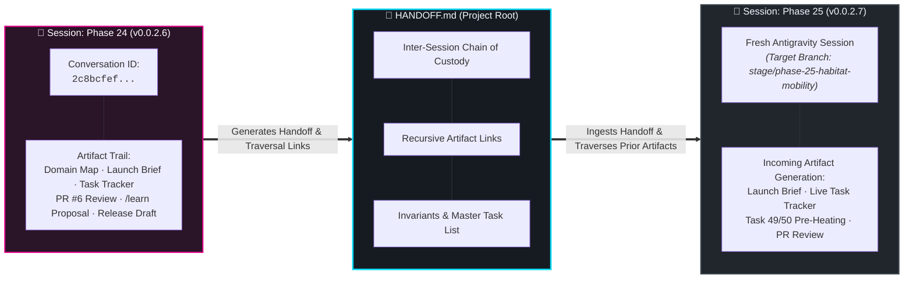
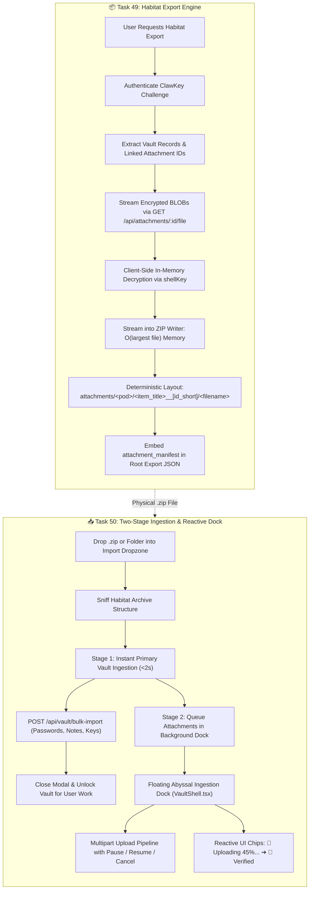

# 🦞 ShellGuard Session Handoff: Phase 24 ➔ Phase 25

> **Canonical Document**: Root `HANDOFF.md`  
> **Protocol**: Antigravity Inter-Session Chain of Custody & Recursive Artifact Trail  
> **Current Shipped Milestone**: `v0.0.2.6 (Build 28)` — Cryptographic Audit Hardening & Third-Party Auditability  
> **Incoming Milestone Target**: `v0.0.2.7 (Build 29)` — Habitat Full-Archive Mobility & Reactive Ingestion Dock  
> **Handoff Author**: Lucas (@lucas) & Antigravity (@antigravity)  
> **Timestamp**: 2026-10-18 09:55 PST  

---

## 🏛️ Executive Summary & Immediate Status

ShellGuard has shipped **Phase 24 (`v0.0.2.6 Build 28`)**. The cryptographic core has reached mathematical certainty: our pure-TypeScript WebCrypto fallback engine is unskipped and verified byte-identical against official published standards vectors (FIPS 180-4, RFC 2104, RFC 5869, NIST SP 800-38D), constant-time comparisons have been mechanized across all secret token and key paths, an automated Docs-as-Code claim battery has been introduced into our build gates, and runtime operational realities are formalized in the threat model.

The repository stands in a pristine, verified state:
- **`main` Branch**: Clean, up to date with `origin/main` at commit `bf7fee1`.
- **Release Status**: Git tag `v0.0.2.6` created and pushed; official GitHub Release published and Docker GHCR container build triggered.
- **Single Active Release Draft**: Root contains strictly `RELEASE-v0.0.2.6.md`; `RELEASE-v0.0.2.5.md` was purged.
- **Roadmap Rolling Window**: `ROADMAP.md` retains strictly the 3 most recent completed releases (Phases 22, 23, and 24); Phase 21 was retired to `.agents/brain/ROADMAP-HISTORY.md`.
- **Next Runway**: Gate 1 Master Domain Map for Phase 25 is authored and staged at `.agents/brain/2c8bcfef-ec4c-4646-ad4b-b0398a9748b9/phase-25-habitat-mobility-map.md`.



---

## 🔗 Antigravity Inter-Session Lineage & Recursive Artifact Trail

Because each stage is executed as a **fresh Antigravity chat session**, this section establishes the formal **epistemic chain of custody**. An incoming session does not guess or deduce past rationale from git commit summaries alone; it traverses the prior session's actual transcript and generated artifact trail.

### 📜 Master Session Lineage Ledger

| Stage | Version | Antigravity Conversation ID | Date | Transcript & Artifacts URI | Status |
| :--- | :--- | :--- | :--- | :--- | :--- |
| **Phase 24** | `v0.0.2.6 (Build 28)` | `2c8bcfef-ec4c-4646-ad4b-b0398a9748b9` | 2026-10-18 | [`transcript.jsonl`](file:///config/.gemini/antigravity/brain/2c8bcfef-ec4c-4646-ad4b-b0398a9748b9/.system_generated/logs/transcript.jsonl) | **Shipped & Tagged ✅** |
| **Phase 25** | `v0.0.2.7 (Build 29)` | *(Active in Next Session)* | Pending | *(To be populated upon session initialization)* | **Staged (Gate 1 Done) ⬜** |

---

### 🗃️ Immediate Predecessor Artifact Trail (Phase 24 Session: `2c8bcfef-ec4c-4646-ad4b-b0398a9748b9`)

The incoming agent can directly read any of these artifacts to inspect the exact architectural decisions, review verifications, and epistemic findings produced during the Phase 24 session:

1. **Gate 1 Master Domain Map**:  
   📄 [`phase-24-cryptographic-audit-hardening-map.md`](file:///config/.gemini/antigravity/brain/2c8bcfef-ec4c-4646-ad4b-b0398a9748b9/phase-24-cryptographic-audit-hardening-map.md)  
   *What it captures*: In-scope vs. out-of-scope boundaries, the 4 NIST/RFC standards vectors, constant-time AST AST/regex rules, and the initial third-party auditability posture.

2. **Gate 2 Jules Launch Brief**:  
   📄 [`phase-24-jules-launch-brief.md`](file:///config/.gemini/antigravity/brain/2c8bcfef-ec4c-4646-ad4b-b0398a9748b9/phase-24-jules-launch-brief.md)  
   *What it captures*: The exact dispatch instructions, security redlines, paired task definitions, and the initial authorization of the Epistemic Escape Hatch (`// TODO(uncertainty):`).

3. **Gate 2 Live Task Tracker (Living Audit Matrix)**:  
   📄 [`phase-24-task-tracker.md`](file:///config/.gemini/antigravity/brain/2c8bcfef-ec4c-4646-ad4b-b0398a9748b9/phase-24-task-tracker.md)  
   *What it captures*: 42 granular sub-task checkboxes tracking pre-flight, Jules implementation, post-review verification, and release prep. Documents that Jules completed 31 items, while 2 items (L2 Schemas vs. migrations and L6 Storage limits) were caught during reconciliation and carried forward into Phase 25.

4. **PR #6 Review & Epistemic Ratification Report**:  
   📄 [`pr_review_6_2026_10_18_1151.md`](file:///config/.gemini/antigravity/brain/2c8bcfef-ec4c-4646-ad4b-b0398a9748b9/pr_review_6_2026_10_18_1151.md)  
   *What it captures*: Complete deep-dive audit of Jules PR #6. Explains the critical ratification of Jules's `// TODO(uncertainty):` comment regarding the AES-GCM 128-bit tag vector—confirming that Node's native `crypto.createCipheriv` outputs the identical `d0d1c8a7...` tag, converting epistemic doubt into ratified platform truth.

5. **`/learn` Protocol Ratification Artifact**:  
   📄 [`learning_proposal.md`](file:///config/.gemini/antigravity/brain/2c8bcfef-ec4c-4646-ad4b-b0398a9748b9/learning_proposal.md)  
   *What it captures*: Lucas's invocation of `/learn` to codify the Post-Review Verification Stack and 4-Part Adjacency Sweep (Habitat archives, mobile TLS racing, container reboot rate-limit volatility, and OWASP vs. YAGNI calculus) directly into `.agents/rules/` and `.agents/skills/`.

6. **Phase 25 Gate 1 Territory Map (Pre-Staged in this Session)**:  
   📄 [`phase-25-habitat-mobility-map.md`](file:///config/.gemini/antigravity/brain/2c8bcfef-ec4c-4646-ad4b-b0398a9748b9/phase-25-habitat-mobility-map.md)  
   *What it captures*: Full architectural scope, stream memory boundaries ($O(\text{largest file})$), collision-proof directory layout, two-stage ingestion timeline, and OWASP Zip Slip / Zip Bomb defense matrix.

---

## 🔍 How the Incoming Session Traverses the Predecessor Session

When starting the new session for Phase 25, the incoming agent must execute this traversal sequence during orientation:

1. **Read the Prior Story & Active Context**:
   - `.agents/brain/myStory.md` (specifically the latest narrative beat: `2026-10-18 07:22 — The Mathematical Bedrock: Hardening Vectors & Rolling the Reef`).
   - `.agents/brain/activeContext.md` (verifying active decisions and the sliding window of 10 recent changes).
2. **Inspect the Predecessor Artifacts**:
   - Read [`phase-25-habitat-mobility-map.md`](file:///config/.gemini/antigravity/brain/2c8bcfef-ec4c-4646-ad4b-b0398a9748b9/phase-25-habitat-mobility-map.md) to understand the approved scope.
   - Read [`phase-24-task-tracker.md`](file:///config/.gemini/antigravity/brain/2c8bcfef-ec4c-4646-ad4b-b0398a9748b9/phase-24-task-tracker.md) § Section 3 to review the carried-forward auditor battery items (L2 & L6).
3. **If Conversational Nuance is Needed**:
   - The agent can inspect the raw transcript at:
     `/config/.gemini/antigravity/brain/2c8bcfef-ec4c-4646-ad4b-b0398a9748b9/.system_generated/logs/transcript.jsonl`
   - Search for specific discussions using grep (e.g. `grep -n "uncertainty" transcript.jsonl`).

---

## 🔁 Recursive Stage Progression (The Preceding Chain)

For broader context across the full development arc, these are the architectural baselines established across the preceding three milestones:

### 1. Phase 22 (`v0.0.2.4 Build 26`) — Reef Polish Pass & Unified Search
- **Architectural Contribution**: Replaced fragmented category searches with a high-performance unified multi-index client search engine (`searchEngine.ts`) searching across pearls, notes, and SSH keys simultaneously. Consolidated the top navigation bar into a unified command search bar with sticky keyboard ergonomics (`/` or `Ctrl+K`), tag badges, and instant item filtering.
- **The Baton Passed**: Left the search surface unified, but revealed that complex items (passwords with embedded notes, live TOTP, and attachments) still suffered from relational leakage and deletion anomalies.

### 2. Phase 23 & Sub-Stage 25.1 (`v0.0.2.5 Build 27`) — Bitwarden Item Integrity & Relational Molt
- **Architectural Contribution**: 
  - Mandatory parent linkage (`parent_id`, `parent_type`) on all attachments.
  - Non-destructive orphan quarantine with automatic cleanup sweeper.
  - Relational cascade deletion: deleting an item scrubs foreign keys while purging raw binary BLOBs from `vault_secure_attachments`.
  - Type-truthful dashboard counters: attachments decoupled from Pod item counts.
  - Pre-flight storage quota endpoint (`GET /api/attachments/quota`).
- **The Baton Passed**: Ensured backend attachment storage was pristine, but exposed that our WebCrypto fallback had carried an unverified skipped test since v0.0.1.2, and our constant-time comparison guarantees lacked mechanized CI enforcement.

### 3. Phase 24 (`v0.0.2.6 Build 28`) — Cryptographic Audit Hardening & Third-Party Auditability
- **Architectural Contribution**:
  - Standards Vector Parity: Unskipped fallback tests, achieving 100% byte-identical parity with Node native OpenSSL across SHA-256, HMAC, HKDF, and AES-GCM.
  - Constant-Time Comparison Sweep: Universal `constantTimeCompare()` eliminating timing side-channels across all auth routes.
  - Auditor's Battery: L1–L5 Docs-as-Code assertions preventing documentation drift.
  - Threat Model Addendum: Honest boundary narration for in-process limiters, LRU caches, and plain-HTTP origins.
- **The Baton Passed**: Cryptography and storage are rock solid. The next barrier is full **Archive Mobility**—packaging and unpacking the entire vault and all its binary attachments in a single portable file.

---

## 📦 The Next Horizon: Phase 25 (Stage 26)

### Phase Title: Habitat Full-Archive Mobility & Reactive Ingestion Dock
> **Target Version**: `v0.0.2.7 (Build 29)`  
> **Source**: `ROADMAP.md` Phase 25 & `project/meta-prompt-ai-studio.md` Stage 26  
> **Target Branch**: `stage/phase-25-habitat-mobility`  



### Core Deliverables:
1. **Task 49: Habitat ZIP Packaging Engine & Streamed Attachment Decryption**
   - File: `src/lib/habitatExport.ts`
   - Stream ciphertext from `GET /api/attachments/:id/file`.
   - Decrypt locally with active session `shellKey` (`vault_secure_attachments:<id>` AAD).
   - Feed files into client streaming ZIP generator (e.g. `client-zip` or `fflate`) with constant bounded RAM overhead ($O(\text{largest single file})$, never $O(\text{total archive})$).
   - Collision-proof directory structure: `attachments/<pod>/<item_title>__[<id_short>]/<file_name>` with path sanitization (`../` stripped).
   - Root manifest: Embed `attachment_manifest` in `shellguard_vault_export.json`.
   - Gated behind ClawKey verification challenge.
   - Tests: `tests/unit/habitat-export.test.ts`.

2. **Task 50: Two-Stage Ingestion Pipeline & Reactive Abyssal Ingestion Dock**
   - Files: `src/components/ImportExportView.tsx`, `src/components/VaultShell.tsx`, `src/components/ItemDetailPane.tsx`, `src/components/ItemListPane.tsx`
   - Dropzone accepts `.zip` or directory (`webkitdirectory`).
   - Stage 1: Fast unpack & `POST /api/vault/bulk-import` ($<2\text{s}$), closing the modal immediately.
   - Stage 2: Minimized floating dock in `VaultShell.tsx` streaming multipart uploads (`uploadAttachmentMultipart`) in background.
   - Ergonomics: Minimize/expand, pause, resume, cancel, per-item retry.
   - Reactive UI: In-flight attachment chips render real-time progress (`📎 Uploading 45%...`) and transition to `Verified` ready state without page reloads.
   - Safety: Window `beforeunload` warning while uploads are active.

3. **Carried Forward Auditor Battery Checks**:
   - Codify **L2** (Schema tables vs. migration files parity) and **L6** (Storage limits parity: `ATTACHMENT_MAX_MB` 500MB / `GROTTO_QUOTA_MB` 1000MB) in `tests/build-gates.test.ts`.

---

## 🛡️ Critical Invariants & Architectural Guardrails

Any incoming session MUST preserve these non-negotiable repository invariants:

> [!CAUTION]
> ### 1. Zero Heavy Builds or Tests Locally on Host
> - Host development machine resources are strictly preserved.
> - **NEVER** execute `npm test`, `npm run test:*`, `npm run build`, or `npm run docs:build` locally on this development host.
> - Execute lightweight static checks only: `npm run lint` (`tsc --noEmit`).
> - Offload all tests and builds to GitHub Actions: push to GitHub and tail via `gh run watch`. Verification is achieved ONLY when GitHub Actions exits 100% green.

> [!IMPORTANT]
> ### 2. 100% Sovereign `.agents/` Boundary
> - `.agents/` is orchestrator sovereign space. External co-pilots (Jules, Cline) are strictly forbidden from modifying `.agents/`.
> - If an external co-pilot PR touches `.agents/`, immediately discard those files using `git checkout origin/main -- .agents/` prior to merging.

> [!NOTE]
> ### 3. Zero-Knowledge Server Invariant
> - The server is a cipher-keeper, never an archivist.
> - The server NEVER receives decrypted attachment bytes or unzipped file trees. All ZIP packaging, attachment decryption, and manifest generation occur purely inside client browser memory.
> - Plaintext files never hit the server filesystem or SQLite temp tables.

> [!WARNING]
> ### 4. Bounded Memory $O(\text{largest file})$
> - Do NOT buffer the entire ZIP archive in a single JavaScript `ArrayBuffer` or `Uint8Array`.
> - A vault with 20 attachments of 200MB each will crash the browser tab with an Out-of-Memory (OOM) error if buffered simultaneously.
> - Use streaming generators (e.g. `client-zip` or `fflate`) to stream files chunk-by-chunk into the download sink.

> [!NOTE]
> ### 5. HTTP LAN Fallback Compatibility
> - `window.crypto.subtle` is strictly `undefined` on plain-HTTP LAN IP origins (e.g. Unraid servers).
> - All cryptographic operations (decryption, hashing) must route through the pure-TS fallback engine in `src/lib/webCryptoFallback.ts` when native WebCrypto is unavailable.

---

## 📋 Master Execution Plan for Incoming Session (Phase 25)

Follow the **4-Gate `prep-jules-work` Pipeline** (`.agents/skills/prep-jules-work/SKILL.md`):

### Gate 1: Scope & Territory Map
- [x] **Done in Phase 24 Session**: Authored [`phase-25-habitat-mobility-map.md`](file:///config/.gemini/antigravity/brain/2c8bcfef-ec4c-4646-ad4b-b0398a9748b9/phase-25-habitat-mobility-map.md).

### Gate 2: Operational Artifacts Generation
- [ ] Author Jules Launch Brief artifact in incoming session: `phase-25-jules-launch-brief.md`.
- [ ] Author Live Task Tracker artifact in incoming session: `phase-25-task-tracker.md`.

### Gate 3: Knowledge Pre-Heating & Escape Hatches
- [ ] Create and checkout target branch: `git checkout -b stage/phase-25-habitat-mobility`.
- [ ] Author `.jules/tasks/task-49.md` (Habitat ZIP Packaging & Decryption).
- [ ] Author `.jules/tasks/task-50.md` (Two-Stage Ingestion & Ingestion Dock).
- [ ] Pre-heat `.jules/knowledge/KNOWLEDGE.md` with attachment streaming routes, AAD format, Busboy upload contracts, and ZIP streaming patterns.
- [ ] Insert inline `// TODO(jules):` markers at target integration sites in `src/`.
- [ ] Authorize the Epistemic Escape Hatch `// TODO(uncertainty):`.

### Gate 4: Final Trigger & Dispatch
- [ ] Assemble dispatch command with strict `.jules/` discovery and `.agents/` boundary invariants.
- [ ] Present command to Lucas and await explicit execution confirmation.
- [ ] Dispatch Jules session via `jules new`.

### Post-Execution Review & Verification
- [ ] Audit Epistemic Scars (`git diff origin/main..HEAD | grep -n "TODO.*uncertainty"`).
- [ ] Reconcile PR diff against Live Task Tracker.
- [ ] Run 4-part Adjacency Sweep (OWASP vs YAGNI, storage limits, memory bounds).
- [ ] Check out sovereign `.agents/` (`git checkout HEAD -- .agents/`).
- [ ] Tail GitHub Actions CI run (`gh run watch`). Ensure 100% green pass.
- [ ] Present numbered Live Verification Checklist for physical browser testing on port 6464.

### Release Roll (`v0.0.2.7 Build 29`)
- [ ] Merge PR into `stage/phase-25-habitat-mobility`.
- [ ] Execute `/draft-release` for `v0.0.2.7 (Build 29)`:
  - [ ] Author `RELEASE-v0.0.2.7.md` and purge `RELEASE-v0.0.2.6.md`.
  - [ ] Advance `ROADMAP.md` 3-version sliding window (retire Phase 22 to `ROADMAP-HISTORY.md`).
  - [ ] Synchronize all central version anchors to `0.0.2.7`.
  - [ ] Commit with Two-Layer Attribution.
  - [ ] Merge stage into `main` with `--no-ff`.
  - [ ] Tag `v0.0.2.7` and push upstream.
  - [ ] Update `HANDOFF.md` with Phase 25 Conversation ID & Artifact Trail for Phase 26!

---

## ⚡ Quick-Start Commands for the Incoming Session

```bash
# 1. Verify Repository Health & Clean Status
git status
git log -n 3 --oneline

# 2. Create and switch to target stage branch
git checkout -b stage/phase-25-habitat-mobility
git push -u origin stage/phase-25-habitat-mobility

# 3. Check for any dangling uncertainty markers
git grep "TODO(uncertainty)"

# 4. Run local static type check (Lightweight only)
npm run lint

# 5. Tail Cloud Actions (When commits are pushed)
gh run list --limit 3
gh run watch
```

---
*End of Session Handoff Specification · ClawStack Studios Sovereign Engineering.*
