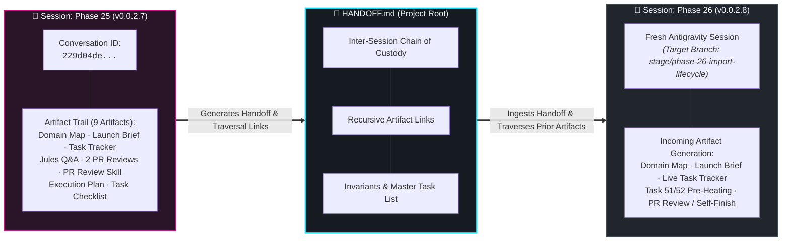
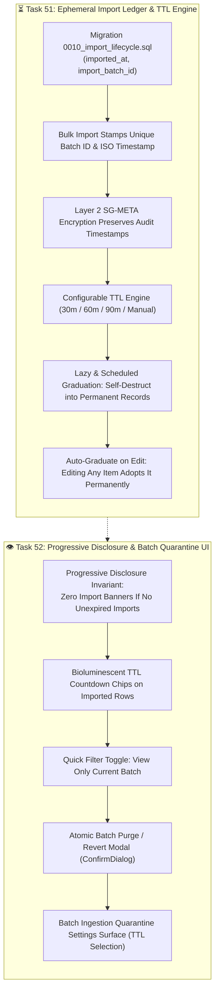

# 🦞 ShellGuard Session Handoff: Phase 25 ➔ Phase 26

> **Canonical Document**: Root `HANDOFF.md`  
> **Protocol**: Antigravity Inter-Session Chain of Custody & Recursive Artifact Trail  
> **Current Shipped Milestone**: `v0.0.2.7 (Build 29)` — Habitat Full-Archive Mobility & Reactive Ingestion Dock  
> **Incoming Milestone Target**: `v0.0.2.8 (Build 30)` — Import Lifecycle Tracking, Ephemeral Retention Window & Batch Ingestion Quarantine  
> **Handoff Author**: Lucas (@lucas) & Antigravity (@antigravity)  
> **Timestamp**: 2026-10-20 05:25 PST  

---

## 🏛️ Executive Summary & Immediate Status

ShellGuard has shipped **Phase 25 (`v0.0.2.7 Build 29`)**. Vault mobility has reached full maturity: our Habitat archive export engine streams complete encrypted vaults with linked binary attachments in an $O(\text{largest file})$ memory-bounded ZIP pipeline with deterministic, collision-proof folder hierarchies (`attachments/<pod>/<item_title>__[<id_short>]/<file_name>`), path traversal sanitization, and ClawKey challenge gate verification. The Two-Stage Ingestion Pipeline allows instant Stage 1 primary vault import ($<2\text{s}$) with 1:1 parent UUID preservation, while Stage 2 background multipart uploads stream seamlessly through the floating Reef Modernist `AbyssalIngestionDock` with reactive bioluminescent in-flight upload chips, pause/resume/cancel controls, and browser `beforeunload` safety guards. Dev server container inotify instance limits have been permanently resolved via `server.watch.usePolling: true`.

The repository stands in a pristine, verified state:
- **`main` Branch**: Clean, up to date with `origin/main` at merge commit `744eb5d`.
- **Release Status**: Git tag `v0.0.2.7` created and pushed; official GitHub Release published and Docker GHCR container build running.
- **Single Active Release Draft**: Root contains strictly `RELEASE-v0.0.2.7.md`; `RELEASE-v0.0.2.6.md` was purged.
- **Roadmap Rolling Window**: `ROADMAP.md` retains strictly the 3 most recent completed releases (Phases 23, 24, and 25); Phase 22 was retired to `.agents/brain/ROADMAP-HISTORY.md`.
- **Next Runway**: Phase 26 (Import Lifecycle Tracking, Ephemeral Retention Window & Batch Ingestion Quarantine) is queued for Gate 1 Master Domain Map authoring.



---

## 🔗 Antigravity Inter-Session Lineage & Recursive Artifact Trail

Because each stage is executed as a **fresh Antigravity chat session**, this section establishes the formal **epistemic chain of custody**. An incoming session does not guess or deduce past rationale from git commit summaries alone; it traverses the prior session's actual transcript and generated artifact trail.

### 📜 Master Session Lineage Ledger

| Stage | Version | Antigravity Conversation ID | Date | Transcript & Artifacts URI | Status |
| :--- | :--- | :--- | :--- | :--- | :--- |
| **Phase 24** | `v0.0.2.6 (Build 28)` | `2c8bcfef-ec4c-4646-ad4b-b0398a9748b9` | 2026-10-18 | [`transcript.jsonl`](file:///config/.gemini/antigravity/brain/2c8bcfef-ec4c-4646-ad4b-b0398a9748b9/.system_generated/logs/transcript.jsonl) | **Shipped & Tagged ✅** |
| **Phase 25** | `v0.0.2.7 (Build 29)` | `229d04de-e3e4-4956-8b25-22f3d6a48c93` | 2026-10-20 | [`transcript.jsonl`](file:///config/.gemini/antigravity/brain/229d04de-e3e4-4956-8b25-22f3d6a48c93/.system_generated/logs/transcript.jsonl) | **Shipped & Tagged ✅** |
| **Phase 26** | `v0.0.2.8 (Build 30)` | *(Active in Next Session)* | Pending | *(To be populated upon session initialization)* | **Queued ⬜** |

---

### 🗃️ Immediate Predecessor Artifact Trail (Phase 25 Session: `229d04de-e3e4-4956-8b25-22f3d6a48c93`)

The incoming agent can directly read any of these artifacts to inspect the exact architectural decisions, review verifications, and epistemic findings produced during the Phase 25 session:

1. **Gate 1 Master Domain Map**:  
   📄 [`phase-25-habitat-mobility-map.md`](file:///config/.gemini/antigravity/brain/229d04de-e3e4-4956-8b25-22f3d6a48c93/phase-25-habitat-mobility-map.md)  
   *What it captures*: Full architectural scope, stream memory boundaries ($O(\text{largest file})$), collision-proof directory layout, two-stage ingestion timeline, and OWASP Zip Slip / Zip Bomb defense matrix.

2. **Gate 2 Jules Launch Brief**:  
   📄 [`phase-25-jules-launch-brief.md`](file:///config/.gemini/antigravity/brain/229d04de-e3e4-4956-8b25-22f3d6a48c93/phase-25-jules-launch-brief.md)  
   *What it captures*: The exact dispatch instructions, security redlines, paired task definitions, and authorization of the Epistemic Escape Hatch (`// TODO(uncertainty):`).

3. **Gate 2 Live Task Tracker (Living Audit Matrix)**:  
   📄 [`phase-25-task-tracker.md`](file:///config/.gemini/antigravity/brain/229d04de-e3e4-4956-8b25-22f3d6a48c93/phase-25-task-tracker.md)  
   *What it captures*: Comprehensive tracking across Pre-Flight, PR #7 Review, Follow-Up Evaluation, Orchestrator Self-Finish (Tasks 49 & 50), Cloud CI runs (`#39203270400`, `#39420991967`), and Release Roll.

4. **Jules Mid-Flight Response Artifact**:  
   📄 [`phase-25-jules-response-artifact.md`](file:///config/.gemini/antigravity/brain/229d04de-e3e4-4956-8b25-22f3d6a48c93/phase-25-jules-response-artifact.md)  
   *What it captures*: Direct mid-flight guidance answering Jules's questions on UI components, test strategy, and streaming architecture.

5. **PR #7 Review 1 (Initial Review)**:  
   📄 [`pr_review_7_2026_10_19_0020.md`](file:///config/.gemini/antigravity/brain/229d04de-e3e4-4956-8b25-22f3d6a48c93/pr_review_7_2026_10_19_0020.md)  
   *What it captures*: Initial deep-dive audit of PR #7 detecting omitted application code (`habitatExport.ts`, `habitatImport.ts`, UI wiring). Verdict: REFINE-AND-RE-PR.

6. **PR #7 Review 2 (Follow-up Review)**:  
   📄 [`pr_review_7_2026_10_19_0330.md`](file:///config/.gemini/antigravity/brain/229d04de-e3e4-4956-8b25-22f3d6a48c93/pr_review_7_2026_10_19_0330.md)  
   *What it captures*: Audit of follow-up commit `de3cd54`. Confirmed valid documentation and L2/L6 test gates, but noted application files remained untracked, leading to the orchestrator self-finish directive.

7. **Socratic PR Review Skill Codification**:  
   📄 [`learning-socratic-pr-review-skill.md`](file:///config/.gemini/antigravity/brain/229d04de-e3e4-4956-8b25-22f3d6a48c93/learning-socratic-pr-review-skill.md)  
   *What it captures*: Codification of "The Socratic Invariable" in `.agents/skills/git-review-pr/SKILL.md` for co-pilot review feedback.

8. **Orchestrator Execution Plan**:  
   📄 [`phase-25-orchestrator-execution-plan.md`](file:///config/.gemini/antigravity/brain/229d04de-e3e4-4956-8b25-22f3d6a48c93/phase-25-orchestrator-execution-plan.md)  
   *What it captures*: The 6-phase finishing plan executed by the orchestrator to author `habitatExport.ts`, `habitatImport.ts`, UI components, and test suites.

9. **Orchestrator Task Checklist**:  
   📄 [`phase-25-orchestrator-task-checklist.md`](file:///config/.gemini/antigravity/brain/229d04de-e3e4-4956-8b25-22f3d6a48c93/phase-25-orchestrator-task-checklist.md)  
   *What it captures*: Granular verification checkpoints across all 6 execution phases, container inotify diagnosis, and final release release gates.

---

## 🔍 How the Incoming Session Traverses the Predecessor Session

When starting the new session for Phase 26, the incoming agent must execute this traversal sequence during orientation:

1. **Read the Prior Story & Active Context**:
   - `.agents/brain/myStory.md` (specifically narrative beats from Phase 25).
   - `.agents/brain/activeContext.md` (verifying active decisions and the sliding window of 10 recent changes).
2. **Inspect the Predecessor Artifacts**:
   - Read [`phase-25-task-tracker.md`](file:///config/.gemini/antigravity/brain/229d04de-e3e4-4956-8b25-22f3d6a48c93/phase-25-task-tracker.md) to review completed milestones and verification logs.
   - Read [`ROADMAP.md`](file:///config/Local-Storage/workspace-lucas/projects/Agents/ShellGuard/ROADMAP.md) § Phase 26 to inspect the target deliverables for Tasks 51 and 52.
3. **If Conversational Nuance is Needed**:
   - The agent can inspect the raw transcript at:
     `/config/.gemini/antigravity/brain/229d04de-e3e4-4956-8b25-22f3d6a48c93/.system_generated/logs/transcript.jsonl`
   - Search for specific discussions using grep (e.g. `grep -n "inotify" transcript.jsonl`).

---

## 🔁 Recursive Stage Progression (The Preceding Chain)

For broader context across the full development arc, these are the architectural baselines established across the preceding three milestones:

### 1. Phase 23 & Sub-Stage 25.1 (`v0.0.2.5 Build 27`) — Bitwarden Item Integrity & Relational Molt
- **Architectural Contribution**: Mandatory parent linkage (`parent_id`, `parent_type`) on all attachments; non-destructive orphan quarantine with automatic cleanup sweeper; relational cascade deletion; type-truthful dashboard counters (attachments decoupled from Pod item counts); pre-flight storage quota endpoint (`GET /api/attachments/quota`).
- **The Baton Passed**: Ensured backend attachment storage was pristine, but exposed that fallback tests and constant-time comparison guarantees needed formalization.

### 2. Phase 24 (`v0.0.2.6 Build 28`) — Cryptographic Audit Hardening & Third-Party Auditability
- **Architectural Contribution**: Standards Vector Parity achieving 100% byte-identical parity with Node native OpenSSL across SHA-256, HMAC, HKDF, and AES-GCM; universal `constantTimeCompare()` eliminating timing side-channels; Auditor's Battery L1–L5 Docs-as-Code assertions; honest threat model addendum.
- **The Baton Passed**: Cryptography and storage were rock-solid. The next frontier was full **Archive Mobility**—packaging and unpacking the entire vault and all its binary attachments in a single portable file.

### 3. Phase 25 (`v0.0.2.7 Build 29`) — Habitat Full-Archive Mobility & Reactive Ingestion Dock
- **Architectural Contribution**:
  - Memory-Bounded Streaming ZIP Packaging (`habitatExport.ts`): $O(\text{largest single file})$ RAM overhead using `client-zip` and `fflate`.
  - Deterministic Collision-Proof Layout: `attachments/<pod>/<item_title>__[<id_short>]/<file_name>` with path traversal sanitization and ClawKey verification challenge.
  - Two-Stage Ingestion Pipeline (`habitatImport.ts`): Instant Stage 1 manifest ingestion ($<2\text{s}$) with 1:1 parent item UUID preservation.
  - Floating Reef Modernist `AbyssalIngestionDock`: Background sequential multipart uploads, pause/resume/cancel controls, reactive in-flight chips, and `beforeunload` safety guard.
  - Dev Server Container Fix: `server.watch.usePolling: true` in `vite.config.ts` eliminating container inotify instance crashes.
- **The Baton Passed**: Habitat mobility is complete. The next critical need is **Import Lifecycle Tracking**—solving import remorse and batch isolation with ephemeral quarantine windows and auto-graduation.

---

## 📦 The Next Horizon: Phase 26 (Stage 27)

### Phase Title: Import Lifecycle Tracking, Ephemeral Retention Window & Batch Ingestion Quarantine
> **Target Version**: `v0.0.2.8 (Build 30)`  
> **Source**: `ROADMAP.md` Phase 26  
> **Target Branch**: `stage/phase-26-import-lifecycle`  



### Core Deliverables:
1. **Task 51: [Functionality] Ephemeral Import Ledger, Time-to-Live (TTL) Engine & Multi-Batch Tracking**
   - Migration `0010_import_lifecycle.{up,down}.sql`: add `imported_at TEXT` and `import_batch_id TEXT` across `vault_pearls`, `vault_secure_notes`, and `vault_ssh_keys`.
   - Update `POST /api/vault/bulk-import` to generate atomic `import_batch_id` and stamp `imported_at`.
   - Implement TTL expiration, auto-graduation on edit, and atomic batch rollback.
   - Unit tests: `tests/unit/import-lifecycle.test.ts`.

2. **Task 52: [UI / Interactive] Progressive Disclosure Banners, Bioluminescent TTL Chips, Batch Actions & Revert Modal**
   - Progressive disclosure: zero imported UI elements unless unexpired imported items exist.
   - Bioluminescent countdown chips, quick filter toggles, batch revert modal (`ConfirmDialog`), and configuration settings in Settings view.
   - Component tests & integration tests.

---

## 🛡️ Critical Invariants & Architectural Guardrails

Any incoming session MUST preserve these non-negotiable repository invariants:

> [!CAUTION]
> ### 1. Zero Heavy Builds or Tests Locally on Host
> - Host development machine resources are strictly preserved.
> - **NEVER** execute `npm test`, `npm run test:*`, `npm run build`, or `npm run docs:build` locally on this development host.
> - Execute lightweight static checks only: `npm run lint` (`tsc --noEmit`).
> - Offload all tests and builds to GitHub Actions: push to GitHub and tail via `gh run watch`. Verification is achieved ONLY when GitHub Actions exits 100% green.

> [!IMPORTANT]
> ### 2. 100% Sovereign `.agents/` Boundary
> - `.agents/` is orchestrator sovereign space. External co-pilots (Jules, Cline) are strictly forbidden from modifying `.agents/`.
> - If an external co-pilot PR touches `.agents/`, immediately discard those files using `git checkout origin/main -- .agents/` prior to merging.

> [!NOTE]
> ### 3. Progressive Disclosure Invariant
> - The UI must remain completely quiet and visually clean if no imported items are in active quarantine.
> - Never render persistent empty state banners or zero-count chips for import retention when no imports exist.

> [!WARNING]
> ### 4. Dev Server Polling Invariant
> - Container environments on this host have strict inotify instance limits (`max_user_instances = 128`).
> - Maintain `server.watch.usePolling: true` (1s interval) in `vite.config.ts` to prevent `EMFILE: too many open files` crashes.

> [!NOTE]
> ### 5. HTTP LAN Fallback Compatibility
> - `window.crypto.subtle` is strictly `undefined` on plain-HTTP LAN IP origins (e.g. Unraid servers).
> - All cryptographic operations (decryption, hashing) must route through the pure-TS fallback engine in `src/lib/webCryptoFallback.ts` when native WebCrypto is unavailable.

---

## 📋 Master Execution Plan for Incoming Session (Phase 26)

Follow the **4-Gate `prep-jules-work` Pipeline** (`.agents/skills/prep-jules-work/SKILL.md`):

### Gate 1: Scope & Territory Map
- [ ] Author Master Domain Map artifact: `phase-26-import-lifecycle-map.md`.

### Gate 2: Operational Artifacts Generation
- [ ] Author Jules Launch Brief artifact: `phase-26-jules-launch-brief.md`.
- [ ] Author Live Task Tracker artifact: `phase-26-task-tracker.md`.

### Gate 3: Knowledge Pre-Heating & Escape Hatches
- [ ] Create and checkout target branch: `git checkout -b stage/phase-26-import-lifecycle`.
- [ ] Author `.jules/tasks/task-51.md` (Import Ledger & TTL Engine).
- [ ] Author `.jules/tasks/task-52.md` (Progressive Disclosure & Quarantine UI).
- [ ] Pre-heat `.jules/knowledge/KNOWLEDGE.md` with schema contracts, migration rules, and progressive disclosure patterns.
- [ ] Insert inline `// TODO(jules):` markers at target integration sites in `src/`.
- [ ] Authorize the Epistemic Escape Hatch `// TODO(uncertainty):`.

### Gate 4: Final Trigger & Dispatch
- [ ] Assemble dispatch command with strict `.jules/` discovery and `.agents/` boundary invariants.
- [ ] Present command to Lucas and await explicit execution confirmation.
- [ ] Dispatch Jules session via `jules new`.

### Post-Execution Review & Verification
- [ ] Audit Epistemic Scars (`git diff origin/main..HEAD | grep -n "TODO.*uncertainty"`).
- [ ] Reconcile PR diff against Live Task Tracker.
- [ ] Run 4-part Adjacency Sweep.
- [ ] Check out sovereign `.agents/` (`git checkout HEAD -- .agents/`).
- [ ] Tail GitHub Actions CI run (`gh run watch`). Ensure 100% green pass.
- [ ] Present numbered Live Verification Checklist for physical browser testing on port 6464.

### Release Roll (`v0.0.2.8 Build 30`)
- [ ] Merge PR into `stage/phase-26-import-lifecycle`.
- [ ] Execute `/draft-release` for `v0.0.2.8 (Build 30)`:
  - [ ] Author `RELEASE-v0.0.2.8.md` and purge `RELEASE-v0.0.2.7.md`.
  - [ ] Advance `ROADMAP.md` 3-version sliding window (retire Phase 23 to `ROADMAP-HISTORY.md`).
  - [ ] Synchronize all central version anchors to `0.0.2.8`.
  - [ ] Commit with Two-Layer Attribution.
  - [ ] Merge stage into `main` with `--no-ff`.
  - [ ] Tag `v0.0.2.8` and push upstream.
  - [ ] Update `HANDOFF.md` with Phase 26 Conversation ID & Artifact Trail for Phase 27!

---

## ⚡ Quick-Start Commands for the Incoming Session

```bash
# 1. Verify Repository Health & Clean Status
git status
git log -n 3 --oneline

# 2. Create and switch to target stage branch
git checkout -b stage/phase-26-import-lifecycle
git push -u origin stage/phase-26-import-lifecycle

# 3. Check for any dangling uncertainty markers
git grep "TODO(uncertainty)"

# 4. Run local static type check (Lightweight only)
npm run lint

# 5. Tail Cloud Actions (When commits are pushed)
gh run list --limit 5
gh run watch
```

---
*End of Session Handoff Specification · ClawStack Studios Sovereign Engineering.*
