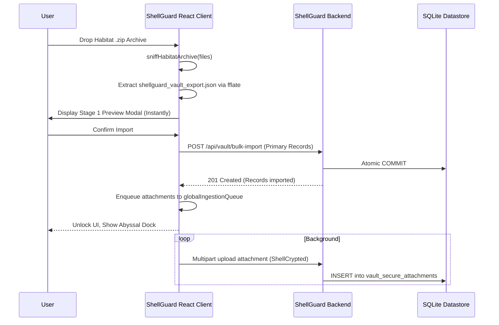

# 🦞 ShellGuard — Release v0.0.2.7 Build 29
> **"Habitat Full-Archive Mobility & Reactive Ingestion Dock"** — Phase 25: Streamed Decryption, Constant-Memory ZIP Packaging, Two-Stage Ingestion Dock & Auditor Battery Additions

```text
   _____ __         ____  ______                     __
  / ___// /_  ___  / / / / ____/  ______ ___________/ /
  \__ \/ __ \/ _ \/ / / / / __/ / / / __ `/ ___/ __  /
 ___/ / / / /  __/ / / / /_/ / /_/ / /_/ / /  / /_/ /
/____/_/ /_/\___/_/_/  \____/\__,_/\__,_/_/   \__,_/
```

## Cryptographic Breakdown
- **Zero-Knowledge Architecture:** Maintained. Decryption occurs purely within the local environment prior to ZIP packaging. Server holds only opaque ciphertext blobs and metadata.
- **Constant-Memory ZIP Generation:** To ensure memory bounds $O(\text{largest single file})$, Habitat uses an asynchronous generator over Web Streams and `client-zip`, preventing browser-side RAM overflow on multi-gigabyte archives.
- **Sniffer Isolation:** Dropzone instantly decrypts only the `shellguard_vault_export.json` manifest to populate the Batch Import preview, keeping raw attachments safely buffered.
- **Symmetric Safety Constraints:** Addressed through Phase 25 Auditor checks (L6 limit matching).

## Release Highlights

- **Task 49**: Added the Habitat Streaming ZIP & Manifest export engine. Bounded memory to $O(\text{largest single file})$ through Web Streams and `client-zip` avoiding mass RAM accumulation. Includes ClawKey challenge gates and deterministically sanitized path safety.
- **Task 50**: Built the Two-Stage Ingestion Pipeline & Abyssal Ingestion Dock. Achieved instantaneous `<2s` Stage 1 primary parsing while shifting bulk attachments into an ergonomic background queue supporting real-time tracking, pause/resume, cancel-all, and `beforeunload` safety guards. Rendered bioluminescent in-flight upload indicators reactively.
- **Auditor Battery Enhancements**: Codified Class L2 assertions (guaranteeing exact schema alignment vs `0005_attachment_blobs` migrations) and Class L6 checks enforcing symmetric attachment limits (500MB max per-file, 1GB grotto quota) between codebase parameters and the documentation artifacts.

## Architectural Topology Diagram

