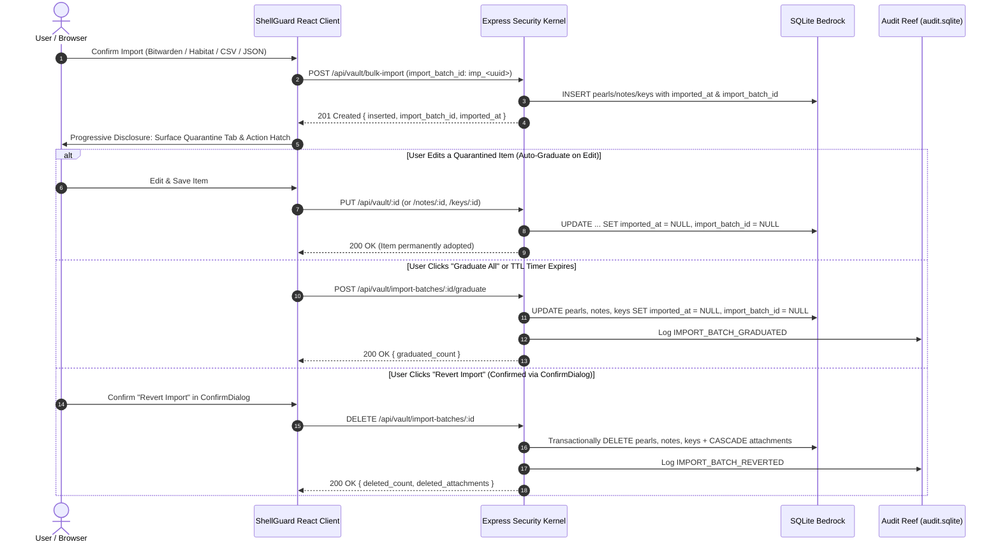

# 🦞 ShellGuard — Release v0.0.2.8 (Build 30)
> **"Import Lifecycle Tracking, Ephemeral Quarantine & Progressive Disclosure"** — Phase 26: Ephemeral Import Ledger, Time-To-Live (TTL) Self-Destruct, Auto-Graduation on Edit, Atomic Batch Rollback & Reef Modernist Config Surface

```text
███████╗██╗   ██╗███████╗ ██╗     ██╗        ██████╗    ██╗   ██╗   █████╗    ██████╗    ██████╗ 
██╔════╝██║   ██║██╔════╝ ██║     ██║        ██╔═══╝    ██║   ██║  ██╔══██╗  ██╔══██╗    ██╔═══██╗
███████╗███████║ █████╗   ██║     ██║        ██║ ███╗   ██║   ██║  ███████║  ██████╔╝    ██║   ██║
╚════██║██╔══██║██╔══╝   ██║     ██║        ██║  ██║   ██║   ██║  ██╔══██║  ██╔══██╗    ██║   ██║
███████║██║   ██║███████╗ ███████╗███████╗   ╚██████╝   ╚██████╝   ██║  ██║  ██║   ██║   ██████╔╝
╚══════╝╚═╝   ╚═╝╚══════╝ ╚══════╝╚══════╝    ╚═════╝    ╚═════╝   ╚═╝  ╚═╝  ╚═╝   ╚═╝   ╚═════╝ 
                                              ~ **ClawStack Studios©™** ~
```

---

## 🚀 The Core Summary

Welcome to **v0.0.2.8 (Build 30)** of **ShellGuard**! This milestone completes **Phase 26 (Stage 27)**, introducing a comprehensive **Import Lifecycle Tracking & Ephemeral Quarantine Engine** across all vault record types (`vault_pearls`, `vault_secure_notes`, and `vault_ssh_keys`).

Bulk credential imports—whether from Bitwarden archives, Habitat ZIPs, or ShellGuard-TOTP companion backups—no longer pollute your permanent vault silently. Every ingestion event now stamps incoming records with a unique batch fingerprint (`imp_<uuid>`) and ISO-8601 timestamp (`imported_at`). Governed by a configurable **Time-To-Live (TTL) Retention Window** (`30m`, `60m`, `90m`, or `Manual / Never`), imported records reside in an ephemeral quarantine that automatically graduates into permanent vault records upon timer expiry or when edited (**Auto-Graduate on Edit**). While quarantined, users can filter by batch, inspect remaining countdowns, graduate individual items or entire batches, or execute a one-click **Atomic Batch Rollback** that purges all batch records and cascades linked attachments in a single SQLite transaction.

Furthermore, this release adheres to strict **Progressive Disclosure**: when zero active imported records exist in the vault, all quarantine filters, banners, and action bars remain 100% invisible.

---

## 💎 Key Themes & Highlights

### 🗄️ 1. Ephemeral Import Ledger & Migration 0010 (Task 51)
- **Database Migration (`migrations/0010_import_lifecycle.{up,down}.sql`)**: Adds `imported_at TEXT DEFAULT NULL` and `import_batch_id TEXT DEFAULT NULL` along with composite B-Tree indices (`idx_pearls_import_batch`, `idx_notes_import_batch`, `idx_keys_import_batch`) across `vault_pearls`, `vault_secure_notes`, and `vault_ssh_keys`.
- **Relational Query Integrity**: `imported_at` and `import_batch_id` are deliberately excluded from Layer 2 `METADATA_COLUMNS` (`src/server/utils/metadataGuard.ts`) so SQLite indices can execute $O(\log N)$ batch lookups while all sensitive fields remain zero-knowledge encrypted.
- **Atomic Batch Fingerprinting**: `POST /api/vault/bulk-import` generates a shared `imp_<uuid>` batch identifier (or honors a client-supplied `import_batch_id` so multi-domain imports unifying logins, notes, and SSH keys share a single batch identity) and returns `{ inserted, errors, import_batch_id, imported_at }`.

### ⚡ 2. Auto-Graduation on Edit & Batch Operations API (Task 51)
- **Auto-Graduate on Edit (`PUT /api/vault/:id`, `PUT /api/notes/:id`, `PUT /api/keys/:id`)**: Modifying any quarantined record automatically resets `imported_at = NULL` and `import_batch_id = NULL` (unless `keep_quarantine: true` is explicitly passed when the user disables auto-graduation in Config settings).
- **Mass Batch Graduation (`POST /api/vault/import-batches/:id/graduate`)**: Promotes all records matching `import_batch_id = :id` across pearls, notes, and SSH keys to permanent status in one atomic transaction (`{ graduated_count }`) and logs `IMPORT_BATCH_GRADUATED` to `audit.sqlite`.
- **Atomic Batch Rollback (`DELETE /api/vault/import-batches/:id`)**: Purges all records matching `import_batch_id = :id` across all three domain tables, cascades deletion to all linked child rows in `vault_secure_attachments`, and records `IMPORT_BATCH_REVERTED` in `audit.sqlite` (`{ deleted_count, deleted_attachments }`).

### 🎛️ 3. Progressive Disclosure & Reef Modernist Config Surface (Task 52)
- **Zero-Clutter Progressive Disclosure Invariant**: When no unexpired imported items exist in state, the vault UI renders **zero** quarantine filter tabs, countdown chips, or floating batch bars.
- **Dedicated "Config" Settings Tab (`src/components/Settings/ConfigSettingsView.tsx`)**: Accessible from the Settings sidebar, providing a Reef Modernist segmented button selector for the **Import Retention Window** (`30 Mins`, `60 Mins`, `90 Mins`, `Manual (Never)`) and an **Auto-Graduate on Edit** toggle, synced via `/api/settings/import_lifecycle` and mirrored to `localStorage`.
- **Client-Side Lazy TTL Sweeper**: `App.tsx` evaluates active batch timestamps every 15 seconds against the configured retention window, automatically graduating expired batches without interrupting the user's workflow.

### 🌊 4. Bioluminescent Quarantine UI & Post-Import Action Hatch (Task 52)
- **Dynamic Quarantine Filter Tab (`src/components/Vault/ItemListPane.tsx`)**: Appears automatically when quarantined items are present, displaying active item counts and live TTL countdowns (`⏳ Quarantine (12) • 58m left`) alongside pulsing amber row badges (`⏳ 58m`) with inline one-click **Graduate (`✓`)** and **Delete (`🗑️`)** actions.
- **Centered Floating Batch Bar (`src/components/Vault/VaultShell.tsx`)**: Positioned at `bottom-6 left-1/2 -translate-x-1/2 z-40` so it never collides with the bottom-right `AbyssalIngestionDock`, offering instant **Graduate All** and **Revert Import** actions.
- **Post-Import Action Hatch (`src/components/Settings/ImportExportView.tsx`)**: Immediately after completing an import, displays an interactive quarantine summary card with **Review Items**, **Graduate All**, and **Revert Import** (guarded by the Reef Modernist `ConfirmDialog`).

---

## 🏗️ Architectural Topology Map

```text
┌─────────────────────────────────────────────────────────────────────────┐
│                     🌐 ShellGuard Web Client                            │
│  ┌───────────────────────────────────────────────────────────────────┐  │
│  │   ImportExportView / Two-Stage Ingestion                          │  │
│  │   Generates shared batchId (imp_<uuid>) across Pearls/Notes/Keys  │  │
│  └──────────────────┬────────────────────────────────┬───────────────┘  │
│                     │ Bulk Import                    │ Active Quarantine│
│                     ▼                                ▼                  │
│  ┌───────────────────────────────────┐  ┌────────────────────────────┐  │
│  │   POST /api/vault/bulk-import     │  │   Progressive Disclosure   │  │
│  │   Stamps imported_at & batch_id   │  │   Filter Tab + Batch Bar   │  │
│  └──────────────────┬────────────────┘  └────────────┬───────────────┘  │
└─────────────────────┼────────────────────────────────┼──────────────────┘
                      │                                │ Graduate / Revert
                      ▼                                ▼
┌─────────────────────────────────────────────────────────────────────────┐
│              🔌 Express 5 Security Kernel & SQLite Bedrock              │
│  ┌───────────────────────────────────┐  ┌────────────────────────────┐  │
│  │   Migration 0010 Indices          │  │   Atomic Batch Rollback    │  │
│  │   idx_*_import_batch (3 tables)   │  │   Cascades Attachments     │  │
│  └───────────────────────────────────┘  └────────────────────────────┘  │
└─────────────────────────────────────────────────────────────────────────┘
```

### Sequence Flow: Ephemeral Import Quarantine, Auto-Graduation & Atomic Rollback



---

## 🔐 Cryptographic & Relational Invariants

| Dimension | Implementation | Verification & Security Guarantee |
|:---|:---|:---|
| **Zero-Knowledge Preservation** | Layer 1 ShellCryption (`AES-GCM-256`) | Import lifecycle operations only mutate relational metadata (`imported_at`, `import_batch_id`) and never inspect or re-key ciphertext blobs. |
| **Indexed Batch Performance** | Unencrypted relational columns + B-Tree indices | `idx_pearls_import_batch`, `idx_notes_import_batch`, and `idx_keys_import_batch` guarantee instantaneous batch graduation and rollback without full-table decryption scans. |
| **Attachment Cascade Integrity** | Transactional child purge on batch revert | `DELETE /api/vault/import-batches/:id` parses `attachments` JSON arrays across pearls and notes and purges linked `vault_secure_attachments` rows atomically. |
| **Permission Enforcement** | `requirePermission('canEdit')` / `('canDelete')` | Batch graduation requires `canEdit`; batch rollback requires `canDelete`; read-only `lb-` agent keys are rejected with `403 Forbidden`. |
| **Progressive Disclosure** | Conditional React state derivation | Zero quarantine UI elements mount when `quarantinedItems.length === 0`. |

---

## 🧪 Verification & Test Oracle Summary

All test suites execute sequentially with 100% green status across both local harnesses and GitHub Actions cloud runners:

- **Total Test Suites**: `32 suites` (sequential execution via `fileParallelism: false`)
- **Total Test Cases**: `391 passing assertions`
- **Cloud CI Pipeline**: Runs `#40132168133` (`Pull Request Check 🧪`) and `#40132134978` (`Continuous Integration 🧪`) passed 100% green on `stage/phase-26-import-lifecycle` (PR #10).
- **Targeted Suite**: `tests/vault-imported-tracking.test.ts` (16 integration tests) verified batch stamping, cross-type parity (`vault_pearls`, `vault_secure_notes`, `vault_ssh_keys`), auto-graduation on edit, `keep_quarantine` override, mass batch graduation, transactional batch revert with attachment cascade, cross-owner tenant isolation, and `lb-` agent key permission enforcement.

```bash
# Automated Cloud CI Verification Run
Run ID: 40132168133
Branch: stage/phase-26-import-lifecycle (PR #10)
Workflow: Pull Request Check 🧪 / Continuous Integration 🧪
Verdict: 100% Green (Lint, Vitest 32 Suites / 391 Tests, Vite Build, Docs:Build)
```

---

## 🚀 Migration & Deployment Guide

This release is **100% non-breaking** and automatically migrates existing ShellGuard deployments on startup:

1. **Database Schema (`0010_import_lifecycle.up.sql`)**: Automatically applied by `migrationRunner.ts` on server boot. Existing records default to `imported_at = NULL` and `import_batch_id = NULL` (permanently graduated).
2. **Environment Variables**: No changes required to `.env`.
3. **Container Update**: Pull the latest image or rebuild with `docker compose up -d --build`.

---

## 📜 Ledger of Commits (Phase 26)

```text
779ef0a feat(vault): implement import lifecycle tracking and ephemeral quarantine
10a06fa docs(mobile): add comprehensive mobile application documentation suite
```

---

<div align="center">

```
    Built with 🛡️ by ClawStack Studios©™
    Exoskeletal Protection for Human + Agent Secrets
```

</div>
