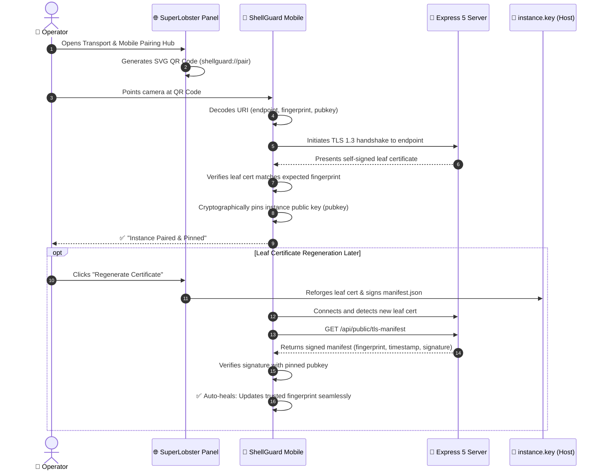

# 📱 The Reef Handshake & Visual Mobile Pairing

<CopyPage />

Pairing a mobile device to a self-hosted secrets vault on a local network shouldn't require squinting at long IP addresses, ports, or 64-character SHA-256 certificate hashes.

**The Reef Handshake** is ShellGuard's visual onboarding protocol. It converts mobile onboarding into a single camera scan that establishes a cryptographically pinned, auto-healing TLS connection between **ShellGuard Mobile** (or **ShellGuard-TOTP**) and your server.



---

## ⚡ How It Works

From the SuperLobster control panel, navigating to **Transport & Mobile Pairing** reveals the active **Reef Handshake QR Card**:

1. Open **ShellGuard Mobile** on your Android or iOS device.
2. Tap **Pair with Reef (Scan QR)**.
3. Align the camera with the on-screen QR code in SuperLobster.
4. The client decodes the `shellguard://pair` URI, executes a cryptographic probe, pins the server identity, and opens the gateway.

---

## 📐 The `shellguard://pair` URI Schema

The visual QR code encodes a standard custom-scheme URI containing all parameters required for secure transport bootstrapping:

```
shellguard://pair?endpoint=https%3A%2F%2F192.168.1.50%3A6565&fingerprint=80%3ABF%3A34%3AC8%3A32%3A94%3A...&pubkey=04a98b8d69e39153dd204147837126950c7694f5ea24022ff0cb0cdae6c23fccd984922aea90fd55c6105c3afd08feb4bf62f21fb530c39432568f0d67bf2c3e9c
```

| Query Parameter | Format | Purpose |
|:---|:---|:---|
| **`endpoint`** | Fully Qualified URL | The primary HTTPS address and port of the ShellGuard server on the local network (e.g. `https://192.168.1.50:6565`). |
| **`fingerprint`** | Colon-delimited Hex | The SHA-256 fingerprint of the server's current self-signed leaf certificate. Used for initial Trust on First Use (TOFU) verification. |
| **`pubkey`** | 130-char Hex String | The uncompressed EC P-256 public key of the server's immutable **Instance Identity Anchor** (`DATA_DIR/instance.key`). |

---

## 🛡️ Cryptographic Identity Pinning

Traditional web browsers rely on trusted Certificate Authorities (CAs). On a local homelab without a public domain name, self-signed certificates are necessary, but naive implementations leave users vulnerable to Man-in-the-Middle (MITM) attacks if an attacker intercepts local ARP traffic.

The Reef Handshake solves this through **Instance Identity Pinning**:
1. During the handshake, the mobile app does **not** simply pin the leaf certificate (which is ephemeral and may expire or rotate).
2. Instead, it extracts and permanently stores the server's `pubkey` (the public half of `DATA_DIR/instance.key`).
3. All subsequent connections require either the pinned certificate fingerprint or a cryptographic signature verified by this pinned public key.
4. An attacker cannot impersonate the server without stealing `DATA_DIR/instance.key` (protected by file mode `0o600` on the server).

---

## 🔄 Auto-Healing Trust (Signed Rotation Manifests)

When an administrator regenerates a TLS certificate—whether to add new IP SANs or refresh an expiring cert—existing mobile clients would normally break and throw SSL handshake errors.

ShellGuard eliminates this friction with **Auto-Healing Trust**:
1. Upon certificate regeneration, the server signs a new rotation manifest (`manifest.json`):
   $$\text{Signature} = \text{ECDSA-Sign}_{K_{\text{instance}}}(\text{certFingerprint} \parallel \text{timestamp})$$
2. When the mobile app next connects, it detects that the server's leaf certificate has changed.
3. Instead of immediately aborting, the mobile client fetches `GET /api/public/tls-manifest`.
4. The client verifies the manifest's ECDSA signature against its **pinned instance public key**.
5. If the signature is mathematically valid and the timestamp is monotonic, the mobile app **automatically updates its trusted fingerprint**.
6. The connection proceeds smoothly without the operator ever needing to re-scan a QR code or touch their phone.

---

## 📋 Manual Pairing Fallback

If camera permissions are restricted or the server is running on a remote headless machine accessed via SSH port forwarding:
1. In SuperLobster, click **Copy Pairing URL**.
2. Transfer the copied `shellguard://pair?...` string to your mobile device via a secure channel (such as Signal or local clipboard).
3. In ShellGuard Mobile, select **Manual Pairing ➔ Paste Pairing URL**.
4. The app parses the payload and verifies the connection identically to the QR scan.
