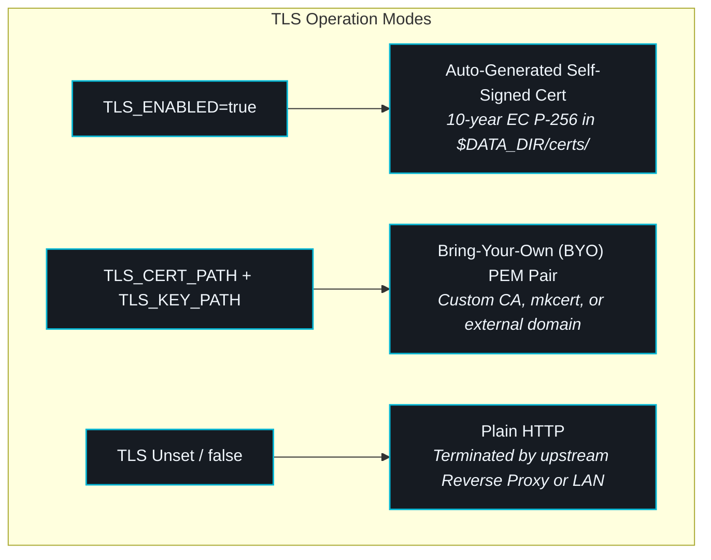

# ⚙️ Docker Environment Variables Reference

<CopyPage />

ShellGuard is distributed as a single unified container image (`ghcr.io/clawstackstudios/shellguard`). All runtime configurations—including cryptographic keys, storage directories, network bindings, and rate limit ceilings—are injected via environment variables.

Use the interactive catalog below to filter by category, search specific parameters, or copy variable names and ready-to-paste assignments directly to your clipboard.

---

## 🎛️ Interactive Variable Catalog

<EnvarList />

---

## 🔑 Core Cryptography & Identity Invariants

### 1. Master Database Key (`DB_ENCRYPTION_KEY`)

```bash
# Generate a cryptographically random 256-bit Base64 key
openssl rand -base64 32
```

The `DB_ENCRYPTION_KEY` governs two distinct defense-in-depth layers:
1. **Layer 2 (Per-Row Metadata Encryption)**: Encrypts vault item titles, usernames, URLs, categories, custom fields, tags, and attachment metadata with AES-256-GCM.
2. **Layer 3 (SQLCipher Whole-DB Encryption)**: Encrypts the underlying `db.sqlite` SQLite database file at rest on disk.

> [!IMPORTANT]
> `DB_ENCRYPTION_KEY` accepts both standard Base64 (`+/=`) and Base64URL (`-_`) encodings. It must decode to at least 32 bytes (256 bits) of cryptographic entropy. Client secret payloads are **always** encrypted client-side with ShellCryption™ before leaving the browser, regardless of whether `DB_ENCRYPTION_KEY` is configured. However, leaving `DB_ENCRYPTION_KEY` unset stores vault item titles and categories in plaintext on disk. Setting this variable is strongly advised for all production deployments.

### 2. SuperLobster Control Plane Token (`ADMIN_TOKEN`)

```bash
# Generate a secure administrative token
openssl rand -hex 24
```

Guards the SuperLobster administrator panel at `/superlobster`. When unset, or configured with fewer than 16 characters or trivial passwords (`admin`, `true`, `123456`), all administrative routes return HTTP `503 Service Unavailable` and the startup diagnostic banner logs a configuration warning.

> [!NOTE]
> `ADMIN_TOKEN` has zero decryption authority over user secrets. It is strictly scoped to system health inspection, scheduled database snapshots, audit log export, and identity lifecycle management.

### 3. Public Registration Gate (`DISABLE_SIGNUPS`)

By default (`false`), any user who accesses the ShellGuard instance can create a new vault identity. In multi-user self-hosted environments or public internet deployments, setting `DISABLE_SIGNUPS=true` (or `1`, `yes`) locks down identity creation. New identities then require a single-use invite token (`?invite=inv_...`) generated by an administrator inside the SuperLobster panel.

> [!WARNING]
> **Catch-22 Lockout Alert**: If `DISABLE_SIGNUPS=true` is enabled while `ADMIN_TOKEN` is unset or invalid, Genesis User #1 can hatch normally, but subsequent users cannot be invited because the administrative invite generator is sealed. Ensure a valid `ADMIN_TOKEN` is configured alongside `DISABLE_SIGNUPS`.

---

## 🌐 Networking, Reverse Proxies & CORS

### Reverse Proxy Detection (`TRUST_PROXY`)

When ShellGuard runs behind a reverse proxy (e.g. Nginx, Caddy, Traefik, NPM, or Cloudflare Tunnel), the incoming TCP connection terminates at the proxy. Setting:

```ini
TRUST_PROXY=true
```

tells Express to inspect the `X-Forwarded-For` and `X-Forwarded-Proto` request headers, ensuring that:
- Brute-force rate limiters track the actual client IP rather than the reverse proxy's internal gateway IP.
- HTTPS redirects correctly recognize SSL termination at the proxy edge.
- Audit records in `audit.sqlite` log physical remote IPs.

### Cross-Origin Resource Sharing (`CORS_ORIGIN`)

ShellGuard adopts a zero-friction security default for LAN setups:
- When `CORS_ORIGIN` is **unset**, the server automatically permits requests from `localhost`, `127.0.0.1`, RFC 1918 private subnets (`192.168.0.0/16`, `10.0.0.0/8`, `172.16.0.0/12`), and Carrier-Grade NAT / Tailscale ranges (`100.64.0.0/10`).
- For public domains, set `CORS_ORIGIN=https://vault.yourdomain.com` (or comma-separated origins) to restrict API calls to trusted frontends.

---

## 🔒 Native HTTPS & Bring-Your-Own TLS

ShellGuard supports native HTTPS without requiring an external reverse proxy:



### Self-Signed Frictionless TLS (`TLS_ENABLED=true`)
When `TLS_ENABLED=true` is specified without external certificate paths:
- ShellGuard generates a 10-year EC P-256 certificate and private key on first startup and writes them to `$DATA_DIR/certs/cert.pem` and `$DATA_DIR/certs/key.pem`.
- Subject Alternative Names (SANs) include `localhost`, `127.0.0.1`, and all detected host LAN IPs.
- Docker health checks automatically bypass certificate validation via `wget --no-check-certificate`.

### Bring-Your-Own Certificates (`TLS_CERT_PATH` & `TLS_KEY_PATH`)
Mount your custom PEM certificate and private key into the container and provide their absolute container paths:

```yaml
environment:
  - TLS_CERT_PATH=/app/data/certs/vault.crt
  - TLS_KEY_PATH=/app/data/certs/vault.key
```

---

## 💾 Storage, Permissions & Quotas

### Container User Mapping (`PUID` & `PGID`)

To prevent permission conflicts when mounting host directories into the container, ShellGuard features an entrypoint privilege-drop script (`docker-entrypoint.sh`). It remaps the internal `node` user to match your host user and group IDs:

- **Standard Linux / Docker**: `PUID=1000`, `PGID=1000`
- **Unraid**: `PUID=99`, `PGID=100`

### Attachment Storage Ceilings

ShellGuard stores encrypted file attachments directly as raw ciphertext BLOBs in SQLite:
- **`ATTACHMENT_MAX_MB`** (Default: `500`): Protects against denial-of-service memory exhaustion during streaming uploads. Any single file exceeding this size terminates immediately with HTTP `413 Payload Too Large`.
- **`GROTTO_QUOTA_MB`** (Default: `1000`): Allocates a cumulative storage quota per user (1 GB default).

---

## 📋 Production Compose Blueprint

A complete `docker-compose.yml` leveraging standard production variables:

```yaml
services:
  shellguard:
    image: ghcr.io/clawstackstudios/shellguard:latest
    container_name: shellguard
    restart: unless-stopped
    ports:
      - "6464:6464"
    volumes:
      - ./data:/app/data
    environment:
      # Core Identity & Encryption
      - NODE_ENV=production
      - PORT=6464
      - DATA_DIR=/app/data
      - DB_ENCRYPTION_KEY=YOUR_GENERATED_BASE64_KEY
      - ADMIN_TOKEN=YOUR_GENERATED_ADMIN_HEX
      - DISABLE_SIGNUPS=false

      # Reverse Proxy & Networking
      - TRUST_PROXY=true
      - CORS_ORIGIN=https://vault.example.com

      # Permissions (Unraid: PUID=99, PGID=100)
      - PUID=1000
      - PGID=1000

      # Storage & Quotas
      - ATTACHMENT_MAX_MB=500
      - GROTTO_QUOTA_MB=2000
      - TOKEN_TTL_DEFAULT=24h
    healthcheck:
      test: ["CMD", "wget", "-qO-", "http://localhost:6464/api/health"]
      interval: 15s
      timeout: 10s
      retries: 5
      start_period: 15s
```

---

## 🔗 Related Documentation
- [Docker & Compose Stacks](/deployment/docker) — Deployment walkthrough and container lifecycle.
- [First-Class HTTPS & TLS](/deployment/https-tls) — In-depth guide on native TLS and reverse proxy architectures.
- [Unraid Community Apps](/deployment/unraid) — One-click template deployment for Unraid storage servers.
- [Database Blueprint Schema](/reference/blueprint-schema) — Relational schema and encryption primitives.
