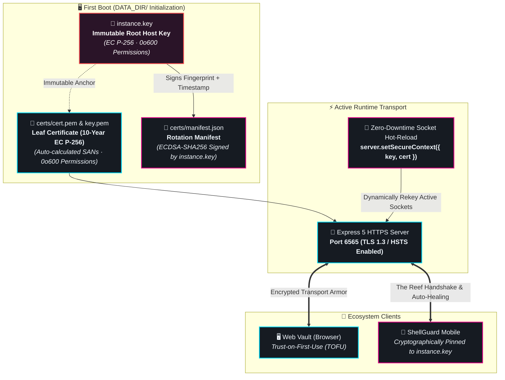

# 🔒 First-Class HTTPS & Built-in TLS Engine

<CopyPage />

ShellGuard provides native, zero-command transport security out of the box. Designed specifically for self-hosters and local homelabs, ShellGuard eliminates the need for external reverse proxies or complex certificate tooling just to achieve end-to-end encrypted local network transport.



---

## 🏛️ How the Built-in TLS Engine Works

When `TLS_ENABLED=true`, ShellGuard initializes a hardened cryptographic hierarchy:

### 1. The Immutable Root Host Key (`DATA_DIR/instance.key`)
- On the very first startup, ShellGuard checks for the presence of `DATA_DIR/instance.key`.
- If absent, it automatically generates a high-entropy **EC P-256 private key** written to disk with restrictive `0o600` permissions (owner read/write only).
- **Core Invariant**: This instance key is **immutable**. It never rotates or regenerates when leaf certificates are refreshed. It serves as the sovereign identity anchor for the host machine.
- Mobile clients pin trust to the uncompressed public key derived from this anchor.

### 2. Automatic 10-Year Leaf Certificate (`DATA_DIR/certs/`)
- ShellGuard generates a 10-year self-signed EC P-256 certificate (`cert.pem`) and matching private key (`key.pem`) saved in `DATA_DIR/certs/` with `0o600` permissions.
- **Dynamic SAN Reflection**: The certificate automatically computes Subject Alternative Names (SANs) for:
  - `localhost` and `127.0.0.1`
  - Host system hostname (e.g. `reef-server.local`)
  - All non-internal IPv4 interfaces detected on the host (e.g. `192.168.1.50`, `10.0.0.12`, `100.x.y.z` Tailscale IPs).
- The certificate is stored on disk and reused across container restarts, providing **Trust on First Use (TOFU)** stability without prompting users on every boot.

### 3. Signed Rotation Manifest (`DATA_DIR/certs/manifest.json`)
- Each time a certificate is generated or reforged, ShellGuard produces a rotation manifest:
  ```json
  {
    "certFingerprint": "80:BF:34:C8:32:94:76:C1:17:53:E9:04:14:4C:BE:37:78:70:1F:5A:54:5C:16:5A:32:CC:44:C1:C0:2C:88:D4",
    "timestamp": 1793105657,
    "signature": "3046022100b78ef0fdf6e25c952643503e18c7b35d8efcb2d0e9e9bc980b9f0136e8b2cdaa0221009532549619292e9a765a685877076e5e3963c12403f2ed0964e5ca107ca1b412"
  }
  ```
- The signature is generated by signing `${certFingerprint}${timestamp}` with `instance.key` using ECDSA-SHA256.
- The manifest is exposed publicly via `GET /api/public/tls-manifest`, enabling companion mobile clients to verify and auto-heal trust when certificates rotate.

---

## ⚡ Zero-Downtime Socket Hot-Reloading

In traditional servers, replacing a TLS certificate requires a full process restart, severing active client sessions and terminating background agent tasks.

ShellGuard implements **zero-downtime socket context hot-reloading**:
1. When an administrator clicks **Regenerate Certificate** in the SuperLobster control panel, a new leaf certificate and manifest are written to disk.
2. The internal TLS manager invokes `registerTlsReloadListener`.
3. The running HTTPS server dynamically updates its secure memory context:
   ```ts
   httpsServer.setSecureContext({ key, cert });
   httpsServer.closeIdleConnections();
   ```
4. The regeneration endpoint sets the HTTP header `Connection: close`, cleanly notifying existing clients to establish fresh sockets using the new leaf certificate.
5. In-flight database transactions, worker queues, and the Node.js process continue running without a millisecond of downtime.

---

## 🎛️ Operational Modes

ShellGuard supports three distinct transport topologies:

### Mode 1: Native Self-Signed HTTPS (Recommended for Homelabs)
```bash
TLS_ENABLED=true
PORT=6565
DATA_DIR=/app/data
```
- ShellGuard generates and manages its own persistent certificates.
- Enables HTTP Strict Transport Security (HSTS) and cookie `Secure` flags.
- Access via **`https://<server-ip>:6565`**.
- Accept the browser self-signed security warning once on your first visit (TOFU).

### Mode 2: Bring Your Own Certificates (BYO)
If you already use an internal CA (like Step-CA, FreeIPA, or cert-manager):
```bash
TLS_ENABLED=true
TLS_CERT_PATH=/etc/ssl/certs/shellguard.crt
TLS_KEY_PATH=/etc/ssl/private/shellguard.key
PORT=6565
```
- When both paths are defined, ShellGuard bypasses self-signed generation and loads your external certificates.
- Files must be readable by the container's running user (`0o600` or `0o644`).

### Mode 3: Edge Proxy Parity Mode (Cloudflare Tunnels, Caddy, Nginx)
If you terminate TLS upstream using a reverse proxy or tunnel:
```bash
TLS_ENABLED=false
TRUST_PROXY=true
PORT=6565
```
- ShellGuard operates cleanly in plain HTTP on port `6565`.
- HSTS headers and forced HTTPS redirects are disabled so upstream proxies can handle termination.
- Zero certificate files are generated or required.
- The SuperLobster panel displays an informational badge: `TLS Status: DISABLED (Reverse Proxy / Tunnel Mode)`.
- Share Signups and Mobile Pairing remain **100% operational**.

---

## 🛡️ Epistemic & Architectural Boundary

> [!IMPORTANT]
> **Transport Armor, Not Root of Trust**  
> While TLS 1.3 protects network metadata, headers, and traffic against LAN eavesdropping, it is **Layer 0** in ShellGuard's defense stack.
> 
> The sovereign cryptographic boundary of ShellGuard is **ShellCryption©™** (client-side AES-256-GCM authenticated encryption). Even if transport encryption were completely compromised or stripped by an adversarial middleman, zero plaintext vault items, notes, credentials, or keys could ever be decrypted without the user's sovereign 67-character `hu-` ClawKey.
