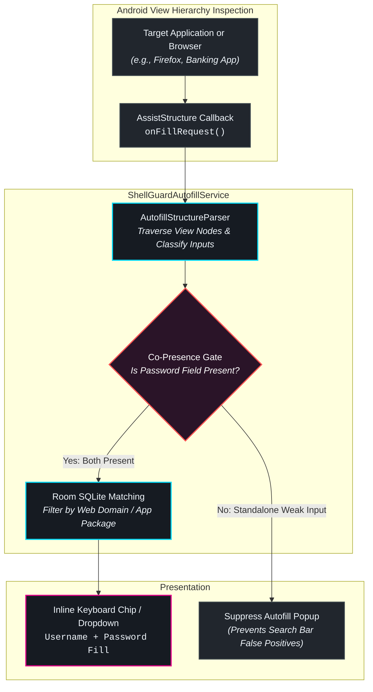

# 🤖 Autofill & System Integration

**ShellGuard Mobile** integrates directly with the Android OS to provide system-wide credential autofill across third-party apps, browsers (Chrome, Firefox, Brave), and WebViews without requiring manual app-switching.

---

## 🛠️ Enabling the Autofill Service

To activate system autofill:

1. Open Android **Settings** on your device.
2. Navigate to **Passwords & Accounts** (or **System > Languages & Input > Autofill service** depending on OEM).
3. Tap **Autofill service** and select **ShellGuard**.
4. Confirm the system prompt.

---

## 🛡️ The Autofill Co-Presence Gate

A notorious pain point in mobile password managers is **Autofill False Positives**: tapping a search bar, coupon code input, or comment box in apps like Amazon, YouTube, or eBay triggers an aggressive, unwanted autofill suggestion chip.

ShellGuard Mobile eliminates this friction through its proprietary **Co-Presence Gate**:

### The Problem: Weak Field Heuristics
HTML inputs and Android `EditText` views frequently reuse generic attributes like `name="query"`, `id="user_input"`, or `hint="Search"`. Naive autofill engines classify these as "Username" fields (Rank 4/5 confidence) and spam the user with credential suggestions.

### The Solution: Co-Presence Verification
When the `AutofillStructureParser` detects an input that only matches weak username heuristics:

1. **Child & Sibling Tree Traversal**: The parser recursively inspects all sibling and child nodes within the parent form container.
2. **Password Verification**: If **no password field** (`InputType.TYPE_TEXT_VARIATION_PASSWORD`, `autocomplete="current-password"`, etc.) is co-present within the form, username autofill suggestions are **strictly suppressed**.
3. **High-Confidence Exceptions**: The gate allows standalone username chips only on explicit, verified login domains (e.g., two-step login flows on Google or Microsoft) where confidence is validated through verified domain heuristics.

The result is a whisper-quiet autofill experience that appears when you need to log in, and stays invisible when you are searching or browsing.

---

## 🔑 Android 14+ Credential Provider & Passkeys

On devices running Android 14 (API level 34) and above, ShellGuard Mobile acts as a native **Credential Provider**, unlocking passwordless authentication via **Passkeys (FIDO2 / WebAuthn)**:

- **Passkey Generation**: When creating an account on a supported site, ShellGuard intercepts the WebAuthn challenge, generates an EC P-256 keypair inside the hardware enclave, and stores the public credential in your vault.
- **Biometric Signing**: When logging in, the relying party issues an assertion challenge. ShellGuard prompts for fingerprint or face authentication and signs the challenge directly on device.
- **Cross-Platform Sync**: Passkeys stored in ShellGuard Mobile synchronize via delta sync to your self-hosted instance as encrypted ciphertext envelopes, making them available across your other ShellGuard clients.

---

## 🎛️ Quick Settings Tiles

For power users, ShellGuard Mobile provides two configurable **Quick Settings Tiles** in the Android notification shade:

| Quick Settings Tile | Icon | Action & Security Behavior |
| :--- | :---: | :--- |
| **ShellGuard Search** | 🔍 | Opens a floating quick-search window over your current app to look up credit cards, notes, or credentials without switching tasks. |
| **Emergency Lock** | 🔒 | Immediately zeroizes volatile memory (`zeroizeMemory()`), clears the active session key, and locks the vault into an impenetrable state. |

To add these tiles, swipe down twice from the top of your screen, tap the **Edit (Pencil)** icon in Quick Settings, and drag **ShellGuard Search** and **ShellGuard Lock** into your active tiles tray.
