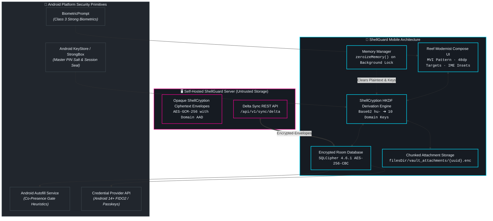

# 🐚 ShellGuard Mobile Overview

> *"Your reef. Your keys. Your vault. In your pocket."*

**ShellGuard Mobile** (`com.clawstack.shellguard`) is the official native Android client engineered for complete sovereign secrets management across the ClawStack ecosystem. Operating either paired with a self-hosted ShellGuard web server or in total air-gapped isolation, ShellGuard Mobile delivers a full-featured, zero-knowledge, hardware-secured vault directly to your mobile device.

Unlike mirror companions or web wrappers, ShellGuard Mobile is a ground-up Kotlin / Jetpack Compose application designed around native Android platform services: system-wide Autofill, Credential Provider (Passkeys & FIDO2), biometric authentication, 16 KB page-aligned SQLCipher encrypted persistence, and chunked attachment streaming.

---

## 🧭 Vault Client vs. TOTP Companion

The ShellGuard ecosystem provides two distinct Android applications tailored for different operational models. Understanding their boundaries is essential:

| Characteristic | 🐚 ShellGuard Mobile (`com.clawstack.shellguard`) | 📱 ShellGuard-TOTP (`com.clawstack.shellguard.totp`) |
| :--- | :--- | :--- |
| **Role & Purpose** | **Full Sovereign Vault Client** | **Dedicated 2FA Authenticator Mirror** |
| **Data Domains** | Logins, Secure Notes, Credit Cards, Identities, SSH Keys, Passkeys, and Attachments | RFC 6238 Time-Based One-Time Passwords (TOTP) only |
| **CRUD Capabilities** | Full bidirectional CRUD (Create, Read, Update, Delete) with delta sync | Read-only mirror for vault seeds; sovereign local-only codes |
| **System Integration** | Android Autofill Framework, Android 14+ Credential Provider, Quick Settings Tiles | Manual code copying, Wear OS companion tile, camera QR scanner |
| **Storage Architecture** | Room SQLite encrypted via SQLCipher 4.6.1 AES-256 + 64KB chunked disk streaming | Room SQLite encrypted via Android KeyStore AES-GCM-256 |
| **Network Footprint** | Direct LAN HTTP, Tailscale WireGuard, or WAN HTTPS with consent-gated self-signed TLS | REST delta polling or manual offline QR pair |
| **Documentation Link** | **This Guide (`/mobile/`)** | [**Companion Guide (`/companion/`)**](/companion/) |

---

## 🏗️ Architectural Topology

ShellGuard treats remote servers as strictly untrusted storage. Master keys never leave device volatile memory, and all persistence layers are encrypted at rest with hardware-backed security.

---

## 🛡️ Core Security & Engineering Invariants

ShellGuard Mobile is constructed on four foundational non-negotiables:

### 1. Security-First Boundary
Security is never an afterthought or a decorator on top of UI. Every field entered into the app is bound to its record UUID and domain namespace using Authenticated Additional Data (AAD) in AES-GCM-256:
$$\text{AAD} = \text{itemUuid} \parallel \text{domainNamespace}$$
If ciphertext is maliciously swapped between records or domains on the server, decryption fails client-side with a cryptographic authentication error.

### 2. Zero-Knowledge Cryptographic Isolation
The client derives domain encryption keys locally using HKDF-SHA256 from the Base62 `hu-` master sovereign identity key. Decrypted records and raw keys reside strictly in volatile heap memory. When the app is locked or backgrounded, `zeroizeMemory()` systematically scrubs arrays and memory references to protect against process heap inspection (OWASP Mobile M2).

### 3. Offline-First Resilience
100% of read, search, credential copy, and TOTP generation operations function completely offline without network availability. Local storage is protected by SQLCipher 4.6.1 with a hardware-backed key. When connectivity is restored, pending modifications are pushed and upstream changes are reconciled via mutex-serialized delta synchronization.

### 4. 16 KB Page Alignment & Memory Standards
Engineered to comply with Android 15 and Android 16 requirements for 16 KB ELF segment alignment. All shared native libraries (`libsqlcipher.so`) are packaged uncompressed and page-aligned (`jniLibs.useLegacyPackaging = false`), ensuring maximum performance, zero memory mapping faults, and full compatibility with modern Google Pixel and OEM flagship kernels.

---

## 📋 System Requirements & Distribution

- **Operating System**: Android 7.0 (API level 24) through Android 16 (API level 36).
- **Target SDK**: SDK 36.
- **Architectures**: `arm64-v8a`, `armeabi-v7a`, `x86_64` (16 KB page-aligned).
- **Distribution Formats**:
  - **APK (Universal / Architecture-split)**: Available on GitHub Releases.
  - **AAB (Android App Bundle)**: Signed for Google Play Store distribution.
  - **F-Droid**: Planned reproducible sovereign build repository.

---

## 🗺️ Documentation Roadmap

Follow the user journey sequentially to explore every facet of ShellGuard Mobile:

1. [**Onboarding & Gateway Setup**](/mobile/onboarding-and-gateway): Connect to self-hosted instances over LAN HTTP, Tailscale, or WAN HTTPS with consent-gated self-signed TLS and Base62 sovereign key import.
2. [**Vault Management & Items**](/mobile/vault-and-crud): Manage 5 core record domains, utilize sub-0.5ms search, configure custom fields, stream chunked attachments, and generate TOTP codes.
3. [**Autofill & System Integration**](/mobile/autofill-and-integration): Configure Android Autofill, understand the Co-Presence Gate heuristic, and enable Android 14+ Passkeys.
4. [**Security, Biometrics & PIN Lock**](/mobile/security-and-lock): Explore Class 3 BiometricPrompt, the PBKDF2 PIN manager, in-place re-authentication, and memory zeroization.
5. [**Sync Engine, Offline & Backups**](/mobile/sync-offline-and-backups): Understand offline caching, conflict resolution, encrypted `.sgvault.bak` backups, and emergency recovery sheets.
