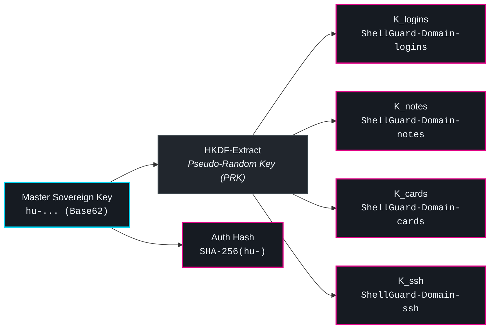

# 🚀 Gateway Connection & Onboarding

When launching **ShellGuard Mobile** for the first time, you are greeted by the **Gateway Connection Screen** (`GatewayScreen`). This screen acts as the cryptographic checkpoint establishing the trust boundary between your phone and your self-hosted ShellGuard vault instance.

---

## 🌐 Network Mobility & Transport Sovereignty

Homelab architectures vary wildly—from bare-metal servers on local subnets to WireGuard/Tailscale VPN meshes and public domains behind reverse proxies. ShellGuard Mobile is engineered with **Transport Sovereignty**, guaranteeing frictionless connectivity across all topologies without compromising cryptographic awareness.

```mermaid
flowchart TD
    subgraph Client ["📱 ShellGuard Mobile (Android)"]
        UI["Gateway Screen Input<br/><code>Base URL + Trust Toggle</code>"]
        NetConfig["Network Config Check<br/><code>http:// vs https://</code>"]
        OkHttp["Ktor / OkHttp Engine<br/><code>ConnectionSpec & TLS Engine</code>"]
        Pill["Amber Warning Banner<br/><i>(Visual Transport Risk Pill)</i>"]
    end

    subgraph Modes ["Supported Network Topologies"]
        LAN["1. Local LAN / Tailscale HTTP<br/><code>http://192.168.1.100:8080</code><br/><i>Cleartext Traffic Permitted</i>"]
        SignedWAN["2. Public Domain HTTPS<br/><code>https://vault.example.com</code><br/><i>Strict Platform TLS</i>"]
        SelfSigned["3. Homelab Self-Signed HTTPS<br/><code>https://192.168.1.100:8443</code><br/><i>User Consent Toggle</i>"]
    end

    UI --> NetConfig
    NetConfig -->|http://| LAN
    NetConfig -->|https:// (Verified CA)| SignedWAN
    NetConfig -->|https:// (Self-Signed)| SelfSigned

    LAN --> Pill
    SelfSigned --> Pill
    LAN --> OkHttp
    SignedWAN --> OkHttp
    SelfSigned --> OkHttp

    classDef client fill:#161B22,stroke:#00D8F6,stroke-width:2px,color:#F0F6FC;
    classDef warning fill:#2A1428,stroke:#FF9800,stroke-width:2px,color:#FFFFFF;
    classDef mode fill:#21262D,stroke:#3D484E,stroke-width:1.5px,color:#F0F6FC;

    class Client,UI,NetConfig,OkHttp client;
    class Pill warning;
    class Modes,LAN,SignedWAN,SelfSigned mode;
```

### 1. Local LAN & Tailscale Plaintext HTTP (`http://`)
Many self-hosters run their vaults exclusively within private subnets (`192.168.x.x`, `10.x.x.x`) or over Tailscale MagicDNS (`*.ts.net`). Because Tailscale encrypts all packets at the WireGuard protocol layer (Layer 3), running unencrypted HTTP on top is cryptographically sound.

- **Android Platform Invariant**: Modern Android (API 28+) disables cleartext HTTP by default. Android's `<network-security-config>` XML parser strictly **rejects CIDR notation** (e.g., `<domain>192.168.0.0/16</domain>` crashes on boot). ShellGuard Mobile configures `<base-config cleartextTrafficPermitted="true" />` so private homelab IPs connect immediately.
- **OkHttp Connection Specifications**: The client registers `ConnectionSpec.CLEARTEXT` alongside `ConnectionSpec.MODERN_TLS` to prevent `UnknownServiceException` socket errors.

### 2. Frictionless Self-Signed HTTPS Consent (`trustSelfSignedCerts`)
On first startup, the ShellGuard Web Server generates an internal EC P-256 TLS certificate (`server.crt`). Traditionally, connecting an Android app to a self-signed server forces the user to manually install the certificate into Android OS system settings—a tedious and risky process that triggers alarming persistent OS notifications.

ShellGuard Mobile solves this via **In-App User Consent**:
- **Default Posture**: The app enforces strict public CA validation by default.
- **Consent Toggle**: Users connecting to a self-signed homelab instance can switch on **"Trust self-signed certificates"** directly on the Gateway screen.
- **Engine Mechanics**: Enabling this toggle activates a custom `X509TrustManager` and permissive `HostnameVerifier` exclusively within the isolated OkHttp client instance. **No OS root CA installation is ever required.**

### 3. Amber Transport Warning Pills
To ensure users are always fully cognizant of transport exposure, an **Amber Warning Pill** renders dynamically below the server URL input when:
- An unencrypted `http://` URL is entered:  
  `⚠️ Unencrypted HTTP — Session tokens and item metadata are exposed on local network`
- The self-signed certificate toggle is active:  
  `⚠️ Self-Signed TLS — Unverified certificate accepted by user consent`

> [!NOTE]
> Even if transport is unencrypted, all vault item secrets remain fully encrypted with client-side AES-GCM-256. However, transport encryption protects vault metadata (item names, URLs, usernames) and active session bearer tokens from local packet sniffing.

### 4. CWE-532 URL Query Redaction
In strict adherence to secure logging standards (CWE-532), ShellGuard Mobile automatically redacts authentication tokens, sovereign keys, and sensitive parameters from all HTTP diagnostic logs and stack traces.

---

## 🔑 Sovereign Key Provisioning

Authentication in ShellGuard does not rely on a traditional email/password combination. Instead, authentication and cryptographic authorization are governed by your **Master Sovereign Key**.

```
hu-a1b2c3d4e5f6... (67 characters in Base62)
```

### Sovereign Key Specifications
- **Base62 Character Set**: Consists exclusively of `0–9`, `a–z`, and `A–Z`.
- **Length & Prefix**: Exactly 67 characters starting with `hu-` (Human Sovereign Key) or `lb-` (SuperLobster automated agent key).
- **Entropy**: 256 bits of cryptographic entropy encoded in the trailing 64 Base62 characters.



### Input Methods
1. **Camera QR Code Scanner**: Tap the QR icon to scan the sovereign key QR code displayed in your ShellGuard Web dashboard (`Settings > Emergency Kit`).
2. **Manual Keyboard Entry**: Enter or paste the 67-character key. The input field is hardened with `KeyboardOptions(autoCorrect = false)` to prevent custom third-party keyboards from logging the key to disk dictionaries (OWASP Mobile M1).

### Domain Key Derivation (HKDF-SHA256)
Once entered, the master sovereign key is expanded into 10 domain-specific cryptographic keys:
$$K_{\text{domain}} = \text{HKDF-Expand}(\text{PRK}, \text{"ShellGuard-Domain-" + namespace}, 32)$$
Simultaneously, a one-way `SHA-256` hash of the key is calculated to serve as the gateway authentication token. The raw sovereign key never leaves client memory.

---

## 🔒 Master PIN & Biometric Enrollment

After verifying connection with your server and deriving domain keys, the onboarding wizard prompts you to configure local access credentials:

1. **6-Digit Master PIN**: Created on the custom `PinPadView`. The PIN is hashed using PBKDF2-SHA256 with 100,000 rounds and salted with a cryptographically secure random salt anchored to Android KeyStore.
2. **Biometric Unlock**: If your device supports Class 3 Biometrics (fingerprint or hardware facial recognition), you can enable biometric unlock. The biometric key is wrapped in the Android hardware TEE / StrongBox enclave.

Once complete, ShellGuard Mobile executes its initial delta synchronization, populates your local encrypted database, and opens the **Vault Dashboard**.
