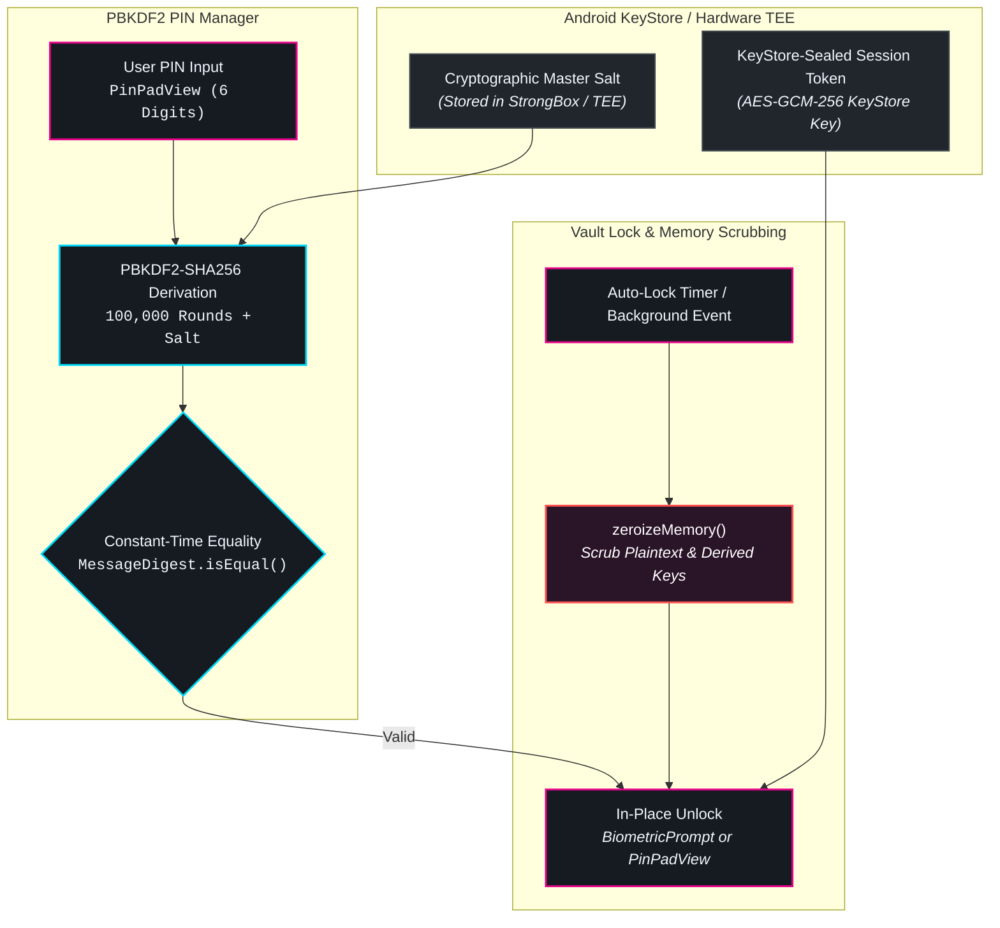

# 🛡️ Security, Biometrics & PIN Lock

Mobile devices live in hostile environments—subject to physical theft, shoulder surfing, side-channel attacks, and memory inspection. **ShellGuard Mobile** is engineered from the ground up to defend against both physical and cryptographic threats.

---

## 🔐 Dual-Layer Local Authentication

ShellGuard Mobile employs a dual-layer authentication model separating high-friction cryptographic derivation from daily ergonomic unlocking:



### 1. Android BiometricPrompt (Class 3 Strong Biometrics)
The app integrates with Android's official `BiometricPrompt` framework, requiring hardware-backed Class 3 Biometrics (fingerprint sensors or 3D structured-light facial scanners). Biometric authentication keys are anchored inside the device's Trusted Execution Environment (TEE) or StrongBox security chip.

### 2. PBKDF2-SHA256 PIN Manager (`PinAuthManager`)
For devices without biometrics—or when biometric unlock fails—access is guarded by a 6-digit Master PIN:
- **100,000 PBKDF2-SHA256 Rounds**: Stretches the PIN into a cryptographic hash, neutralizing offline brute-force attempts.
- **Hardware-Anchored Salt**: The salt is generated via `SecureRandom` and sealed within the Android KeyStore.
- **Constant-Time Verification**: Verification uses `MessageDigest.isEqual()` to prevent side-channel timing attacks that could deduce PIN digits by observing comparison latency.
- **Ergonomic `PinPadView`**: Flat Modernist design with minimum 48dp clickable touch targets, haptic feedback pulses on keypress, and an optional randomized digit grid to eliminate physical smudge attacks.

---

## 🔄 Session Decoupling & In-Place Re-Authentication

A critical innovation in ShellGuard Mobile is **Session Decoupling**:

In naive apps, locking the screen forces a full logout, requiring an active internet connection to contact the remote server upon unlocking. If you are on an airplane, in an underground garage, or your server is offline, you are locked out of your credentials.

ShellGuard Mobile decouples **Vault Locking** from **Server Authentication**:

1. **Vault Lock (Volatile Heap Clearance)**: When locked, the client destroys all decrypted records, search indexes, and derived domain symmetric keys in RAM.
2. **Session Preservation**: Your server session token (`jwt`) and encrypted database master key remain securely sealed in the Android KeyStore.
3. **In-Place Re-Auth**: When returning to the app, you unlock **in-place** using your fingerprint or PIN. The KeyStore unseals the database key locally. **Zero network round-trips are required to unlock.**

---

## 🧹 OWASP Mobile M2: Volatile Heap Zeroization (`zeroizeMemory()`)

In standard Java/Kotlin environments, memory is collected asynchronously by the Garbage Collector (GC). Decrypted passwords and cryptographic keys can linger in process RAM for minutes or hours, making them extractable via Android root heap inspection (OWASP Mobile M2).

ShellGuard Mobile defeats this via proactive memory zeroization:

- **Immediate Overwrite**: Whenever the vault locks, the `VaultLockManager` invokes `zeroizeMemory()`.
- **Byte-Level Scrubbing**: All in-memory `CharArray` and `ByteArray` instances containing plaintext secrets, sovereign keys, and derived symmetric keys are immediately overwritten with `0x00`.
- **Lifecycle Hooking**: Zeroization triggers instantly when the app is placed in the background, when the screen turns off, or when the auto-lock timer fires.

---

## ⌨️ OWASP Mobile M1: IME Keyboard Hardening

Custom Android keyboards (e.g., Gboard, SwiftKey, or third-party OEM keyboards) log entered words to local disk dictionary files to improve predictive text. On rooted devices or through backup extraction, these dictionary files expose passwords and sovereign keys.

To prevent this vulnerability:
- Every sensitive text input in ShellGuard Mobile is explicitly configured with:
  ```kotlin
  keyboardOptions = KeyboardOptions(
      autoCorrect = false,
      keyboardType = KeyboardType.Password
  )
  ```
- This tells the Android Input Method Editor (IME) service to treat input as sensitive, blocking disk dictionary caching, predictive text suggestions, and cloud telemetry sync.

---

## 🛡️ Screen Capture Protection (`FLAG_SECURE`)

To prevent third-party applications from capturing sensitive vault records:
- Production release builds declare `WindowManager.LayoutParams.FLAG_SECURE` on all app windows.
- The Android OS blocks screenshots, screen recordings, and task-switcher thumbnail captures.
- In recent apps view, ShellGuard Mobile displays a blank protected window rather than exposing vault contents.
