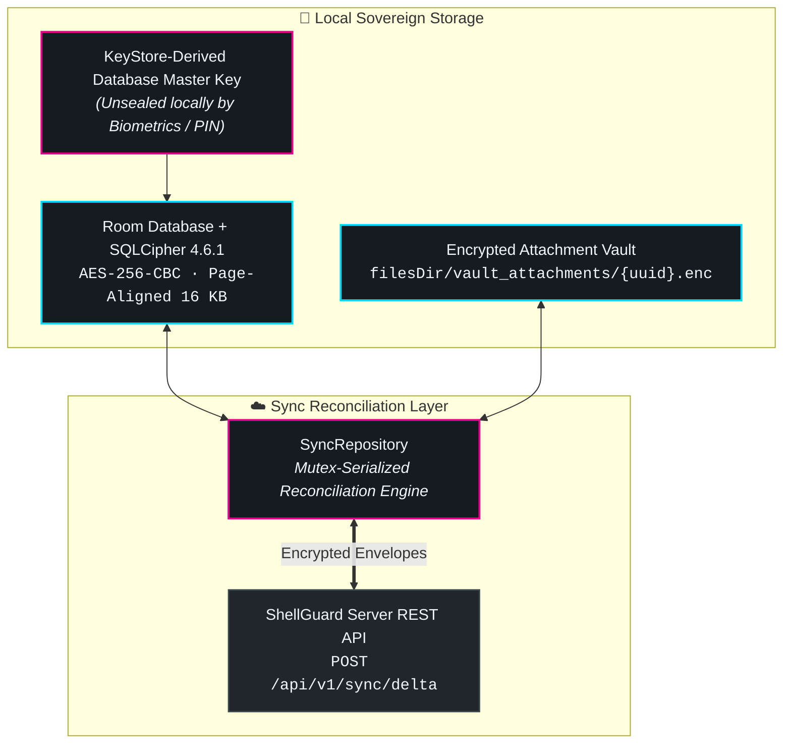
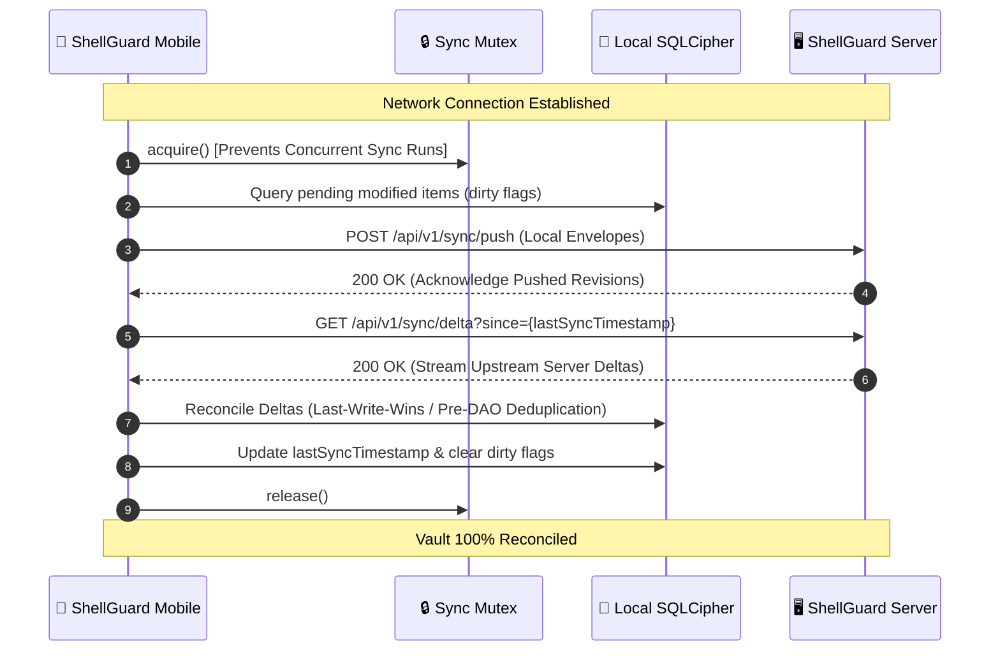

# 🔄 Sync Engine, Offline & Backups

A vault client that fails when disconnected from the internet is a liability. **ShellGuard Mobile** is built on an **Offline-First Resilience** model: your phone maintains a complete, cryptographically isolated copy of your entire vault, fully accessible anywhere on earth without an internet connection.

---

## 💾 Offline-First Architecture (SQLCipher 4.6.1)

All local records in ShellGuard Mobile are stored in an encrypted Room SQLite database powered by **SQLCipher 4.6.1**:

### Storage Invariants:
1. **Hardware-Anchored Database Key**: The SQLCipher database encryption key is generated via `SecureRandom` on first launch and sealed inside the Android KeyStore. It is unsealed only after successful Biometric or PIN verification.
2. **Zero Plaintext on Flash**: Raw database pages, WAL write-ahead logs, and temporary SQLite cursors on the flash storage are 100% encrypted with AES-256-CBC.
3. **100% Offline Capability**: Searching, viewing, copying passwords, viewing custom fields, streaming attachments, and generating TOTP authentication codes require zero network round-trips.

---

## 🔁 Mutex-Serialized Delta Sync Engine

When internet connectivity is available, ShellGuard Mobile synchronizes modifications with your self-hosted instance using a high-efficiency **Delta Sync Protocol**:

### Key Synchronization Mechanics:
- **Mutex Serialization**: All sync operations are guarded by a coroutine `Mutex` inside `SyncRepository`. Even if rapid background network changes occur, only one sync cycle executes at a time, eliminating database write collisions.
- **Automated Network Probing**: The app registers a `ConnectivityManager.NetworkCallback`. When moving from cellular to Wi-Fi or coming out of airplane mode, the client immediately probes server health (`GET /api/v1/health`) and initiates delta reconciliation.
- **Conflict Resolution (Last-Write-Wins)**: If an item is modified simultaneously on the mobile client and the web dashboard, revisions are compared by server-assigned monotonic sequence numbers and timestamps. Local modifications are safely preserved in version history.

---

## 📦 Encrypted Vault Backups (`.sgvault.bak`)

In addition to automated server synchronization, ShellGuard Mobile allows you to generate complete, portable encrypted backups directly from your device:

| Backup Format | Extension | Target Contents | Interoperability |
| :--- | :---: | :--- | :--- |
| **Full Mobile Vault** | `.sgvault.bak` | All 5 domains (Logins, Notes, Cards, Identities, SSH Keys), custom fields, and metadata | Fully compatible with ShellGuard Web and desktop imports |
| **TOTP Authenticator** | `.sgtotp.bak` | Dedicated 2FA seeds created on device | Compatible with [ShellGuard-TOTP Companion](/companion/) |

### Backup Security Architecture:
1. **AES-GCM-256 Envelope Encryption**: The backup JSON payload is compressed using GZIP and encrypted with AES-GCM-256.
2. **Password Stretching**: Backups can be encrypted with your master sovereign key or a custom standalone backup password stretched via PBKDF2-SHA256 (100,000 iterations).
3. **Air-Gapped Portability**: Export your `.sgvault.bak` file to an external USB flash drive, SD card, or local device folder via the Android Storage Access Framework (SAF).

---

## 🖨️ Emergency Kit & Disaster Recovery

If your phone is damaged, lost, or your self-hosted server experiences catastrophic hardware failure, your **Emergency Kit** provides the ultimate sovereign recovery path:

1. **The Sovereign Key**: Your 67-character Base62 `hu-` sovereign key is all that is required to decrypt any existing `.sgvault.bak` backup.
2. **Emergency Sheet**: In **Settings > Security > Emergency Kit**, tap **Export Emergency Sheet**. This generates a printable, high-contrast PDF containing:
   - Your Master Sovereign Key in plaintext and QR code formats.
   - Your Self-Hosted Gateway URL.
   - Cryptographic derivation parameters.
3. **Air-Gapped Restoration**: To restore on a new Android device, install ShellGuard Mobile, select **Restore from Backup / Emergency Kit**, scan the sheet QR code, and import your `.sgvault.bak` file. Your vault is reconstructed locally in seconds with zero dependence on cloud infrastructure.
