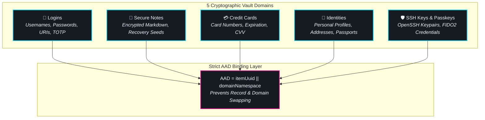
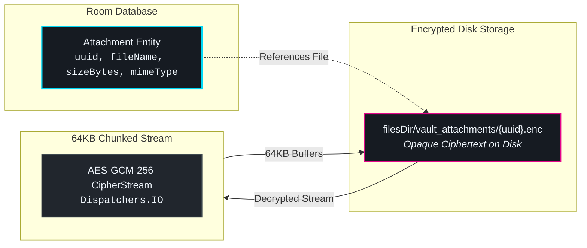

# 🗄️ Vault Management & Items

The **Vault Dashboard** (`VaultDashboardScreen`) is the primary workstation within ShellGuard Mobile. It provides immediate access to your entire digital habitat, organized across five cryptographic domains with instant search, rich filtering, and hardware-accelerated security.

---

## 📦 The 5 Core Vault Domains

Every record in ShellGuard Mobile belongs to one of five distinct domains. Each domain is encrypted using a dedicated symmetric key derived via HKDF from your master sovereign key:

### 1. Logins
- **Credentials**: Multi-field support for usernames, email addresses, passwords, and secondary authentication fields.
- **URI Association**: Associate multiple URLs with configurable match modes (Base Domain, Exact URL, Host Only, or Never).
- **Integrated TOTP Seed**: Store RFC 6238 two-factor seeds directly inside login entries.

### 2. Secure Notes
- **Unbounded Text**: Store recovery seeds, server configuration blocks, and cryptographic mnemonics.
- **Markdown Rendering**: Clean monospace formatting for code blocks and multi-line notes.

### 3. Credit Cards
- **Cardholder Attributes**: Cardholder name, card number, expiration month/year, and CVV.
- **Privacy Masking**: CVV and card numbers are masked by default, requiring explicit tap-to-reveal.
- **Brand Detection**: Automatic detection of Visa, Mastercard, American Express, and Discover.

### 4. Identities
- **Personal Profiles**: Manage complete personal profiles including full legal name, physical addresses, telephone numbers, and email identities.
- **Government IDs**: Securely record passport numbers, driver's licenses, and national tax identifiers.

### 5. SSH Keys & Passkeys
- **SSH Keypairs**: Store public and private keys in OpenSSH or PEM formats, complete with key passphrases.
- **FIDO2 Passkeys**: Android 14+ Credential Provider storage for passwordless WebAuthn credentials.

---

## ⚡ Search, Filtering & Navigation Ergonomics

The Vault Dashboard is optimized for sub-millisecond retrieval, regardless of vault size:

- **Sub-0.5ms SQLite Search**: Powered by SQLCipher-indexed queries. Typing immediately filters results by title, username, domain, or notes.
- **Domain Category Chips**: Horizontally scrollable chips at the top of the dashboard allow instant domain isolation (`All`, `Logins`, `Notes`, `Cards`, `Identities`, `Keys`).
- **Tag Filtering & Favorites**: Mark critical records as favorites for one-tap access at the top of the screen. Assign arbitrary tags for custom workflows.
- **Clipboard Auto-Clear**: Copying a password or secret automatically arms a 30-second background timer. When the timer expires, the Android clipboard is cleared to prevent cross-app snooping.

---

## 🧩 Custom Fields & Strict AAD Binding

Beyond default fields, every vault record can be extended with unlimited custom fields:

| Field Type | Behavior & Visibility | Common Use Case |
| :--- | :--- | :--- |
| **Text** | Plaintext alphanumeric string, visible on screen | Security questions, employee IDs, server ports |
| **Hidden** | Masked with bullet dots, tap-to-reveal | API tokens, database passwords, PIN codes |
| **Boolean** | Binary toggle (`true`/`false`) | Flagging sandbox accounts, 2FA bypass flags |

### Authenticated Additional Data (AAD) Invariant
In naive password managers, an attacker with server database access could swap ciphertext blobs between different records (e.g., swapping a low-privilege test password into an admin account).

ShellGuard Mobile prevents this cryptographically. During every AES-GCM-256 encryption pass, the record's UUID and domain namespace are fed into the cipher as Authenticated Additional Data (AAD):
$$\text{AAD} = \text{itemUuid} \parallel \text{domainNamespace}$$
If a ciphertext envelope is moved to another record UUID or imported into a different domain, the GCM authentication tag verification fails immediately, aborting decryption with zero plaintext exposure.

---

## 📎 Hybrid Attachment Streaming (64KB Chunking)

Most Android password managers crash with `android.os.TransactionTooLargeException` when users attach images or PDF documents. This happens because Android's `CursorWindow` limits SQLite query results over IPC Binder to 2 megabytes.

ShellGuard Mobile resolves this via a **Hybrid File-System Architecture**:

1. **Metadata Isolation**: Attachment metadata (UUID, file name, MIME type, size) is stored in the Room database entity.
2. **Chunked Streaming**: The binary payload never touches the database. It is streamed directly to `filesDir/vault_attachments/{uuid}.enc` using 64KB memory buffers on `Dispatchers.IO`.
3. **Hardware Encryption**: Each attachment file is encrypted on disk with a dedicated AES-GCM-256 key, ensuring sensitive PDFs, keys, and images remain completely safe even on rooted devices.

---

## ⏱️ Integrated RFC 6238 TOTP Engine

When a login record contains a two-factor seed (`otpauth://` URI or raw Base32 secret), ShellGuard Mobile displays a live TOTP ticker directly on the item detail view and vault list:

- **Circular Dial Picker**: A smooth progress circle indicates remaining validity (standard 30-second window).
- **Time Drift Compensation**: Computes hash values against device system clock with ±1 step drift tolerance.
- **Instant Copy**: Tapping the 6-digit code copies it to the clipboard and triggers a subtle haptic feedback pulse.
