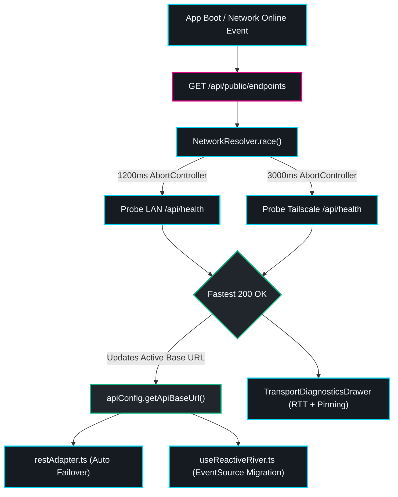

# 🌐 Dual-Homed Network Resolver & MagicDNS Mesh

<CopyPage />

Self-hosted vaults are routinely accessed from two different network contexts: fast **local Wi-Fi / LAN** at home and encrypted **Tailscale MagicDNS** while roaming. Manually switching browser URLs or bookmarking two origins creates friction and splits browser storage.

Introduced in **v0.0.3.1 (Stage 29B)**, ShellGuard's **Dual-Homed Network Resolution Engine** automatically discovers both LAN and Tailscale reachability vectors, races them in parallel, fails over transparently when networks change, and exposes live telemetry inside the **Transport Diagnostics Drawer**.



---

## 1. Public Reachability Manifest (`GET /api/public/endpoints`)

The server publishes its detected network topology on an unauthenticated discovery endpoint (`src/server/routes/public.ts`), backed by `buildReachabilityVectors()` in `src/server/utils/networkTopology.ts`:

```json
{
  "success": true,
  "data": {
    "lan": "https://192.168.1.50:6565",
    "tailscale": "https://reef.tail12345.ts.net:6565",
    "tls": {
      "enabled": true,
      "fingerprint": "80:BF:34:C8:32:94:..."
    }
  }
}
```

### Topology Classification Rules
- **LAN Vector**: First non-internal RFC 1918 IPv4 address (`10.0.0.0/8`, `172.16.0.0/12`, `192.168.0.0/16`).
- **Tailscale Vector**: Prefers resolved `*.ts.net` MagicDNS hostname; falls back to Tailscale CGNAT IPv4 (`100.64.0.0/10`) or Tailscale IPv6 (`fd7a:115c:a1e0::/48`); returns `null` when Tailscale is absent.
- **3-Tier MagicDNS Waterfall**:
  1. Tailscale LocalAPI Unix Socket (`/var/run/tailscale/tailscaled.sock`)
  2. Reverse DNS lookup (`dns.reverse`) on detected `100.x.y.z` interfaces
  3. Optional environment hint (`TAILSCALE_DOMAIN` / `MAGIC_DNS_HOST`)

---

## 2. Client `NetworkResolver` Engine (`src/lib/networkResolver.ts`)

The singleton `networkResolver` coordinates vector probing, single-flight race deduplication, and user pinning preferences:

| Parameter | Default | Behavior |
|:---|:---|:---|
| **LAN Probe Timeout** | `1200ms` | Fast-fail `AbortController` budget so roaming clients don't stall waiting on unreachable private IPs. |
| **Tailscale Probe Timeout** | `3000ms` | Tolerates cellular/WAN RTT while racing concurrently with LAN. |
| **Resolution Strategy** | Fast-First | Resolves immediately when the fastest healthy vector responds `200 OK`; continues recording the slower vector's RTT in the background for diagnostics. |
| **Single-Flight Coalescing** | Enabled | Concurrent `race()` calls share one in-flight promise, preventing probe storms. |
| **Pinning Persistence** | `localStorage` (`sg_transport_config`) | Persists `auto`, `force-lan`, or `force-tailscale` across reloads. |
| **Auto Re-Race** | `window.addEventListener('online')` | Automatically re-races vectors whenever the browser regains connectivity. |

### Pinning Modes
- **`auto` (Default)**: Races both LAN and Tailscale in parallel and selects the fastest healthy vector.
- **`force-lan`**: Pins all traffic to the LAN vector (useful on local networks with split-horizon DNS quirks).
- **`force-tailscale`**: Pins all traffic to the Tailscale MagicDNS vector (useful when testing remote access while physically on LAN).

---

## 3. Transparent REST & SSE Failover

### REST Transport Failover (`src/services/api/restAdapter.ts`)
- Every API call resolves its base URL dynamically via `getApiBaseUrl()` (`src/config/apiConfig.ts`).
- When a request fails with a **network transport error** (`TypeError` / connection reset — never on HTTP `4xx` or `5xx` application responses), `restAdapter` triggers a single emergency `networkResolver.race()`.
- If the emergency race elects a different healthy vector, `restAdapter` transparently retries the request once against the new vector without surfacing a UI error.

### Reactive River SSE Migration (`src/hooks/useReactiveRiver.ts`)
- `useReactiveRiver` subscribes to `networkResolver` state changes.
- When the active transport vector switches (e.g. walking out the door from Wi-Fi LAN to Tailscale cellular), the hook cleanly closes the stale `EventSource` and opens a fresh stream against the winning vector, preserving the monotonic `Last-Event-ID` cursor so zero vault mutations are missed.

---

## 4. Transport Diagnostics Drawer (`TransportDiagnosticsDrawer.tsx`)

Operators and users can inspect and control live transport state at any time:
- **Entry Points**: Click the interactive **Reactive River status pill** in the top header or open **Settings ➔ Network & Transport**.
- **Live Telemetry**: Displays active vector badge, per-vector RTT latency cards (`LAN` and `Tailscale`), reachability status, and the server's active SHA-256 TLS certificate fingerprint.
- **Controls**: Switch between `Auto`, `Force LAN`, and `Force Tailscale` modes or click **Race Now** to trigger an immediate probe cycle.
- **Accessibility**: Supports keyboard `Escape` dismissal, `Tab` focus trapping, and ARIA dialog semantics.
