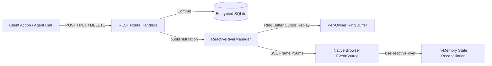

# 🌊 Reactive River SSE & Mutation Stream Reference

<CopyPage />

ShellGuard's **Reactive River** (`/api/sync/events`) is a zero-latency (<50ms) Server-Sent Events (SSE) stream engine providing live state reconciliation across browser tabs, mobile companion devices, and autonomous agent processes.

Whenever an item is created, modified, or deleted inside a user's vault, a lightweight mutation payload is broadcast through the in-process event bus directly to all active streams owned by that tenant.

---

## 🛰️ Architecture & Design Principles



### Core Invariants

1. **Zero-Knowledge Payloads**: Mutation frames NEVER contain sensitive secret plaintext or encrypted payload blobs. Events broadcast only IDs, entity domains, actions, and revisions. The client decrypts or fetches data through authenticated channels using its sovereign `shellKey`.
2. **Strict Tenant Isolation**: Event streams are scoped strictly by `owner_uuid`. User A's mutations are strictly inaudible to User B.
3. **Cursor Replay via Ring Buffer**: Reconnecting clients supply the standard W3C `Last-Event-ID` header (or `?lastEventId=` query parameter). Missed events within the 100-event ring buffer are immediately replayed upon reconnection.
4. **Proxy & Tunnel Unbuffering**: SSE headers include `X-Accel-Buffering: no` and `Cache-Control: no-cache, no-transform` with 25-second periodic `: heartbeat` comments to prevent reverse proxies (e.g. Nginx, Caddy, Cloudflare) from terminating or buffering the stream.

---

## 📡 HTTP Wire Contract

### Endpoint Specification

- **Path**: `GET /api/sync/events`
- **Protocol**: HTTP/1.1 or HTTP/2 Server-Sent Events (`text/event-stream`)
- **Authentication**:
  - Standard Header: `Authorization: Bearer api-...`
  - Browser Query Parameter: `?token=api-...` (enables native `window.EventSource` support without third-party polyfills)

### Response Headers

```http
HTTP/1.1 200 OK
Content-Type: text/event-stream
Cache-Control: no-cache, no-transform
Connection: keep-alive
X-Accel-Buffering: no
```

---

## 📜 Event Frames & Framing

### 1. Connection Handshake
Immediately upon establishing a valid authenticated connection, the server sends a comment acknowledging the stream:

```text
: river connected

```

### 2. Periodic Keepalive Heartbeat (Every 25s)
To prevent timeouts on intermediate proxies, NAT gateways, and firewalls:

```text
: heartbeat

```

### 3. Vault Mutation Event (`vault_mutation`)

```text
id: ev_42
event: vault_mutation
data: {"domain":"vault_pearls","id":"pearl_9a3c1","rev":2,"action":"upsert","timestamp":"2026-11-01T12:00:00.000Z"}

```

#### Payload Fields

| Field | Type | Description |
| :--- | :--- | :--- |
| `domain` | `string` | The mutated entity domain: `'vault_pearls'`, `'vault_secure_notes'`, `'vault_ssh_keys'`, or `'vault_attachments'`. |
| `id` | `string` | Unique UUID / ID of the item that mutated. |
| `rev` | `number` | Monotonically increasing revision counter for this specific item. |
| `action` | `string` | `'upsert'` (item created or modified) or `'delete'` (item removed). |
| `timestamp` | `string` | ISO 8601 UTC timestamp of the mutation commit. |

---

## 🔄 Reconnection & Cursor Replay

When a client loses network connectivity (e.g. laptop lid closes or mobile network switches between Wi-Fi and LTE):

1. The client browser's native `EventSource` automatically attempts reconnection.
2. The browser automatically attaches the `Last-Event-ID` header containing the last seen frame ID (e.g. `ev_41`).
3. The server inspects its in-memory per-owner ring buffer (last 100 events) and immediately streams all missed events between `ev_41` and current head before resuming live broadcast.

---

## 💻 Frontend Client Hook (`useReactiveRiver`)

The web UI consumes this stream via `src/hooks/useReactiveRiver.ts`:

```typescript
import { useReactiveRiver } from '../hooks/useReactiveRiver';

export function VaultView() {
  const { status, lastEvent } = useReactiveRiver({
    enabled: true,
    onMutation: (event) => {
      console.log('Live mutation received:', event.domain, event.id, event.action);
      // Reconcile in-memory state non-destructively
    },
  });

  return (
    <div>
      <span>River Status: {status}</span>
    </div>
  );
}
```

### Connection States

- `connecting`: Handshake in flight.
- `connected`: Stream active; bioluminescent emerald indicator lit (`🟢 River Live`).
- `reconnecting`: Network interrupted; backoff retry active (`🟡 Reconnecting…`).
- `disconnected`: Vault locked, session ended, or offline.
