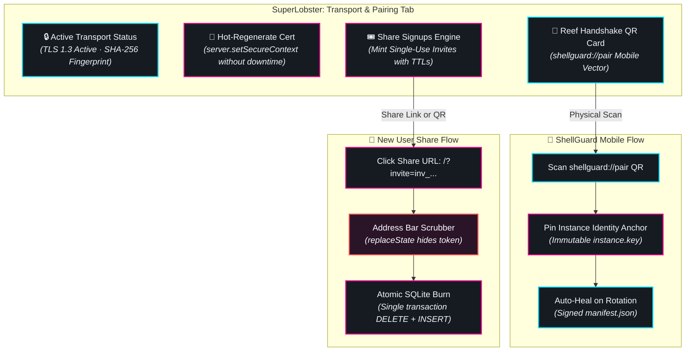
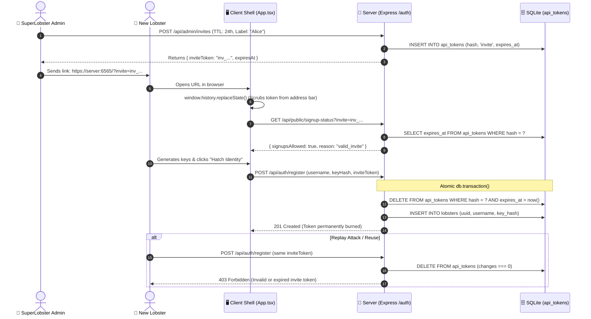

# 🌐 Transport & Mobile Pairing Hub

<CopyPage />

The **Transport & Mobile Pairing Hub** is an administrative control plane within SuperLobster (`/superlobster`) that unites native TLS transport management, mobile ecosystem pairing, and single-use share signups into a unified operator dashboard.



---

## 🔒 Transport Status & Certificate Control

The top section of the hub provides continuous visibility into the running server's transport layer:

### Real-Time Status Indicators
- 🟢 **Active HTTPS (TLS 1.3)**: Indicates that native TLS is enabled (`TLS_ENABLED=true`). Connections are encrypted on the local network, and HSTS headers are actively enforced.
- 🟡 **Cleartext HTTP (LAN Only)**: Warns that `TLS_ENABLED=false`. All traffic between the client and server is transmitted unencrypted over the wire unless terminated upstream by an edge reverse proxy (such as Cloudflare Tunnels or Caddy).

### Certificate Metadata & Tooling
- **SHA-256 Fingerprint Pill**: Displays the cryptographic SHA-256 fingerprint of the currently active leaf certificate. Operators can click the copy icon to copy the exact fingerprint for verification in client trust stores.
- **Subject Alternative Names (SANs)**: Lists all IP addresses and hostnames baked into the certificate. ShellGuard automatically inspects host network interfaces on first boot, baking `localhost`, `127.0.0.1`, and all LAN/Tailscale IPs into the certificate.
- **Download Certificate (`.pem`)**: Exports the public leaf certificate (`cert.pem`). Operators can import this certificate into operating system or browser root trust stores to permanently silence self-signed certificate warnings across their home network.
- **Regenerate Certificate**: Allows administrators to reforge a new 10-year leaf certificate and rotation manifest with zero downtime. Using `server.setSecureContext({ key, cert })`, the active server immediately re-keys active sockets without dropping active user sessions or restarting the process.

---

## 📱 The Reef Handshake QR Pairing Card

Manual configuration of mobile password managers on touchscreen devices is notoriously error-prone. The **Reef Handshake** replaces manual endpoint typing with a single cryptographic scan:

1. **Dynamic Vector QR Code**: SuperLobster generates an SVG QR code encoding a unified URI:
   ```
   shellguard://pair?endpoint=https%3A%2F%2F192.168.1.50%3A6565&fingerprint=80%3ABF%3A...&pubkey=04a98b...
   ```
2. **Parameters Embedded in the Handshake**:
   - `endpoint`: The primary reachable LAN HTTPS URL of the instance.
   - `fingerprint`: The active SHA-256 fingerprint of the server's leaf certificate.
   - `pubkey`: The uncompressed EC P-256 public key of the host's **Instance Identity Anchor** (`DATA_DIR/instance.key`).
3. **1-Click Copy Controls**: If camera access is unavailable on the client device, the operator can click **Copy Pairing URL** to transfer the payload directly via secure chat or local clipboard.

---

## 🎟️ Decoupled Share Signups Engine

In many self-hosted environments, operators wish to lock their server down against public Internet registration while still retaining the ability to invite family members, colleagues, or additional devices.

ShellGuard resolves this through **Decoupled Share Signups**:



### 1. The Genesis User #1 Immunity Rule
When a server is launched with `DISABLE_SIGNUPS=true`, a classic chicken-and-egg problem arises: the administrator cannot log in to SuperLobster because no user accounts exist yet.

ShellGuard enforces the **Genesis Immunity Invariant**:
- When `SELECT COUNT(*) FROM lobsters === 0`, registration is **unconditionally permitted**.
- The first user to hatch on a fresh database is crowned User #1 (the instance owner).
- As soon as User #1 exists, the gateway locks down automatically according to `DISABLE_SIGNUPS`.

### 2. Minting Single-Use Invites
Administrators can mint invites directly from the panel:
- **Identifier Label**: A friendly memo (e.g. *"Alice Phone"*, *"Dev Team"*).
- **Time-to-Live (TTL)**: Select from **1 Hour**, **6 Hours**, **24 Hours**, or **7 Days**.
- **The Invite Token**: A 32-character high-entropy alphanumeric string prefixed with `inv_` (e.g. `inv_9jK2mP...`). Only the cryptographic SHA-256 hash is persisted in `api_tokens`.

### 3. The Interactive Share Modal
Clicking **Generate Invite** opens an interactive share dialog:
- A scannable QR code encoding `https://<server-url>/?invite=inv_...`.
- A **Copy Invite URL** button with animated clipboard feedback.
- A **Copy Token Only** button for manual entry.
- A reminder note: *"This invite token is only accessible while this browser tab stays open. Store or share it immediately."*

### 4. Recipient Address Bar Hygiene
When a recipient clicks an invite link (`https://server:6565/?invite=inv_xyz`):
- React reads the token into memory during boot.
- The **Address Bar Scrubber** immediately invokes `window.history.replaceState({}, document.title, cleanUrl)`, purging the token from the browser address bar.
- The token is never retained in browser history, bookmarks, or external referrer headers.

### 5. Atomic Single-Use Burn Invariant
The moment the recipient completes identity setup:
- Verification and burning are performed inside an atomic SQLite transaction (`db.transaction()`).
- The token is deleted: `DELETE FROM api_tokens WHERE key = ? AND owner_type = 'invite' AND expires_at > datetime('now')`.
- If `changes === 0`, the transaction rolls back and rejects with `403 INVALID_INVITE`.
- An invite token can **never** be redeemed more than once.

### 6. Active Invites Ledger & Revocation
The bottom of the hub displays an auditable table of all outstanding invites:
- **Label / Identity**: The assigned memo.
- **Created Date**: Formatted timestamp.
- **Expires At**: Dynamic countdown showing remaining validity.
- **Revoke Button**: Instantly deletes the invite token from the database, rendering any shared link or QR code inert immediately.
